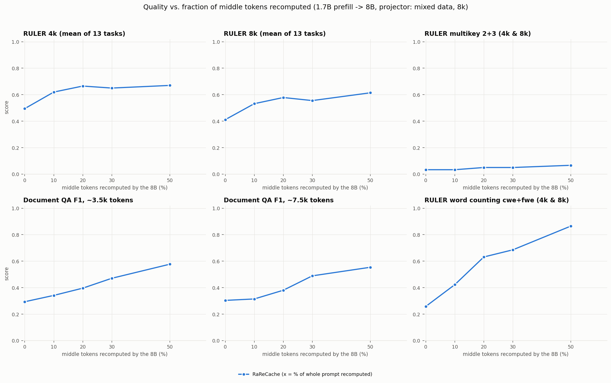
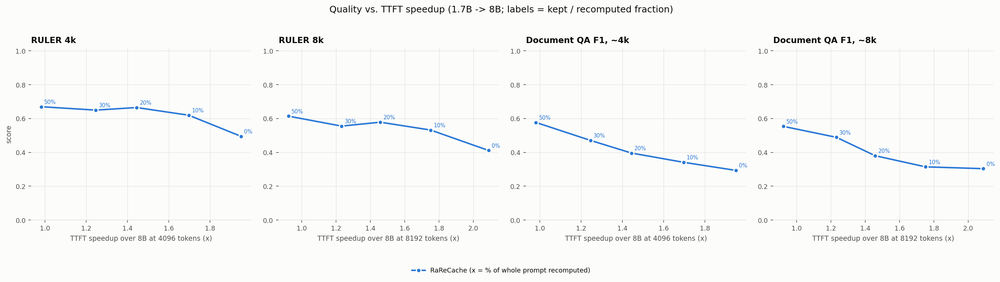

# 选择性重算实验

GPU：NVIDIA L40S；生成：2026-10-28 02:35:48；projector：混合数据 8k（第 12000 步）。小模型：1.7B，大模型：8B。开头 8 个和最后 64 个 token 始终由大模型计算；“重算比例”是中间部分由大模型重新计算的 token 占比。“丢弃其余”配置的选择方式与对应的重算配置完全相同，只是没选中的中间 token 被丢掉而不是用投影 KV 补上；SpecPrefill 是原论文方法（小模型打分，按 32 token 一块保留整段 prompt 的一部分，不强制保留开头和结尾，不用 projector），它的比例是整段 prompt 保留的比例。

## 总表

| 配置 | 实际重算比例（RULER 8k） | RULER 4k | RULER 8k | 问答 F1 4k | 问答 F1 8k | 大海捞针 |
|---|---|---|---|---|---|---|
| RaReCache 重算整段 0% | 0.0% | 0.495 | 0.411 | 0.294 | 0.304 | 1.000 |
| RaReCache 重算整段 10% | 10.0% | 0.620 | 0.532 | 0.341 | 0.315 | 0.989 |
| RaReCache 重算整段 20% | 20.0% | 0.665 | 0.578 | 0.396 | 0.380 | 0.989 |
| RaReCache 重算整段 30% | 30.0% | 0.650 | 0.555 | 0.471 | 0.489 | 1.000 |
| RaReCache 重算整段 50% | 50.0% | 0.670 | 0.614 | 0.577 | 0.554 | 0.978 |

## RULER 4096，按任务类型

| 配置 | 检索 | 汇总 | 变量追踪 | 问答 | 平均 |
|---|---|---|---|---|---|
| RaReCache 重算整段 0% | 0.55 | 0.29 | 0.55 | 0.47 | 0.495 |
| RaReCache 重算整段 10% | 0.65 | 0.50 | 0.95 | 0.47 | 0.620 |
| RaReCache 重算整段 20% | 0.65 | 0.69 | 0.97 | 0.57 | 0.665 |
| RaReCache 重算整段 30% | 0.60 | 0.76 | 1.00 | 0.57 | 0.650 |
| RaReCache 重算整段 50% | 0.60 | 0.90 | 1.00 | 0.57 | 0.670 |

RULER 4096 全部子任务

| 配置 | cwe | fwe | niah_multikey_1 | niah_multikey_2 | niah_multikey_3 | niah_multiquery | niah_multivalue | niah_single_1 | niah_single_2 | niah_single_3 | qa_1 | qa_2 | vt |
|---|---|---|---|---|---|---|---|---|---|---|---|---|---|
| RaReCache 重算整段 0% | 0.07 | 0.51 | 0.73 | 0.13 | 0.00 | 0.72 | 0.65 | 0.53 | 0.73 | 0.87 | 0.73 | 0.20 | 0.55 |
| RaReCache 重算整段 10% | 0.32 | 0.69 | 0.80 | 0.13 | 0.00 | 0.77 | 0.80 | 0.93 | 0.80 | 0.93 | 0.53 | 0.40 | 0.95 |
| RaReCache 重算整段 20% | 0.57 | 0.80 | 0.80 | 0.13 | 0.00 | 0.82 | 0.82 | 1.00 | 0.73 | 0.87 | 0.73 | 0.40 | 0.97 |
| RaReCache 重算整段 30% | 0.76 | 0.76 | 0.80 | 0.20 | 0.00 | 0.62 | 0.78 | 0.87 | 0.73 | 0.80 | 0.73 | 0.40 | 1.00 |
| RaReCache 重算整段 50% | 0.92 | 0.89 | 0.73 | 0.13 | 0.00 | 0.65 | 0.72 | 1.00 | 0.67 | 0.87 | 0.67 | 0.47 | 1.00 |

## RULER 8192，按任务类型

| 配置 | 检索 | 汇总 | 变量追踪 | 问答 | 平均 |
|---|---|---|---|---|---|
| RaReCache 重算整段 0% | 0.50 | 0.22 | 0.20 | 0.37 | 0.411 |
| RaReCache 重算整段 10% | 0.56 | 0.34 | 1.00 | 0.37 | 0.532 |
| RaReCache 重算整段 20% | 0.55 | 0.58 | 1.00 | 0.50 | 0.578 |
| RaReCache 重算整段 30% | 0.53 | 0.61 | 0.96 | 0.40 | 0.555 |
| RaReCache 重算整段 50% | 0.53 | 0.83 | 1.00 | 0.53 | 0.614 |

RULER 8192 全部子任务

| 配置 | cwe | fwe | niah_multikey_1 | niah_multikey_2 | niah_multikey_3 | niah_multiquery | niah_multivalue | niah_single_1 | niah_single_2 | niah_single_3 | qa_1 | qa_2 | vt |
|---|---|---|---|---|---|---|---|---|---|---|---|---|---|
| RaReCache 重算整段 0% | 0.03 | 0.42 | 0.93 | 0.00 | 0.00 | 0.65 | 0.38 | 0.53 | 0.60 | 0.87 | 0.47 | 0.27 | 0.20 |
| RaReCache 重算整段 10% | 0.26 | 0.42 | 1.00 | 0.00 | 0.00 | 0.65 | 0.52 | 0.80 | 0.73 | 0.80 | 0.40 | 0.33 | 1.00 |
| RaReCache 重算整段 20% | 0.55 | 0.60 | 0.93 | 0.07 | 0.00 | 0.73 | 0.43 | 0.87 | 0.67 | 0.67 | 0.60 | 0.40 | 1.00 |
| RaReCache 重算整段 30% | 0.69 | 0.53 | 0.93 | 0.00 | 0.00 | 0.58 | 0.45 | 0.87 | 0.73 | 0.67 | 0.53 | 0.27 | 0.96 |
| RaReCache 重算整段 50% | 0.94 | 0.71 | 0.87 | 0.13 | 0.00 | 0.57 | 0.57 | 0.87 | 0.73 | 0.53 | 0.67 | 0.40 | 1.00 |

## 问答 F1

| 配置 | squad 4k | hotpot 4k | trivia 4k | squad 8k | hotpot 8k | trivia 8k | 平均 4k | 平均 8k |
|---|---|---|---|---|---|---|---|---|
| RaReCache 重算整段 0% | 0.322 | 0.276 | 0.283 | 0.228 | 0.276 | 0.407 | 0.294 | 0.304 |
| RaReCache 重算整段 10% | 0.392 | 0.303 | 0.329 | 0.287 | 0.280 | 0.377 | 0.341 | 0.315 |
| RaReCache 重算整段 20% | 0.406 | 0.380 | 0.402 | 0.360 | 0.312 | 0.470 | 0.396 | 0.380 |
| RaReCache 重算整段 30% | 0.539 | 0.399 | 0.474 | 0.451 | 0.413 | 0.603 | 0.471 | 0.489 |
| RaReCache 重算整段 50% | 0.688 | 0.477 | 0.566 | 0.524 | 0.519 | 0.619 | 0.577 | 0.554 |

## GSM8K（8-shot，对话轮次形式）

| 配置 | 准确率 | 遵守 #### 格式 |
|---|---|---|
| RaReCache 重算整段 0% | 0.660 | 0.040 |
| RaReCache 重算整段 10% | 0.693 | 0.060 |
| RaReCache 重算整段 20% | 0.740 | 0.227 |
| RaReCache 重算整段 30% | 0.727 | 0.293 |
| RaReCache 重算整段 50% | 0.833 | 0.573 |

## 代码下一行补全

| 配置 | 4k 精确匹配 | 4k 相似度 | 8k 精确匹配 | 8k 相似度 |
|---|---|---|---|---|
| RaReCache 重算整段 0% | 0.070 | 0.438 | 0.070 | 0.457 |
| RaReCache 重算整段 10% | 0.080 | 0.452 | 0.090 | 0.484 |
| RaReCache 重算整段 20% | 0.060 | 0.462 | 0.110 | 0.512 |
| RaReCache 重算整段 30% | 0.080 | 0.494 | 0.130 | 0.532 |
| RaReCache 重算整段 50% | 0.110 | 0.550 | 0.170 | 0.590 |

## 首 token 延迟（毫秒，L40S，eager，不含 CUDA graph）

| 配置 | 4096 | 8192 | 16384 | 32768 |
|---|---|---|---|---|
| 8B 单独 | 390.7（1.00 倍） | 907.0（1.00 倍） | 2055.2（1.00 倍） | 5038.7（1.00 倍） |
| 混合，不重算 | 200.4（1.95 倍） | 423.7（2.14 倍） | 977.4（2.10 倍） | 2251.6（2.24 倍） |
| 1.7B 注意力 10%，按句子 | 229.9（1.70 倍） | 527.5（1.72 倍） | 1284.7（1.60 倍） | 3261.4（1.54 倍） |
| 1.7B 注意力 20%，按句子 | 274.4（1.42 倍） | 634.5（1.43 倍） | 1590.5（1.29 倍） | 4303.5（1.17 倍） |
| SpecPrefill 保留整段 10% | 283.1（1.38 倍） | 459.9（1.97 倍） | 928.6（2.21 倍） | 2049.3（2.46 倍） |
| SpecPrefill 保留整段 30% | 349.6（1.12 倍） | 603.3（1.50 倍） | 1282.3（1.60 倍） | 2863.9（1.76 倍） |
| RaReCache 重算整段 0% | 200.3（1.95 倍） | 434.3（2.09 倍） | 1000.1（2.06 倍） | 2299.8（2.19 倍） |
| RaReCache 重算整段 10% | 230.3（1.70 倍） | 517.8（1.75 倍） | 1271.3（1.62 倍） | 3204.7（1.57 倍） |
| RaReCache 重算整段 20% | 270.5（1.44 倍） | 622.0（1.46 倍） | 1592.3（1.29 倍） | 4267.0（1.18 倍） |
| RaReCache 重算整段 30% | 313.5（1.25 倍） | 735.8（1.23 倍） | 1941.4（1.06 倍） | 5286.8（0.95 倍） |
| RaReCache 重算整段 50% | 398.2（0.98 倍） | 981.9（0.92 倍） | 2661.8（0.77 倍） | 7298.9（0.69 倍） |

括号内是相对 8B 单独的加速比。
