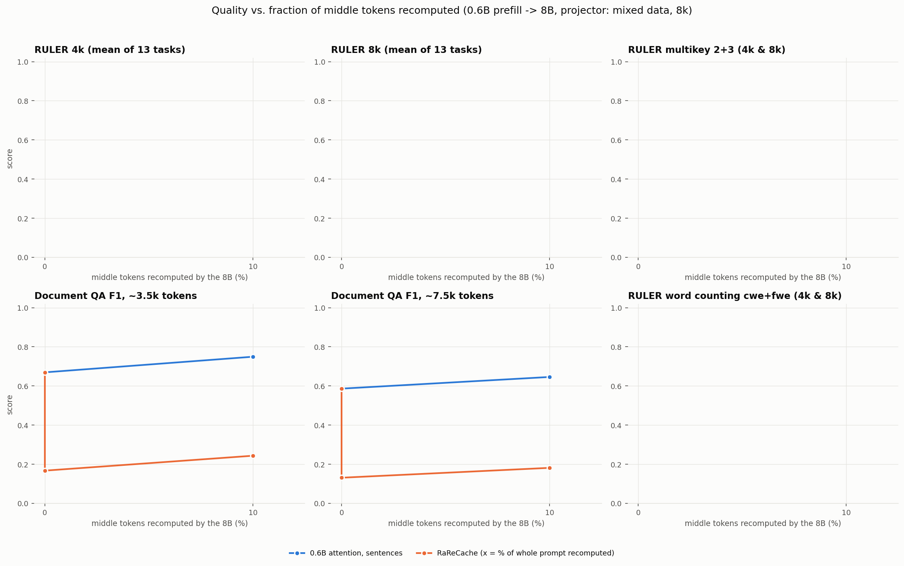

# 选择性重算实验

GPU：NVIDIA L40S；生成：2026-10-28 15:35:58；projector：混合数据 8k（第 12000 步）。小模型：0.6B，大模型：8B。开头 8 个和最后 64 个 token 始终由大模型计算；“重算比例”是中间部分由大模型重新计算的 token 占比。“丢弃其余”配置的选择方式与对应的重算配置完全相同，只是没选中的中间 token 被丢掉而不是用投影 KV 补上；SpecPrefill 是原论文方法（小模型打分，按 32 token 一块保留整段 prompt 的一部分，不强制保留开头和结尾，不用 projector），它的比例是整段 prompt 保留的比例。

## 总表

| 配置 | 实际重算比例（RULER 8k） | RULER 4k | RULER 8k | 问答 F1 4k | 问答 F1 8k | 大海捞针 |
|---|---|---|---|---|---|---|
| 混合，不重算 | - | - | - | 0.669 | 0.586 | - |
| 0.6B 注意力 10%，按句子 | - | - | - | 0.749 | 0.646 | - |
| RaReCache 重算整段 0% | - | - | - | 0.167 | 0.131 | - |
| RaReCache 重算整段 0%，强制开头/尾部 | - | - | - | 0.214 | 0.238 | - |
| RaReCache 重算整段 0%，fp32 映射 | - | - | - | 0.174 | 0.148 | - |
| RaReCache 重算整段 0%，强制开头/尾部，fp32 映射 | - | - | - | 0.230 | 0.237 | - |
| RaReCache 重算整段 10% | - | - | - | 0.243 | 0.181 | - |
| RaReCache 重算整段 10%，强制开头/尾部 | - | - | - | 0.439 | 0.327 | - |
| RaReCache 重算整段 10%，强制开头/尾部，fp32 映射 | - | - | - | 0.437 | 0.339 | - |

## 问答 F1

| 配置 | squad 4k | hotpot 4k | trivia 4k | squad 8k | hotpot 8k | trivia 8k | 平均 4k | 平均 8k |
|---|---|---|---|---|---|---|---|---|
| 混合，不重算 | 0.709 | 0.594 | 0.706 | 0.672 | 0.375 | 0.712 | 0.669 | 0.586 |
| 0.6B 注意力 10%，按句子 | 0.851 | 0.657 | 0.739 | 0.802 | 0.460 | 0.676 | 0.749 | 0.646 |
| RaReCache 重算整段 0% | 0.120 | 0.194 | 0.187 | 0.118 | 0.092 | 0.183 | 0.167 | 0.131 |
| RaReCache 重算整段 0%，强制开头/尾部 | 0.130 | 0.231 | 0.280 | 0.135 | 0.133 | 0.447 | 0.214 | 0.238 |
| RaReCache 重算整段 0%，fp32 映射 | 0.136 | 0.192 | 0.195 | 0.133 | 0.103 | 0.207 | 0.174 | 0.148 |
| RaReCache 重算整段 0%，强制开头/尾部，fp32 映射 | 0.151 | 0.233 | 0.305 | 0.134 | 0.131 | 0.447 | 0.230 | 0.237 |
| RaReCache 重算整段 10% | 0.166 | 0.247 | 0.317 | 0.156 | 0.131 | 0.257 | 0.243 | 0.181 |
| RaReCache 重算整段 10%，强制开头/尾部 | 0.295 | 0.377 | 0.647 | 0.216 | 0.219 | 0.545 | 0.439 | 0.327 |
| RaReCache 重算整段 10%，强制开头/尾部，fp32 映射 | 0.295 | 0.370 | 0.647 | 0.216 | 0.234 | 0.567 | 0.437 | 0.339 |

## GSM8K（8-shot，对话轮次形式）

| 配置 | 准确率 | 遵守 #### 格式 |
|---|---|---|
| 混合，不重算 | 0.883 | 0.533 |
| 0.6B 注意力 10%，按句子 | 0.900 | 0.633 |
| RaReCache 重算整段 0% | 0.417 | 0.000 |
| RaReCache 重算整段 0%，强制开头/尾部 | 0.883 | 0.033 |
| RaReCache 重算整段 0%，fp32 映射 | 0.450 | 0.000 |
| RaReCache 重算整段 0%，强制开头/尾部，fp32 映射 | 0.850 | 0.033 |
| RaReCache 重算整段 10% | 0.467 | 0.017 |
| RaReCache 重算整段 10%，强制开头/尾部 | 0.883 | 0.050 |
| RaReCache 重算整段 10%，强制开头/尾部，fp32 映射 | 0.900 | 0.033 |
