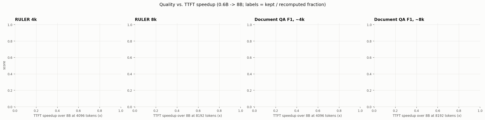

# 选择性重算实验

GPU：NVIDIA L40S；生成：2026-10-28 17:35:54；projector：混合数据 8k（第 12000 步）。小模型：0.6B，大模型：8B。开头 8 个和最后 64 个 token 始终由大模型计算；“重算比例”是中间部分由大模型重新计算的 token 占比。“丢弃其余”配置的选择方式与对应的重算配置完全相同，只是没选中的中间 token 被丢掉而不是用投影 KV 补上；SpecPrefill 是原论文方法（小模型打分，按 32 token 一块保留整段 prompt 的一部分，不强制保留开头和结尾，不用 projector），它的比例是整段 prompt 保留的比例。

## 总表

| 配置 | 实际重算比例（RULER 8k） | RULER 4k | RULER 8k | 问答 F1 4k | 问答 F1 8k | 大海捞针 |
|---|---|---|---|---|---|---|
| RaReCache 重算整段 0%，强制开头/尾部 | - | - | - | - | - | 0.911 |
| RaReCache 重算整段 10%，强制开头/尾部 | - | - | - | - | - | 0.878 |
| RaReCache 重算整段 20%，强制开头/尾部 | - | - | - | - | - | 0.900 |
| RaReCache 重算整段 30%，强制开头/尾部 | - | - | - | - | - | 0.867 |
| RaReCache 重算整段 50%，强制开头/尾部 | - | - | - | - | - | 0.778 |

## 首 token 延迟（毫秒，L40S，eager；SpecPrefill 的 look-ahead 用 CUDA graph 回放）

| 配置 | 4096 | 8192 | 16384 | 32768 |
|---|---|---|---|---|
| 8B 单独 | 394.7（1.00 倍） | 924.1（1.00 倍） | 2050.9（1.00 倍） | 5038.7（1.00 倍） |
| 混合，不重算 | 143.4（2.75 倍） | 295.6（3.13 倍） | 695.8（2.95 倍） | 1727.8（2.92 倍） |
| 0.6B 注意力 10%，按句子 | 173.9（2.27 倍） | 400.9（2.30 倍） | 1002.8（2.05 倍） | 2709.4（1.86 倍） |
| 0.6B 注意力 20%，按句子 | 219.7（1.80 倍） | 505.7（1.83 倍） | 1308.7（1.57 倍） | 3759.9（1.34 倍） |
| SpecPrefill 保留整段 10% | 158.6（2.49 倍） | 311.6（2.97 倍） | 713.3（2.88 倍） | 1783.3（2.83 倍） |
| SpecPrefill 保留整段 30% | 226.7（1.74 倍） | 453.4（2.04 倍） | 1075.4（1.91 倍） | 2628.8（1.92 倍） |
| RaReCache 重算整段 0%，强制开头/尾部 | 162.4（2.43 倍） | 338.2（2.73 倍） | 780.9（2.63 倍） | 1904.5（2.65 倍） |
| RaReCache 重算整段 10%，强制开头/尾部 | 188.2（2.10 倍） | 428.6（2.16 倍） | 1064.7（1.93 倍） | 2819.2（1.79 倍） |
| RaReCache 重算整段 20%，强制开头/尾部 | 233.7（1.69 倍） | 538.2（1.72 倍） | 1368.9（1.50 倍） | 3862.2（1.30 倍） |
| RaReCache 重算整段 30%，强制开头/尾部 | 277.0（1.43 倍） | 642.2（1.44 倍） | 1716.4（1.19 倍） | 4898.4（1.03 倍） |
| RaReCache 重算整段 50%，强制开头/尾部 | 357.4（1.10 倍） | 887.1（1.04 倍） | 2444.8（0.84 倍） | 6921.0（0.73 倍） |

括号内是相对 8B 单独的加速比。
