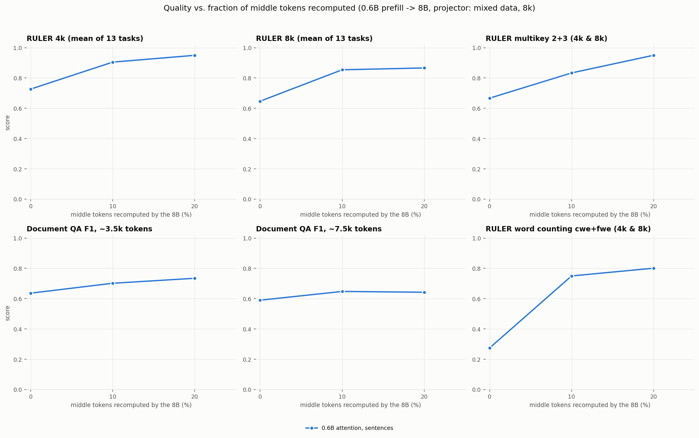

# 选择性重算实验

GPU：NVIDIA L40S；生成：2026-11-06 00:25:15；projector：混合数据 8k（第 4000 步）。小模型：0.6B，大模型：8B。开头 8 个和最后 64 个 token 始终由大模型计算；“重算比例”是中间部分由大模型重新计算的 token 占比。“丢弃其余”配置的选择方式与对应的重算配置完全相同，只是没选中的中间 token 被丢掉而不是用投影 KV 补上；SpecPrefill 是原论文方法（小模型打分，按 32 token 一块保留整段 prompt 的一部分，不强制保留开头和结尾，不用 projector），它的比例是整段 prompt 保留的比例。

## 总表

| 配置 | 实际重算比例（RULER 8k） | RULER 4k | RULER 8k | 问答 F1 4k | 问答 F1 8k | 大海捞针 |
|---|---|---|---|---|---|---|
| 混合，不重算 | 0.0% | 0.727 | 0.647 | 0.636 | 0.590 | 1.000 |
| 0.6B 注意力 10%，按句子 | 10.1% | 0.905 | 0.854 | 0.702 | 0.648 | 1.000 |
| 0.6B 注意力 20%，按句子 | 20.1% | 0.950 | 0.866 | 0.735 | 0.642 | 1.000 |

## RULER 4096，按任务类型

| 配置 | 检索 | 汇总 | 变量追踪 | 问答 | 平均 |
|---|---|---|---|---|---|
| 混合，不重算 | 0.92 | 0.33 | 0.32 | 0.57 | 0.727 |
| 0.6B 注意力 10%，按句子 | 0.96 | 0.85 | 1.00 | 0.70 | 0.905 |
| 0.6B 注意力 20%，按句子 | 1.00 | 0.91 | 1.00 | 0.77 | 0.950 |

RULER 4096 全部子任务

| 配置 | cwe | fwe | niah_multikey_1 | niah_multikey_2 | niah_multikey_3 | niah_multiquery | niah_multivalue | niah_single_1 | niah_single_2 | niah_single_3 | qa_1 | qa_2 | vt |
|---|---|---|---|---|---|---|---|---|---|---|---|---|---|
| 混合，不重算 | 0.11 | 0.56 | 0.87 | 1.00 | 0.67 | 0.95 | 0.98 | 0.93 | 0.93 | 1.00 | 0.73 | 0.40 | 0.32 |
| 0.6B 注意力 10%，按句子 | 0.81 | 0.89 | 1.00 | 1.00 | 0.67 | 1.00 | 1.00 | 1.00 | 1.00 | 1.00 | 0.93 | 0.47 | 1.00 |
| 0.6B 注意力 20%，按句子 | 0.90 | 0.91 | 1.00 | 1.00 | 1.00 | 1.00 | 1.00 | 1.00 | 1.00 | 1.00 | 0.93 | 0.60 | 1.00 |

## RULER 8192，按任务类型

| 配置 | 检索 | 汇总 | 变量追踪 | 问答 | 平均 |
|---|---|---|---|---|---|
| 混合，不重算 | 0.84 | 0.22 | 0.24 | 0.50 | 0.647 |
| 0.6B 注意力 10%，按句子 | 0.96 | 0.65 | 1.00 | 0.57 | 0.854 |
| 0.6B 注意力 20%，按句子 | 0.97 | 0.70 | 1.00 | 0.53 | 0.866 |

RULER 8192 全部子任务

| 配置 | cwe | fwe | niah_multikey_1 | niah_multikey_2 | niah_multikey_3 | niah_multiquery | niah_multivalue | niah_single_1 | niah_single_2 | niah_single_3 | qa_1 | qa_2 | vt |
|---|---|---|---|---|---|---|---|---|---|---|---|---|---|
| 混合，不重算 | 0.01 | 0.42 | 0.93 | 0.80 | 0.20 | 0.95 | 0.92 | 1.00 | 1.00 | 0.93 | 0.67 | 0.33 | 0.24 |
| 0.6B 注意力 10%，按句子 | 0.46 | 0.84 | 1.00 | 1.00 | 0.67 | 1.00 | 1.00 | 1.00 | 1.00 | 1.00 | 0.73 | 0.40 | 1.00 |
| 0.6B 注意力 20%，按句子 | 0.59 | 0.80 | 1.00 | 1.00 | 0.80 | 1.00 | 1.00 | 1.00 | 1.00 | 1.00 | 0.67 | 0.40 | 1.00 |

## 问答 F1

| 配置 | squad 4k | hotpot 4k | trivia 4k | squad 8k | hotpot 8k | trivia 8k | 平均 4k | 平均 8k |
|---|---|---|---|---|---|---|---|---|
| 混合，不重算 | 0.702 | 0.547 | 0.659 | 0.610 | 0.408 | 0.752 | 0.636 | 0.590 |
| 0.6B 注意力 10%，按句子 | 0.802 | 0.615 | 0.688 | 0.677 | 0.537 | 0.729 | 0.702 | 0.648 |
| 0.6B 注意力 20%，按句子 | 0.858 | 0.666 | 0.680 | 0.709 | 0.473 | 0.744 | 0.735 | 0.642 |

## GSM8K（8-shot，对话轮次形式）

| 配置 | 准确率 | 遵守 #### 格式 |
|---|---|---|
| 混合，不重算 | 0.867 | 0.520 |
| 0.6B 注意力 10%，按句子 | 0.887 | 0.653 |
| 0.6B 注意力 20%，按句子 | 0.900 | 0.553 |

## 代码下一行补全

| 配置 | 4k 精确匹配 | 4k 相似度 | 8k 精确匹配 | 8k 相似度 |
|---|---|---|---|---|
| 混合，不重算 | 0.140 | 0.574 | 0.230 | 0.594 |
| 0.6B 注意力 10%，按句子 | 0.170 | 0.598 | 0.300 | 0.649 |
| 0.6B 注意力 20%，按句子 | 0.170 | 0.596 | 0.310 | 0.651 |
