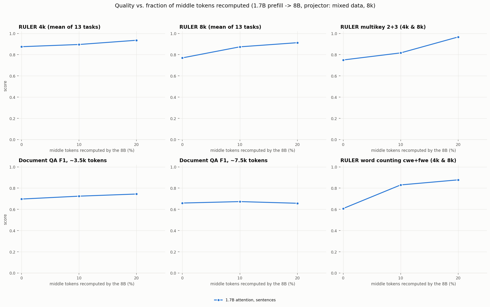

# 选择性重算实验

GPU：NVIDIA L40S；生成：2026-11-06 07:27:41；projector：混合数据 8k（第 4000 步）。小模型：1.7B，大模型：8B。开头 8 个和最后 64 个 token 始终由大模型计算；“重算比例”是中间部分由大模型重新计算的 token 占比。“丢弃其余”配置的选择方式与对应的重算配置完全相同，只是没选中的中间 token 被丢掉而不是用投影 KV 补上；SpecPrefill 是原论文方法（小模型打分，按 32 token 一块保留整段 prompt 的一部分，不强制保留开头和结尾，不用 projector），它的比例是整段 prompt 保留的比例。

## 总表

| 配置 | 实际重算比例（RULER 8k） | RULER 4k | RULER 8k | 问答 F1 4k | 问答 F1 8k | 大海捞针 |
|---|---|---|---|---|---|---|
| 混合，不重算 | 0.0% | 0.875 | 0.770 | 0.697 | 0.659 | 1.000 |
| 1.7B 注意力 10%，按句子 | 10.1% | 0.896 | 0.874 | 0.724 | 0.673 | 1.000 |
| 1.7B 注意力 20%，按句子 | 20.1% | 0.936 | 0.913 | 0.744 | 0.657 | 1.000 |

## RULER 4096，按任务类型

| 配置 | 检索 | 汇总 | 变量追踪 | 问答 | 平均 |
|---|---|---|---|---|---|
| 混合，不重算 | 0.98 | 0.72 | 0.80 | 0.63 | 0.875 |
| 1.7B 注意力 10%，按句子 | 0.94 | 0.90 | 1.00 | 0.67 | 0.896 |
| 1.7B 注意力 20%，按句子 | 0.99 | 0.91 | 1.00 | 0.70 | 0.936 |

RULER 4096 全部子任务

| 配置 | cwe | fwe | niah_multikey_1 | niah_multikey_2 | niah_multikey_3 | niah_multiquery | niah_multivalue | niah_single_1 | niah_single_2 | niah_single_3 | qa_1 | qa_2 | vt |
|---|---|---|---|---|---|---|---|---|---|---|---|---|---|
| 混合，不重算 | 0.69 | 0.76 | 1.00 | 1.00 | 0.87 | 1.00 | 1.00 | 1.00 | 1.00 | 1.00 | 0.80 | 0.47 | 0.80 |
| 1.7B 注意力 10%，按句子 | 0.91 | 0.89 | 1.00 | 1.00 | 0.53 | 1.00 | 0.98 | 1.00 | 1.00 | 1.00 | 0.93 | 0.40 | 1.00 |
| 1.7B 注意力 20%，按句子 | 0.94 | 0.89 | 1.00 | 1.00 | 0.93 | 1.00 | 1.00 | 1.00 | 1.00 | 1.00 | 0.87 | 0.53 | 1.00 |

## RULER 8192，按任务类型

| 配置 | 检索 | 汇总 | 变量追踪 | 问答 | 平均 |
|---|---|---|---|---|---|
| 混合，不重算 | 0.88 | 0.49 | 0.87 | 0.57 | 0.770 |
| 1.7B 注意力 10%，按句子 | 0.96 | 0.76 | 1.00 | 0.57 | 0.874 |
| 1.7B 注意力 20%，按句子 | 0.99 | 0.84 | 1.00 | 0.63 | 0.913 |

RULER 8192 全部子任务

| 配置 | cwe | fwe | niah_multikey_1 | niah_multikey_2 | niah_multikey_3 | niah_multiquery | niah_multivalue | niah_single_1 | niah_single_2 | niah_single_3 | qa_1 | qa_2 | vt |
|---|---|---|---|---|---|---|---|---|---|---|---|---|---|
| 混合，不重算 | 0.43 | 0.56 | 0.93 | 0.87 | 0.27 | 1.00 | 0.95 | 1.00 | 1.00 | 1.00 | 0.73 | 0.40 | 0.87 |
| 1.7B 注意力 10%，按句子 | 0.75 | 0.78 | 1.00 | 1.00 | 0.73 | 1.00 | 0.97 | 1.00 | 1.00 | 1.00 | 0.73 | 0.40 | 1.00 |
| 1.7B 注意力 20%，按句子 | 0.86 | 0.82 | 1.00 | 1.00 | 0.93 | 1.00 | 0.98 | 1.00 | 1.00 | 1.00 | 0.80 | 0.47 | 1.00 |

## 问答 F1

| 配置 | squad 4k | hotpot 4k | trivia 4k | squad 8k | hotpot 8k | trivia 8k | 平均 4k | 平均 8k |
|---|---|---|---|---|---|---|---|---|
| 混合，不重算 | 0.772 | 0.667 | 0.652 | 0.702 | 0.553 | 0.723 | 0.697 | 0.659 |
| 1.7B 注意力 10%，按句子 | 0.813 | 0.666 | 0.693 | 0.741 | 0.534 | 0.744 | 0.724 | 0.673 |
| 1.7B 注意力 20%，按句子 | 0.866 | 0.668 | 0.699 | 0.718 | 0.510 | 0.744 | 0.744 | 0.657 |

## GSM8K（8-shot，对话轮次形式）

| 配置 | 准确率 | 遵守 #### 格式 |
|---|---|---|
| 混合，不重算 | 0.867 | 0.700 |
| 1.7B 注意力 10%，按句子 | 0.920 | 0.753 |
| 1.7B 注意力 20%，按句子 | 0.913 | 0.773 |

## 代码下一行补全

| 配置 | 4k 精确匹配 | 4k 相似度 | 8k 精确匹配 | 8k 相似度 |
|---|---|---|---|---|
| 混合，不重算 | 0.180 | 0.602 | 0.260 | 0.589 |
| 1.7B 注意力 10%，按句子 | 0.190 | 0.611 | 0.290 | 0.639 |
| 1.7B 注意力 20%，按句子 | 0.180 | 0.589 | 0.300 | 0.650 |
