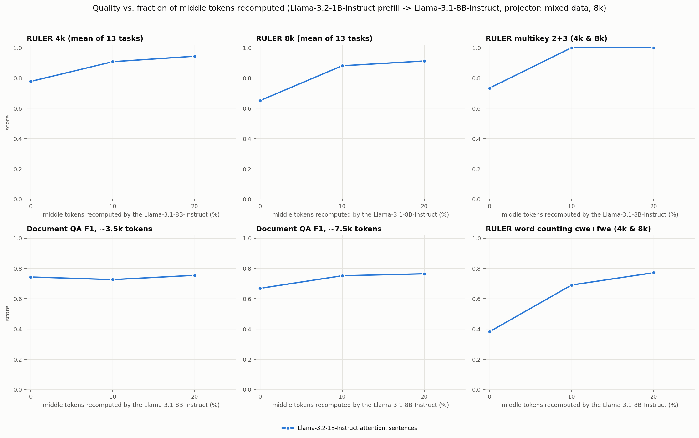

# 选择性重算实验

GPU：NVIDIA L40S；生成：2026-11-06 13:20:39；projector：混合数据 8k（第 4000 步）。小模型：Llama-3.2-1B-Instruct，大模型：Llama-3.1-8B-Instruct。开头 8 个和最后 64 个 token 始终由大模型计算；“重算比例”是中间部分由大模型重新计算的 token 占比。“丢弃其余”配置的选择方式与对应的重算配置完全相同，只是没选中的中间 token 被丢掉而不是用投影 KV 补上；SpecPrefill 是原论文方法（小模型打分，按 32 token 一块保留整段 prompt 的一部分，不强制保留开头和结尾，不用 projector），它的比例是整段 prompt 保留的比例。

## 总表

| 配置 | 实际重算比例（RULER 8k） | RULER 4k | RULER 8k | 问答 F1 4k | 问答 F1 8k | 大海捞针 |
|---|---|---|---|---|---|---|
| 混合，不重算 | 0.0% | 0.777 | 0.651 | 0.743 | 0.668 | 1.000 |
| Llama-3.2-1B-Instruct 注意力 10%，按句子 | 10.1% | 0.907 | 0.881 | 0.726 | 0.751 | 1.000 |
| Llama-3.2-1B-Instruct 注意力 20%，按句子 | 20.1% | 0.944 | 0.912 | 0.754 | 0.764 | 1.000 |

## RULER 4096，按任务类型

| 配置 | 检索 | 汇总 | 变量追踪 | 问答 | 平均 |
|---|---|---|---|---|---|
| 混合，不重算 | 0.94 | 0.47 | 0.35 | 0.63 | 0.777 |
| Llama-3.2-1B-Instruct 注意力 10%，按句子 | 0.99 | 0.80 | 0.92 | 0.67 | 0.907 |
| Llama-3.2-1B-Instruct 注意力 20%，按句子 | 1.00 | 0.86 | 0.95 | 0.80 | 0.944 |

RULER 4096 全部子任务

| 配置 | cwe | fwe | niah_multikey_1 | niah_multikey_2 | niah_multikey_3 | niah_multiquery | niah_multivalue | niah_single_1 | niah_single_2 | niah_single_3 | qa_1 | qa_2 | vt |
|---|---|---|---|---|---|---|---|---|---|---|---|---|---|
| 混合，不重算 | 0.21 | 0.73 | 0.93 | 1.00 | 0.93 | 0.95 | 0.80 | 1.00 | 1.00 | 0.93 | 0.80 | 0.47 | 0.35 |
| Llama-3.2-1B-Instruct 注意力 10%，按句子 | 0.79 | 0.80 | 1.00 | 1.00 | 1.00 | 1.00 | 0.95 | 1.00 | 1.00 | 1.00 | 0.93 | 0.40 | 0.92 |
| Llama-3.2-1B-Instruct 注意力 20%，按句子 | 0.85 | 0.87 | 1.00 | 1.00 | 1.00 | 1.00 | 1.00 | 1.00 | 1.00 | 1.00 | 1.00 | 0.60 | 0.95 |

## RULER 8192，按任务类型

| 配置 | 检索 | 汇总 | 变量追踪 | 问答 | 平均 |
|---|---|---|---|---|---|
| 混合，不重算 | 0.81 | 0.29 | 0.37 | 0.50 | 0.651 |
| Llama-3.2-1B-Instruct 注意力 10%，按句子 | 1.00 | 0.58 | 0.88 | 0.70 | 0.881 |
| Llama-3.2-1B-Instruct 注意力 20%，按句子 | 1.00 | 0.68 | 0.96 | 0.77 | 0.912 |

RULER 8192 全部子任务

| 配置 | cwe | fwe | niah_multikey_1 | niah_multikey_2 | niah_multikey_3 | niah_multiquery | niah_multivalue | niah_single_1 | niah_single_2 | niah_single_3 | qa_1 | qa_2 | vt |
|---|---|---|---|---|---|---|---|---|---|---|---|---|---|
| 混合，不重算 | 0.03 | 0.56 | 1.00 | 0.80 | 0.20 | 0.90 | 0.67 | 1.00 | 1.00 | 0.93 | 0.53 | 0.47 | 0.37 |
| Llama-3.2-1B-Instruct 注意力 10%，按句子 | 0.37 | 0.80 | 1.00 | 1.00 | 1.00 | 1.00 | 1.00 | 1.00 | 1.00 | 1.00 | 0.80 | 0.60 | 0.88 |
| Llama-3.2-1B-Instruct 注意力 20%，按句子 | 0.52 | 0.84 | 1.00 | 1.00 | 1.00 | 1.00 | 1.00 | 1.00 | 1.00 | 1.00 | 0.87 | 0.67 | 0.96 |

## 问答 F1

| 配置 | squad 4k | hotpot 4k | trivia 4k | squad 8k | hotpot 8k | trivia 8k | 平均 4k | 平均 8k |
|---|---|---|---|---|---|---|---|---|
| 混合，不重算 | 0.806 | 0.623 | 0.800 | 0.660 | 0.455 | 0.889 | 0.743 | 0.668 |
| Llama-3.2-1B-Instruct 注意力 10%，按句子 | 0.824 | 0.613 | 0.740 | 0.750 | 0.573 | 0.930 | 0.726 | 0.751 |
| Llama-3.2-1B-Instruct 注意力 20%，按句子 | 0.856 | 0.617 | 0.790 | 0.791 | 0.571 | 0.930 | 0.754 | 0.764 |

## GSM8K（8-shot，对话轮次形式）

| 配置 | 准确率 | 遵守 #### 格式 |
|---|---|---|
| 混合，不重算 | 0.807 | 0.933 |
| Llama-3.2-1B-Instruct 注意力 10%，按句子 | 0.867 | 0.940 |
| Llama-3.2-1B-Instruct 注意力 20%，按句子 | 0.880 | 0.947 |

## 代码下一行补全

| 配置 | 4k 精确匹配 | 4k 相似度 | 8k 精确匹配 | 8k 相似度 |
|---|---|---|---|---|
| 混合，不重算 | 0.230 | 0.619 | 0.170 | 0.593 |
| Llama-3.2-1B-Instruct 注意力 10%，按句子 | 0.280 | 0.652 | 0.270 | 0.641 |
| Llama-3.2-1B-Instruct 注意力 20%，按句子 | 0.300 | 0.685 | 0.280 | 0.643 |
