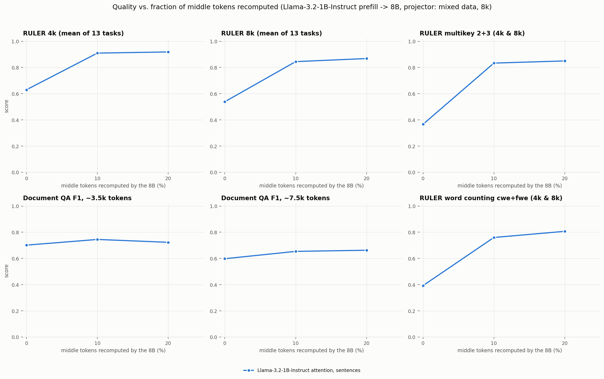

# 选择性重算实验

GPU：NVIDIA L40S；生成：2026-11-06 19:11:14；projector：混合数据 8k（第 4000 步）。小模型：Llama-3.2-1B-Instruct，大模型：8B。开头 8 个和最后 64 个 token 始终由大模型计算；“重算比例”是中间部分由大模型重新计算的 token 占比。“丢弃其余”配置的选择方式与对应的重算配置完全相同，只是没选中的中间 token 被丢掉而不是用投影 KV 补上；SpecPrefill 是原论文方法（小模型打分，按 32 token 一块保留整段 prompt 的一部分，不强制保留开头和结尾，不用 projector），它的比例是整段 prompt 保留的比例。

## 总表

| 配置 | 实际重算比例（RULER 8k） | RULER 4k | RULER 8k | 问答 F1 4k | 问答 F1 8k | 大海捞针 |
|---|---|---|---|---|---|---|
| 混合，不重算 | 0.0% | 0.631 | 0.539 | 0.702 | 0.598 | 0.989 |
| Llama-3.2-1B-Instruct 注意力 10%，按句子 | 10.1% | 0.910 | 0.845 | 0.745 | 0.654 | 1.000 |
| Llama-3.2-1B-Instruct 注意力 20%，按句子 | 20.1% | 0.918 | 0.868 | 0.723 | 0.662 | 1.000 |

## RULER 4096，按任务类型

| 配置 | 检索 | 汇总 | 变量追踪 | 问答 | 平均 |
|---|---|---|---|---|---|
| 混合，不重算 | 0.64 | 0.54 | 0.73 | 0.63 | 0.631 |
| Llama-3.2-1B-Instruct 注意力 10%，按句子 | 0.97 | 0.86 | 1.00 | 0.67 | 0.910 |
| Llama-3.2-1B-Instruct 注意力 20%，按句子 | 0.97 | 0.90 | 1.00 | 0.70 | 0.918 |

RULER 4096 全部子任务

| 配置 | cwe | fwe | niah_multikey_1 | niah_multikey_2 | niah_multikey_3 | niah_multiquery | niah_multivalue | niah_single_1 | niah_single_2 | niah_single_3 | qa_1 | qa_2 | vt |
|---|---|---|---|---|---|---|---|---|---|---|---|---|---|
| 混合，不重算 | 0.35 | 0.73 | 0.67 | 0.73 | 0.27 | 0.68 | 0.37 | 0.73 | 0.87 | 0.80 | 0.93 | 0.33 | 0.73 |
| Llama-3.2-1B-Instruct 注意力 10%，按句子 | 0.79 | 0.93 | 1.00 | 1.00 | 0.80 | 1.00 | 0.97 | 1.00 | 1.00 | 1.00 | 0.87 | 0.47 | 1.00 |
| Llama-3.2-1B-Instruct 注意力 20%，按句子 | 0.87 | 0.93 | 1.00 | 1.00 | 0.73 | 1.00 | 1.00 | 1.00 | 1.00 | 1.00 | 0.87 | 0.53 | 1.00 |

## RULER 8192，按任务类型

| 配置 | 检索 | 汇总 | 变量追踪 | 问答 | 平均 |
|---|---|---|---|---|---|
| 混合，不重算 | 0.63 | 0.25 | 0.49 | 0.50 | 0.539 |
| Llama-3.2-1B-Instruct 注意力 10%，按句子 | 0.94 | 0.66 | 1.00 | 0.57 | 0.845 |
| Llama-3.2-1B-Instruct 注意力 20%，按句子 | 0.96 | 0.71 | 1.00 | 0.60 | 0.868 |

RULER 8192 全部子任务

| 配置 | cwe | fwe | niah_multikey_1 | niah_multikey_2 | niah_multikey_3 | niah_multiquery | niah_multivalue | niah_single_1 | niah_single_2 | niah_single_3 | qa_1 | qa_2 | vt |
|---|---|---|---|---|---|---|---|---|---|---|---|---|---|
| 混合，不重算 | 0.05 | 0.44 | 0.87 | 0.33 | 0.13 | 0.78 | 0.50 | 0.93 | 0.80 | 0.67 | 0.73 | 0.27 | 0.49 |
| Llama-3.2-1B-Instruct 注意力 10%，按句子 | 0.45 | 0.87 | 1.00 | 1.00 | 0.53 | 1.00 | 1.00 | 1.00 | 1.00 | 1.00 | 0.80 | 0.33 | 1.00 |
| Llama-3.2-1B-Instruct 注意力 20%，按句子 | 0.55 | 0.87 | 1.00 | 1.00 | 0.67 | 1.00 | 1.00 | 1.00 | 1.00 | 1.00 | 0.73 | 0.47 | 1.00 |

## 问答 F1

| 配置 | squad 4k | hotpot 4k | trivia 4k | squad 8k | hotpot 8k | trivia 8k | 平均 4k | 平均 8k |
|---|---|---|---|---|---|---|---|---|
| 混合，不重算 | 0.745 | 0.633 | 0.726 | 0.631 | 0.455 | 0.708 | 0.702 | 0.598 |
| Llama-3.2-1B-Instruct 注意力 10%，按句子 | 0.833 | 0.693 | 0.709 | 0.705 | 0.513 | 0.743 | 0.745 | 0.654 |
| Llama-3.2-1B-Instruct 注意力 20%，按句子 | 0.828 | 0.626 | 0.716 | 0.712 | 0.553 | 0.723 | 0.723 | 0.662 |

## GSM8K（8-shot，对话轮次形式）

| 配置 | 准确率 | 遵守 #### 格式 |
|---|---|---|
| 混合，不重算 | 0.900 | 0.567 |
| Llama-3.2-1B-Instruct 注意力 10%，按句子 | 0.880 | 0.760 |
| Llama-3.2-1B-Instruct 注意力 20%，按句子 | 0.913 | 0.753 |

## 代码下一行补全

| 配置 | 4k 精确匹配 | 4k 相似度 | 8k 精确匹配 | 8k 相似度 |
|---|---|---|---|---|
| 混合，不重算 | 0.150 | 0.574 | 0.200 | 0.576 |
| Llama-3.2-1B-Instruct 注意力 10%，按句子 | 0.190 | 0.596 | 0.270 | 0.644 |
| Llama-3.2-1B-Instruct 注意力 20%，按句子 | 0.220 | 0.605 | 0.290 | 0.646 |
