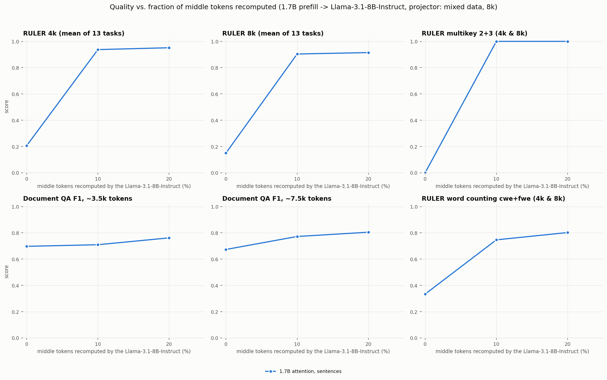

# 选择性重算实验

GPU：NVIDIA L40S；生成：2026-11-07 01:13:43；projector：混合数据 8k（第 4000 步）。小模型：1.7B，大模型：Llama-3.1-8B-Instruct。开头 8 个和最后 64 个 token 始终由大模型计算；“重算比例”是中间部分由大模型重新计算的 token 占比。“丢弃其余”配置的选择方式与对应的重算配置完全相同，只是没选中的中间 token 被丢掉而不是用投影 KV 补上；SpecPrefill 是原论文方法（小模型打分，按 32 token 一块保留整段 prompt 的一部分，不强制保留开头和结尾，不用 projector），它的比例是整段 prompt 保留的比例。

## 总表

| 配置 | 实际重算比例（RULER 8k） | RULER 4k | RULER 8k | 问答 F1 4k | 问答 F1 8k | 大海捞针 |
|---|---|---|---|---|---|---|
| 混合，不重算 | 0.0% | 0.206 | 0.150 | 0.697 | 0.673 | 0.000 |
| 1.7B 注意力 10%，按句子 | 10.2% | 0.937 | 0.904 | 0.710 | 0.772 | 0.978 |
| 1.7B 注意力 20%，按句子 | 20.1% | 0.952 | 0.915 | 0.762 | 0.805 | 1.000 |

## RULER 4096，按任务类型

| 配置 | 检索 | 汇总 | 变量追踪 | 问答 | 平均 |
|---|---|---|---|---|---|
| 混合，不重算 | 0.03 | 0.48 | 0.17 | 0.67 | 0.206 |
| 1.7B 注意力 10%，按句子 | 0.99 | 0.83 | 0.89 | 0.87 | 0.937 |
| 1.7B 注意力 20%，按句子 | 1.00 | 0.90 | 0.99 | 0.80 | 0.952 |

RULER 4096 全部子任务

| 配置 | cwe | fwe | niah_multikey_1 | niah_multikey_2 | niah_multikey_3 | niah_multiquery | niah_multivalue | niah_single_1 | niah_single_2 | niah_single_3 | qa_1 | qa_2 | vt |
|---|---|---|---|---|---|---|---|---|---|---|---|---|---|
| 混合，不重算 | 0.43 | 0.53 | 0.07 | 0.00 | 0.00 | 0.00 | 0.02 | 0.00 | 0.13 | 0.00 | 0.93 | 0.40 | 0.17 |
| 1.7B 注意力 10%，按句子 | 0.79 | 0.87 | 1.00 | 1.00 | 1.00 | 1.00 | 0.90 | 1.00 | 1.00 | 1.00 | 1.00 | 0.73 | 0.89 |
| 1.7B 注意力 20%，按句子 | 0.87 | 0.93 | 1.00 | 1.00 | 1.00 | 1.00 | 0.98 | 1.00 | 1.00 | 1.00 | 1.00 | 0.60 | 0.99 |

## RULER 8192，按任务类型

| 配置 | 检索 | 汇总 | 变量追踪 | 问答 | 平均 |
|---|---|---|---|---|---|
| 混合，不重算 | 0.00 | 0.19 | 0.31 | 0.63 | 0.150 |
| 1.7B 注意力 10%，按句子 | 1.00 | 0.66 | 0.97 | 0.73 | 0.904 |
| 1.7B 注意力 20%，按句子 | 0.99 | 0.70 | 1.00 | 0.77 | 0.915 |

RULER 8192 全部子任务

| 配置 | cwe | fwe | niah_multikey_1 | niah_multikey_2 | niah_multikey_3 | niah_multiquery | niah_multivalue | niah_single_1 | niah_single_2 | niah_single_3 | qa_1 | qa_2 | vt |
|---|---|---|---|---|---|---|---|---|---|---|---|---|---|
| 混合，不重算 | 0.02 | 0.36 | 0.00 | 0.00 | 0.00 | 0.00 | 0.00 | 0.00 | 0.00 | 0.00 | 0.80 | 0.47 | 0.31 |
| 1.7B 注意力 10%，按句子 | 0.66 | 0.67 | 1.00 | 1.00 | 1.00 | 1.00 | 0.98 | 1.00 | 1.00 | 1.00 | 0.87 | 0.60 | 0.97 |
| 1.7B 注意力 20%，按句子 | 0.72 | 0.69 | 1.00 | 1.00 | 1.00 | 0.97 | 0.98 | 1.00 | 1.00 | 1.00 | 0.93 | 0.60 | 1.00 |

## 问答 F1

| 配置 | squad 4k | hotpot 4k | trivia 4k | squad 8k | hotpot 8k | trivia 8k | 平均 4k | 平均 8k |
|---|---|---|---|---|---|---|---|---|
| 混合，不重算 | 0.714 | 0.595 | 0.782 | 0.701 | 0.465 | 0.855 | 0.697 | 0.673 |
| 1.7B 注意力 10%，按句子 | 0.816 | 0.523 | 0.789 | 0.792 | 0.608 | 0.916 | 0.710 | 0.772 |
| 1.7B 注意力 20%，按句子 | 0.834 | 0.635 | 0.816 | 0.811 | 0.643 | 0.960 | 0.762 | 0.805 |

## GSM8K（8-shot，对话轮次形式）

| 配置 | 准确率 | 遵守 #### 格式 |
|---|---|---|
| 混合，不重算 | 0.780 | 0.960 |
| 1.7B 注意力 10%，按句子 | 0.840 | 0.973 |
| 1.7B 注意力 20%，按句子 | 0.867 | 0.913 |

## 代码下一行补全

| 配置 | 4k 精确匹配 | 4k 相似度 | 8k 精确匹配 | 8k 相似度 |
|---|---|---|---|---|
| 混合，不重算 | 0.240 | 0.637 | 0.160 | 0.581 |
| 1.7B 注意力 10%，按句子 | 0.290 | 0.673 | 0.250 | 0.627 |
| 1.7B 注意力 20%，按句子 | 0.330 | 0.688 | 0.270 | 0.646 |
