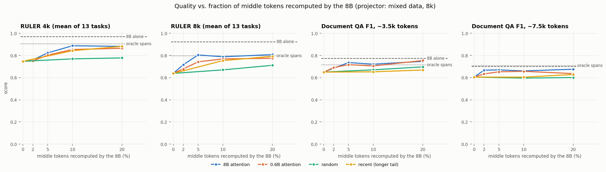

# 选择性重算实验

GPU：NVIDIA H100 80GB HBM3；生成：2026-10-13 22:12:57；projector：混合数据 8k（第 12000 步）。开头 8 个和最后 64 个 token 始终由 8B 计算；“重算比例”是中间部分由 8B 重新计算的 token 占比。

## 总表

| 配置 | 实际重算比例（RULER 8k） | RULER 4k | RULER 8k | 问答 F1 4k | 问答 F1 8k | 大海捞针 |
|---|---|---|---|---|---|---|
| 8B 单独 | 全部 | 0.970 | 0.924 | 0.774 | 0.700 | 1.000 |
| 混合，不重算 | 0.0% | 0.747 | 0.638 | 0.649 | 0.604 | 1.000 |
| 8B 注意力 2% | 2.0% | 0.760 | 0.716 | 0.684 | 0.667 | 0.989 |
| 8B 注意力 5% | 5.0% | 0.823 | 0.804 | 0.736 | 0.669 | 1.000 |
| 8B 注意力 10% | 10.0% | 0.887 | 0.788 | 0.721 | 0.660 | 1.000 |
| 8B 注意力 20% | 20.0% | 0.881 | 0.808 | 0.747 | 0.675 | 1.000 |
| 0.6B 注意力 2% | 2.0% | 0.751 | 0.678 | 0.690 | 0.633 | 0.989 |
| 0.6B 注意力 5% | 5.0% | 0.803 | 0.742 | 0.717 | 0.652 | 1.000 |
| 0.6B 注意力 10% | 10.0% | 0.854 | 0.768 | 0.705 | 0.657 | 1.000 |
| 0.6B 注意力 20% | 20.0% | 0.864 | 0.774 | 0.754 | 0.636 | 1.000 |
| 随机 10% | 10.0% | 0.769 | 0.670 | 0.670 | 0.595 | 0.911 |
| 随机 20% | 20.0% | 0.777 | 0.711 | 0.697 | 0.600 | 0.900 |
| 最近（加长尾部） 10% | 10.0% | 0.843 | 0.753 | 0.652 | 0.604 | 1.000 |
| 最近（加长尾部） 20% | 20.0% | 0.882 | 0.792 | 0.668 | 0.628 | 1.000 |
| 理想（答案位置） | 7.3% | 0.905 | 0.798 | 0.715 | 0.709 | 1.000 |

## RULER 4096，按任务类型

| 配置 | 检索 | 汇总 | 变量追踪 | 问答 | 平均 |
|---|---|---|---|---|---|
| 8B 单独 | 1.00 | 0.97 | 1.00 | 0.83 | 0.970 |
| 混合，不重算 | 0.95 | 0.32 | 0.51 | 0.47 | 0.747 |
| 8B 注意力 2% | 0.88 | 0.62 | 0.63 | 0.50 | 0.760 |
| 8B 注意力 5% | 0.90 | 0.74 | 0.79 | 0.60 | 0.823 |
| 8B 注意力 10% | 0.91 | 0.84 | 1.00 | 0.77 | 0.887 |
| 8B 注意力 20% | 0.89 | 0.90 | 1.00 | 0.77 | 0.881 |
| 0.6B 注意力 2% | 0.87 | 0.67 | 0.55 | 0.47 | 0.751 |
| 0.6B 注意力 5% | 0.87 | 0.77 | 0.80 | 0.57 | 0.803 |
| 0.6B 注意力 10% | 0.86 | 0.86 | 1.00 | 0.73 | 0.854 |
| 0.6B 注意力 20% | 0.86 | 0.92 | 1.00 | 0.77 | 0.864 |
| 随机 10% | 0.88 | 0.70 | 0.64 | 0.47 | 0.769 |
| 随机 20% | 0.82 | 0.83 | 0.79 | 0.53 | 0.777 |
| 最近（加长尾部） 10% | 0.95 | 0.77 | 0.53 | 0.63 | 0.843 |
| 最近（加长尾部） 20% | 0.95 | 0.91 | 0.61 | 0.70 | 0.882 |
| 理想（答案位置） | 0.94 | 0.95 | 1.00 | 0.67 | 0.905 |

RULER 4096 全部子任务

| 配置 | cwe | fwe | niah_multikey_1 | niah_multikey_2 | niah_multikey_3 | niah_multiquery | niah_multivalue | niah_single_1 | niah_single_2 | niah_single_3 | qa_1 | qa_2 | vt |
|---|---|---|---|---|---|---|---|---|---|---|---|---|---|
| 8B 单独 | 0.99 | 0.96 | 1.00 | 1.00 | 1.00 | 1.00 | 1.00 | 1.00 | 1.00 | 1.00 | 0.93 | 0.73 | 1.00 |
| 混合，不重算 | 0.06 | 0.58 | 1.00 | 0.93 | 0.80 | 0.98 | 0.98 | 1.00 | 0.93 | 1.00 | 0.60 | 0.33 | 0.51 |
| 8B 注意力 2% | 0.49 | 0.76 | 0.93 | 0.27 | 0.87 | 1.00 | 1.00 | 1.00 | 1.00 | 0.93 | 0.60 | 0.40 | 0.63 |
| 8B 注意力 5% | 0.68 | 0.80 | 1.00 | 0.73 | 0.67 | 0.97 | 1.00 | 1.00 | 1.00 | 0.87 | 0.73 | 0.47 | 0.79 |
| 8B 注意力 10% | 0.82 | 0.87 | 1.00 | 0.87 | 0.67 | 1.00 | 0.92 | 1.00 | 1.00 | 0.87 | 0.93 | 0.60 | 1.00 |
| 8B 注意力 20% | 0.88 | 0.91 | 1.00 | 0.93 | 0.40 | 1.00 | 1.00 | 1.00 | 1.00 | 0.80 | 0.87 | 0.67 | 1.00 |
| 0.6B 注意力 2% | 0.57 | 0.78 | 0.87 | 0.33 | 0.87 | 0.95 | 0.98 | 1.00 | 1.00 | 0.93 | 0.60 | 0.33 | 0.55 |
| 0.6B 注意力 5% | 0.71 | 0.82 | 1.00 | 0.40 | 0.80 | 0.98 | 0.98 | 1.00 | 1.00 | 0.80 | 0.67 | 0.47 | 0.80 |
| 0.6B 注意力 10% | 0.85 | 0.87 | 1.00 | 0.40 | 0.60 | 0.98 | 1.00 | 1.00 | 1.00 | 0.93 | 0.93 | 0.53 | 1.00 |
| 0.6B 注意力 20% | 0.93 | 0.91 | 1.00 | 0.40 | 0.67 | 1.00 | 1.00 | 1.00 | 1.00 | 0.80 | 0.87 | 0.67 | 1.00 |
| 随机 10% | 0.61 | 0.80 | 0.93 | 0.93 | 0.60 | 0.97 | 0.98 | 1.00 | 0.93 | 0.67 | 0.53 | 0.40 | 0.64 |
| 随机 20% | 0.85 | 0.80 | 0.93 | 0.80 | 0.73 | 0.93 | 0.93 | 0.87 | 0.80 | 0.60 | 0.60 | 0.47 | 0.79 |
| 最近（加长尾部） 10% | 0.69 | 0.84 | 1.00 | 0.87 | 0.87 | 0.97 | 0.98 | 1.00 | 0.93 | 1.00 | 0.87 | 0.40 | 0.53 |
| 最近（加长尾部） 20% | 0.87 | 0.96 | 1.00 | 0.87 | 0.87 | 0.98 | 0.98 | 1.00 | 0.93 | 1.00 | 0.93 | 0.47 | 0.61 |
| 理想（答案位置） | 0.99 | 0.91 | 1.00 | 0.80 | 0.80 | 1.00 | 1.00 | 1.00 | 1.00 | 0.93 | 0.93 | 0.40 | 1.00 |

## RULER 8192，按任务类型

| 配置 | 检索 | 汇总 | 变量追踪 | 问答 | 平均 |
|---|---|---|---|---|---|
| 8B 单独 | 1.00 | 0.94 | 1.00 | 0.57 | 0.924 |
| 混合，不重算 | 0.84 | 0.18 | 0.41 | 0.40 | 0.638 |
| 8B 注意力 2% | 0.84 | 0.45 | 0.72 | 0.50 | 0.716 |
| 8B 注意力 5% | 0.90 | 0.52 | 1.00 | 0.60 | 0.804 |
| 8B 注意力 10% | 0.85 | 0.59 | 1.00 | 0.63 | 0.788 |
| 8B 注意力 20% | 0.88 | 0.69 | 1.00 | 0.53 | 0.808 |
| 0.6B 注意力 2% | 0.81 | 0.39 | 0.71 | 0.43 | 0.678 |
| 0.6B 注意力 5% | 0.81 | 0.55 | 1.00 | 0.53 | 0.742 |
| 0.6B 注意力 10% | 0.83 | 0.64 | 1.00 | 0.53 | 0.768 |
| 0.6B 注意力 20% | 0.81 | 0.73 | 1.00 | 0.57 | 0.774 |
| 随机 10% | 0.79 | 0.40 | 0.61 | 0.50 | 0.670 |
| 随机 20% | 0.80 | 0.59 | 0.65 | 0.50 | 0.711 |
| 最近（加长尾部） 10% | 0.90 | 0.57 | 0.44 | 0.50 | 0.753 |
| 最近（加长尾部） 20% | 0.91 | 0.66 | 0.61 | 0.53 | 0.792 |
| 理想（答案位置） | 0.86 | 0.84 | 0.79 | 0.50 | 0.798 |

RULER 8192 全部子任务

| 配置 | cwe | fwe | niah_multikey_1 | niah_multikey_2 | niah_multikey_3 | niah_multiquery | niah_multivalue | niah_single_1 | niah_single_2 | niah_single_3 | qa_1 | qa_2 | vt |
|---|---|---|---|---|---|---|---|---|---|---|---|---|---|
| 8B 单独 | 0.97 | 0.91 | 1.00 | 1.00 | 1.00 | 1.00 | 1.00 | 1.00 | 1.00 | 1.00 | 0.60 | 0.53 | 1.00 |
| 混合，不重算 | 0.01 | 0.36 | 1.00 | 0.80 | 0.13 | 0.98 | 0.87 | 1.00 | 1.00 | 0.93 | 0.60 | 0.20 | 0.41 |
| 8B 注意力 2% | 0.18 | 0.71 | 1.00 | 0.47 | 0.33 | 1.00 | 0.90 | 1.00 | 1.00 | 1.00 | 0.80 | 0.20 | 0.72 |
| 8B 注意力 5% | 0.33 | 0.71 | 1.00 | 0.87 | 0.40 | 0.98 | 0.97 | 1.00 | 1.00 | 1.00 | 0.80 | 0.40 | 1.00 |
| 8B 注意力 10% | 0.37 | 0.80 | 1.00 | 0.87 | 0.40 | 1.00 | 1.00 | 1.00 | 1.00 | 0.53 | 0.80 | 0.47 | 1.00 |
| 8B 注意力 20% | 0.56 | 0.82 | 1.00 | 0.93 | 0.20 | 1.00 | 0.98 | 1.00 | 1.00 | 0.93 | 0.60 | 0.47 | 1.00 |
| 0.6B 注意力 2% | 0.09 | 0.69 | 1.00 | 0.13 | 0.67 | 1.00 | 0.93 | 1.00 | 1.00 | 0.73 | 0.67 | 0.20 | 0.71 |
| 0.6B 注意力 5% | 0.32 | 0.78 | 1.00 | 0.13 | 0.40 | 1.00 | 0.95 | 1.00 | 1.00 | 1.00 | 0.67 | 0.40 | 1.00 |
| 0.6B 注意力 10% | 0.47 | 0.82 | 1.00 | 0.33 | 0.33 | 1.00 | 0.97 | 1.00 | 1.00 | 1.00 | 0.67 | 0.40 | 1.00 |
| 0.6B 注意力 20% | 0.62 | 0.84 | 1.00 | 0.27 | 0.20 | 1.00 | 1.00 | 1.00 | 1.00 | 1.00 | 0.67 | 0.47 | 1.00 |
| 随机 10% | 0.08 | 0.71 | 1.00 | 0.87 | 0.20 | 0.95 | 0.82 | 0.93 | 1.00 | 0.53 | 0.73 | 0.27 | 0.61 |
| 随机 20% | 0.33 | 0.84 | 0.93 | 0.87 | 0.33 | 0.95 | 0.87 | 0.93 | 0.93 | 0.60 | 0.67 | 0.33 | 0.65 |
| 最近（加长尾部） 10% | 0.23 | 0.91 | 1.00 | 0.80 | 0.67 | 0.98 | 0.83 | 1.00 | 1.00 | 0.93 | 0.73 | 0.27 | 0.44 |
| 最近（加长尾部） 20% | 0.46 | 0.87 | 1.00 | 0.80 | 0.67 | 0.98 | 0.90 | 1.00 | 1.00 | 0.93 | 0.67 | 0.40 | 0.61 |
| 理想（答案位置） | 0.82 | 0.87 | 1.00 | 0.47 | 0.47 | 0.98 | 0.98 | 1.00 | 1.00 | 1.00 | 0.80 | 0.20 | 0.79 |

## 问答 F1

| 配置 | squad 4k | hotpot 4k | trivia 4k | squad 8k | hotpot 8k | trivia 8k |
|---|---|---|---|---|---|---|
| 8B 单独 | 0.873 | 0.739 | 0.710 | 0.751 | 0.586 | 0.762 |
| 混合，不重算 | 0.773 | 0.537 | 0.638 | 0.681 | 0.378 | 0.754 |
| 8B 注意力 2% | 0.787 | 0.583 | 0.683 | 0.779 | 0.422 | 0.800 |
| 8B 注意力 5% | 0.870 | 0.656 | 0.680 | 0.817 | 0.423 | 0.767 |
| 8B 注意力 10% | 0.876 | 0.627 | 0.660 | 0.746 | 0.487 | 0.747 |
| 8B 注意力 20% | 0.901 | 0.648 | 0.690 | 0.746 | 0.492 | 0.787 |
| 0.6B 注意力 2% | 0.807 | 0.579 | 0.683 | 0.717 | 0.402 | 0.780 |
| 0.6B 注意力 5% | 0.852 | 0.649 | 0.649 | 0.811 | 0.418 | 0.727 |
| 0.6B 注意力 10% | 0.822 | 0.653 | 0.640 | 0.790 | 0.432 | 0.747 |
| 0.6B 注意力 20% | 0.918 | 0.645 | 0.700 | 0.723 | 0.433 | 0.752 |
| 随机 10% | 0.807 | 0.563 | 0.640 | 0.700 | 0.334 | 0.752 |
| 随机 20% | 0.748 | 0.661 | 0.680 | 0.707 | 0.337 | 0.757 |
| 最近（加长尾部） 10% | 0.766 | 0.537 | 0.653 | 0.702 | 0.422 | 0.687 |
| 最近（加长尾部） 20% | 0.778 | 0.614 | 0.613 | 0.745 | 0.458 | 0.681 |
| 理想（答案位置） | 0.834 | 0.571 | 0.740 | 0.816 | 0.498 | 0.814 |

## 首 token 延迟（毫秒，H100，eager，不含 CUDA graph）

| 配置 | 4096 | 8192 | 16384 | 32768 |
|---|---|---|---|---|
| 8B 单独 | 156.8（1.00 倍） | 339.7（1.00 倍） | 789.3（1.00 倍） | 2041.1（1.00 倍） |
| 混合，不重算 | 73.5（2.13 倍） | 140.7（2.41 倍） | 305.7（2.58 倍） | 764.8（2.67 倍） |
| 8B 注意力 5% | 110.2（1.42 倍） | 197.4（1.72 倍） | 445.2（1.77 倍） | 1161.8（1.76 倍） |
| 8B 注意力 10% | 114.1（1.37 倍） | 228.1（1.49 倍） | 539.4（1.46 倍） | 1441.2（1.42 倍） |
| 8B 注意力 20% | 135.4（1.16 倍） | 286.5（1.19 倍） | 705.4（1.12 倍） | 2039.5（1.00 倍） |
| 0.6B 注意力 5% | 85.1（1.84 倍） | 162.5（2.09 倍） | 389.6（2.03 倍） | 1063.0（1.92 倍） |
| 0.6B 注意力 10% | 89.1（1.76 倍） | 193.6（1.75 倍） | 484.3（1.63 倍） | 1345.5（1.52 倍） |
| 0.6B 注意力 20% | 110.7（1.42 倍） | 252.0（1.35 倍） | 650.4（1.21 倍） | 1939.7（1.05 倍） |
| 随机 10% | 86.4（1.82 倍） | 187.4（1.81 倍） | 472.5（1.67 倍） | 1327.7（1.54 倍） |

括号内是相对 8B 单独的加速比。

## 分析（手写，2026-10-14；重新运行脚本会覆盖本节）

- **注意力选 token 效果明显，随机选只有小幅提升**（重算 10% 时 RULER 4k / 8k 只多 0.02 / 0.03，在噪声范围内；20% 时 8k 多 0.07。随机选在汇总类和变量追踪上有明显提升，但检索类变差，大海捞针从 100% 降到 83% 到 97%，两者大部分抵消）：8B 注意力重算 5% 时，RULER 8k 从 0.638 升到 0.804（8B 0.924），4k 重算 10% 时从 0.747 升到 0.887（8B 0.970）；问答 F1 4k 从 0.649 升到 0.735（8B 0.774），8k 从 0.604 升到 0.669（8B 0.700）。随机重算 10% 时，RULER 8k 只有 0.670。超过 5% 到 10% 以后基本不再提高。
- **变量追踪和高频词统计改善最大**：变量追踪 8k 从 0.41 升到 1.00（重算 5%），高频词统计 4k 从 0.06 升到 0.82（重算 10%）。
- **多键检索 2、3 反而变差，原因是长字符串只重算了一部分**：不重算时，8k 多键检索 3 的错误大多是原样抄了另一个干扰项的 uuid，即找错了位置。重算后能找到正确的位置，但抄写到一半会"跳"到别的 uuid 上，拼出一个文中不存在的字符串（例如前半段是正确答案、后半段来自干扰项）。注意力选中的通常只是答案开头附近的几个 token，后面的部分仍是 projector 的近似值。下一步应按块选择（例如每块 16 到 32 个 token），让整条信息一起被重算。
- **问答的错误类型**（6 个格子共 300 题，回答的第一行既不含正确答案、F1 也低于 0.5 的算错误）：

| 配置 | 正确 | 答了文中另一处内容 | 答了文中没有的内容 |
|---|---|---|---|
| 8B 单独 | 81% | 14% | 5% |
| 混合，不重算 | 68% | 20% | 11% |
| 8B 注意力 5% | 75% | 18% | 6% |
| 8B 注意力 20% | 77% | 16% | 7% |

  不重算时，回答文中没有的内容的比例是 8B 的约 2 倍，可以算作幻觉增加。重算 5% 后基本回到 8B 的水平。
- **速度**（eager，H100，相对 8B 单独）：8B 注意力 5% 在 4k、8k、32k 时分别是 1.42、1.72、1.76 倍；0.6B 注意力 5% 分别是 1.84、2.09、1.92 倍；不重算是 2.13、2.41、2.67 倍。8B 注意力的打分（多一次结尾的前向和计算注意力权重）在 4k 时约多 28 毫秒，长 prompt 下重算本身用的带 mask 的 attention 也还没优化。
