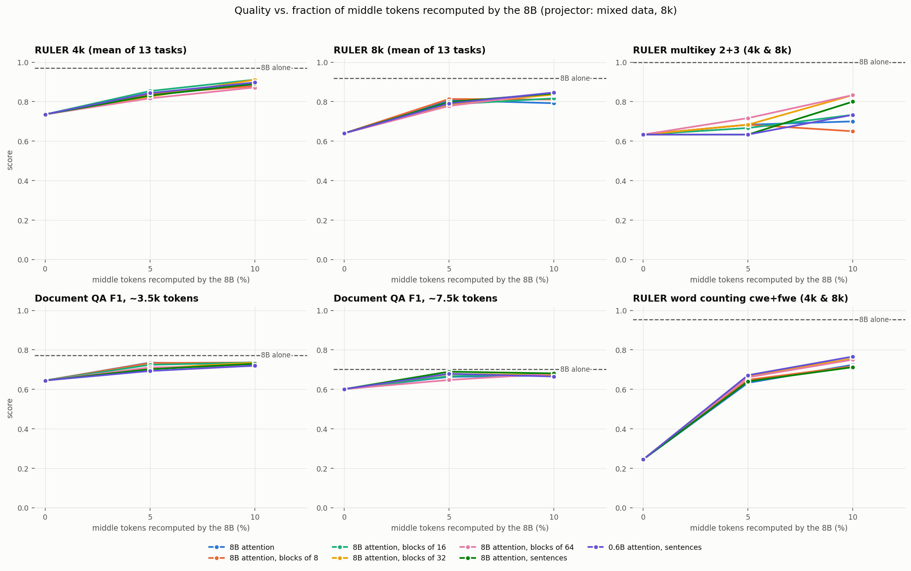

# 选择性重算实验

GPU：NVIDIA L40S；生成：2026-10-14 00:36:48；projector：混合数据 8k（第 12000 步）。开头 8 个和最后 64 个 token 始终由 8B 计算；“重算比例”是中间部分由 8B 重新计算的 token 占比。

## 总表

| 配置 | 实际重算比例（RULER 8k） | RULER 4k | RULER 8k | 问答 F1 4k | 问答 F1 8k | 大海捞针 |
|---|---|---|---|---|---|---|
| 8B 单独 | 全部 | 0.970 | 0.918 | 0.772 | 0.702 | 1.000 |
| 混合，不重算 | 0.0% | 0.736 | 0.640 | 0.645 | 0.601 | 1.000 |
| 8B 注意力 5% | 5.0% | 0.833 | 0.807 | 0.736 | 0.663 | 1.000 |
| 8B 注意力 10% | 10.0% | 0.886 | 0.792 | 0.724 | 0.670 | 1.000 |
| 8B 注意力 5%，8 token 一块 | 5.0% | 0.839 | 0.814 | 0.734 | 0.678 | 1.000 |
| 8B 注意力 5%，16 token 一块 | 5.1% | 0.854 | 0.786 | 0.724 | 0.667 | 1.000 |
| 8B 注意力 5%，32 token 一块 | 5.2% | 0.826 | 0.787 | 0.706 | 0.678 | 1.000 |
| 8B 注意力 5%，64 token 一块 | 5.4% | 0.817 | 0.778 | 0.711 | 0.648 | 1.000 |
| 8B 注意力 5%，按句子 | 5.1% | 0.831 | 0.798 | 0.702 | 0.690 | 1.000 |
| 8B 注意力 10%，8 token 一块 | 10.0% | 0.879 | 0.811 | 0.736 | 0.671 | 1.000 |
| 8B 注意力 10%，16 token 一块 | 10.1% | 0.911 | 0.817 | 0.736 | 0.677 | 1.000 |
| 8B 注意力 10%，32 token 一块 | 10.2% | 0.911 | 0.836 | 0.735 | 0.672 | 1.000 |
| 8B 注意力 10%，64 token 一块 | 10.4% | 0.872 | 0.846 | 0.718 | 0.680 | 1.000 |
| 8B 注意力 10%，按句子 | 10.1% | 0.891 | 0.841 | 0.730 | 0.681 | 1.000 |
| 0.6B 注意力 5%，按句子 | 5.1% | 0.844 | 0.791 | 0.693 | 0.679 | 1.000 |
| 0.6B 注意力 10%，按句子 | 10.1% | 0.897 | 0.846 | 0.720 | 0.665 | 1.000 |

## RULER 4096，按任务类型

| 配置 | 检索 | 汇总 | 变量追踪 | 问答 | 平均 |
|---|---|---|---|---|---|
| 8B 单独 | 1.00 | 0.97 | 1.00 | 0.83 | 0.970 |
| 混合，不重算 | 0.95 | 0.30 | 0.47 | 0.47 | 0.736 |
| 8B 注意力 5% | 0.91 | 0.74 | 0.85 | 0.60 | 0.833 |
| 8B 注意力 10% | 0.91 | 0.83 | 1.00 | 0.77 | 0.886 |
| 8B 注意力 5%，8 token 一块 | 0.93 | 0.74 | 0.76 | 0.60 | 0.839 |
| 8B 注意力 5%，16 token 一块 | 0.95 | 0.79 | 0.72 | 0.60 | 0.854 |
| 8B 注意力 5%，32 token 一块 | 0.95 | 0.77 | 0.45 | 0.57 | 0.826 |
| 8B 注意力 5%，64 token 一块 | 0.94 | 0.76 | 0.40 | 0.60 | 0.817 |
| 8B 注意力 5%，按句子 | 0.91 | 0.74 | 0.81 | 0.60 | 0.831 |
| 8B 注意力 10%，8 token 一块 | 0.92 | 0.83 | 0.99 | 0.70 | 0.879 |
| 8B 注意力 10%，16 token 一块 | 0.97 | 0.86 | 0.99 | 0.67 | 0.911 |
| 8B 注意力 10%，32 token 一块 | 0.99 | 0.88 | 0.79 | 0.70 | 0.911 |
| 8B 注意力 10%，64 token 一块 | 0.96 | 0.85 | 0.59 | 0.67 | 0.872 |
| 8B 注意力 10%，按句子 | 0.97 | 0.82 | 1.00 | 0.60 | 0.891 |
| 0.6B 注意力 5%，按句子 | 0.92 | 0.79 | 0.81 | 0.60 | 0.844 |
| 0.6B 注意力 10%，按句子 | 0.94 | 0.86 | 1.00 | 0.70 | 0.897 |

RULER 4096 全部子任务

| 配置 | cwe | fwe | niah_multikey_1 | niah_multikey_2 | niah_multikey_3 | niah_multiquery | niah_multivalue | niah_single_1 | niah_single_2 | niah_single_3 | qa_1 | qa_2 | vt |
|---|---|---|---|---|---|---|---|---|---|---|---|---|---|
| 8B 单独 | 0.99 | 0.96 | 1.00 | 1.00 | 1.00 | 1.00 | 1.00 | 1.00 | 1.00 | 1.00 | 0.93 | 0.73 | 1.00 |
| 混合，不重算 | 0.04 | 0.56 | 1.00 | 0.87 | 0.80 | 0.98 | 0.98 | 1.00 | 0.93 | 1.00 | 0.60 | 0.33 | 0.47 |
| 8B 注意力 5% | 0.67 | 0.80 | 1.00 | 0.73 | 0.73 | 0.97 | 1.00 | 1.00 | 1.00 | 0.87 | 0.73 | 0.47 | 0.85 |
| 8B 注意力 10% | 0.80 | 0.87 | 1.00 | 0.87 | 0.67 | 1.00 | 0.92 | 1.00 | 1.00 | 0.87 | 0.93 | 0.60 | 1.00 |
| 8B 注意力 5%，8 token 一块 | 0.64 | 0.84 | 1.00 | 0.80 | 0.67 | 1.00 | 1.00 | 1.00 | 1.00 | 1.00 | 0.73 | 0.47 | 0.76 |
| 8B 注意力 5%，16 token 一块 | 0.71 | 0.87 | 1.00 | 0.87 | 0.73 | 1.00 | 1.00 | 1.00 | 1.00 | 1.00 | 0.73 | 0.47 | 0.72 |
| 8B 注意力 5%，32 token 一块 | 0.68 | 0.87 | 1.00 | 0.80 | 0.80 | 1.00 | 1.00 | 1.00 | 1.00 | 1.00 | 0.73 | 0.40 | 0.45 |
| 8B 注意力 5%，64 token 一块 | 0.65 | 0.87 | 1.00 | 0.73 | 0.80 | 0.98 | 0.98 | 1.00 | 1.00 | 1.00 | 0.73 | 0.47 | 0.40 |
| 8B 注意力 5%，按句子 | 0.67 | 0.82 | 1.00 | 0.93 | 0.40 | 1.00 | 0.97 | 1.00 | 1.00 | 1.00 | 0.87 | 0.33 | 0.81 |
| 8B 注意力 10%，8 token 一块 | 0.79 | 0.87 | 1.00 | 0.93 | 0.47 | 1.00 | 0.98 | 1.00 | 1.00 | 1.00 | 0.93 | 0.47 | 0.99 |
| 8B 注意力 10%，16 token 一块 | 0.84 | 0.89 | 1.00 | 0.93 | 0.87 | 1.00 | 1.00 | 1.00 | 1.00 | 1.00 | 0.80 | 0.53 | 0.99 |
| 8B 注意力 10%，32 token 一块 | 0.87 | 0.89 | 1.00 | 1.00 | 0.93 | 1.00 | 0.97 | 1.00 | 1.00 | 1.00 | 0.80 | 0.60 | 0.79 |
| 8B 注意力 10%，64 token 一块 | 0.83 | 0.87 | 1.00 | 1.00 | 0.73 | 1.00 | 0.98 | 1.00 | 1.00 | 1.00 | 0.80 | 0.53 | 0.59 |
| 8B 注意力 10%，按句子 | 0.80 | 0.84 | 1.00 | 1.00 | 0.73 | 1.00 | 1.00 | 1.00 | 1.00 | 1.00 | 0.80 | 0.40 | 1.00 |
| 0.6B 注意力 5%，按句子 | 0.72 | 0.87 | 1.00 | 1.00 | 0.40 | 1.00 | 0.97 | 1.00 | 1.00 | 1.00 | 0.73 | 0.47 | 0.81 |
| 0.6B 注意力 10%，按句子 | 0.84 | 0.89 | 1.00 | 1.00 | 0.53 | 1.00 | 1.00 | 1.00 | 1.00 | 1.00 | 0.93 | 0.47 | 1.00 |

## RULER 8192，按任务类型

| 配置 | 检索 | 汇总 | 变量追踪 | 问答 | 平均 |
|---|---|---|---|---|---|
| 8B 单独 | 1.00 | 0.93 | 1.00 | 0.53 | 0.918 |
| 混合，不重算 | 0.83 | 0.19 | 0.40 | 0.43 | 0.640 |
| 8B 注意力 5% | 0.90 | 0.53 | 1.00 | 0.60 | 0.807 |
| 8B 注意力 10% | 0.85 | 0.62 | 1.00 | 0.63 | 0.792 |
| 8B 注意力 5%，8 token 一块 | 0.91 | 0.55 | 1.00 | 0.60 | 0.814 |
| 8B 注意力 5%，16 token 一块 | 0.88 | 0.54 | 0.96 | 0.57 | 0.786 |
| 8B 注意力 5%，32 token 一块 | 0.89 | 0.56 | 0.92 | 0.53 | 0.787 |
| 8B 注意力 5%，64 token 一块 | 0.91 | 0.56 | 0.71 | 0.50 | 0.778 |
| 8B 注意力 5%，按句子 | 0.90 | 0.54 | 1.00 | 0.57 | 0.798 |
| 8B 注意力 10%，8 token 一块 | 0.90 | 0.60 | 1.00 | 0.57 | 0.811 |
| 8B 注意力 10%，16 token 一块 | 0.89 | 0.64 | 1.00 | 0.60 | 0.817 |
| 8B 注意力 10%，32 token 一块 | 0.93 | 0.63 | 1.00 | 0.60 | 0.836 |
| 8B 注意力 10%，64 token 一块 | 0.95 | 0.65 | 0.97 | 0.57 | 0.846 |
| 8B 注意力 10%，按句子 | 0.93 | 0.60 | 1.00 | 0.63 | 0.841 |
| 0.6B 注意力 5%，按句子 | 0.89 | 0.55 | 1.00 | 0.53 | 0.791 |
| 0.6B 注意力 10%，按句子 | 0.93 | 0.67 | 1.00 | 0.63 | 0.846 |

RULER 8192 全部子任务

| 配置 | cwe | fwe | niah_multikey_1 | niah_multikey_2 | niah_multikey_3 | niah_multiquery | niah_multivalue | niah_single_1 | niah_single_2 | niah_single_3 | qa_1 | qa_2 | vt |
|---|---|---|---|---|---|---|---|---|---|---|---|---|---|
| 8B 单独 | 0.97 | 0.89 | 1.00 | 1.00 | 1.00 | 1.00 | 1.00 | 1.00 | 1.00 | 1.00 | 0.60 | 0.47 | 1.00 |
| 混合，不重算 | 0.01 | 0.38 | 1.00 | 0.73 | 0.13 | 0.98 | 0.88 | 1.00 | 1.00 | 0.93 | 0.67 | 0.20 | 0.40 |
| 8B 注意力 5% | 0.35 | 0.71 | 1.00 | 0.87 | 0.40 | 1.00 | 0.97 | 1.00 | 1.00 | 1.00 | 0.80 | 0.40 | 1.00 |
| 8B 注意力 10% | 0.45 | 0.78 | 1.00 | 0.87 | 0.40 | 1.00 | 1.00 | 1.00 | 1.00 | 0.53 | 0.80 | 0.47 | 1.00 |
| 8B 注意力 5%，8 token 一块 | 0.35 | 0.76 | 1.00 | 0.87 | 0.40 | 1.00 | 1.00 | 1.00 | 1.00 | 1.00 | 0.80 | 0.40 | 1.00 |
| 8B 注意力 5%，16 token 一块 | 0.32 | 0.76 | 1.00 | 0.80 | 0.27 | 1.00 | 0.98 | 1.00 | 1.00 | 1.00 | 0.80 | 0.33 | 0.96 |
| 8B 注意力 5%，32 token 一块 | 0.31 | 0.82 | 1.00 | 0.93 | 0.20 | 1.00 | 0.98 | 1.00 | 1.00 | 1.00 | 0.73 | 0.33 | 0.92 |
| 8B 注意力 5%，64 token 一块 | 0.35 | 0.78 | 1.00 | 0.87 | 0.47 | 1.00 | 0.95 | 1.00 | 1.00 | 1.00 | 0.73 | 0.27 | 0.71 |
| 8B 注意力 5%，按句子 | 0.34 | 0.73 | 1.00 | 1.00 | 0.20 | 1.00 | 0.97 | 1.00 | 1.00 | 1.00 | 0.73 | 0.40 | 1.00 |
| 8B 注意力 10%，8 token 一块 | 0.41 | 0.80 | 1.00 | 0.93 | 0.27 | 1.00 | 1.00 | 1.00 | 1.00 | 1.00 | 0.67 | 0.47 | 1.00 |
| 8B 注意力 10%，16 token 一块 | 0.51 | 0.78 | 1.00 | 0.93 | 0.20 | 1.00 | 1.00 | 1.00 | 1.00 | 1.00 | 0.73 | 0.47 | 1.00 |
| 8B 注意力 10%，32 token 一块 | 0.47 | 0.80 | 1.00 | 0.93 | 0.47 | 1.00 | 1.00 | 1.00 | 1.00 | 1.00 | 0.80 | 0.40 | 1.00 |
| 8B 注意力 10%，64 token 一块 | 0.48 | 0.82 | 1.00 | 1.00 | 0.60 | 1.00 | 0.98 | 1.00 | 1.00 | 1.00 | 0.80 | 0.33 | 0.97 |
| 8B 注意力 10%，按句子 | 0.43 | 0.78 | 1.00 | 1.00 | 0.47 | 1.00 | 1.00 | 1.00 | 1.00 | 1.00 | 0.80 | 0.47 | 1.00 |
| 0.6B 注意力 5%，按句子 | 0.30 | 0.80 | 1.00 | 1.00 | 0.13 | 1.00 | 0.98 | 1.00 | 1.00 | 1.00 | 0.73 | 0.33 | 1.00 |
| 0.6B 注意力 10%，按句子 | 0.51 | 0.82 | 1.00 | 1.00 | 0.40 | 1.00 | 1.00 | 1.00 | 1.00 | 1.00 | 0.80 | 0.47 | 1.00 |

## 问答 F1

| 配置 | squad 4k | hotpot 4k | trivia 4k | squad 8k | hotpot 8k | trivia 8k |
|---|---|---|---|---|---|---|
| 8B 单独 | 0.873 | 0.724 | 0.720 | 0.757 | 0.586 | 0.762 |
| 混合，不重算 | 0.759 | 0.537 | 0.638 | 0.671 | 0.378 | 0.754 |
| 8B 注意力 5% | 0.870 | 0.656 | 0.680 | 0.819 | 0.423 | 0.747 |
| 8B 注意力 10% | 0.884 | 0.627 | 0.660 | 0.756 | 0.507 | 0.747 |
| 8B 注意力 5%，8 token 一块 | 0.863 | 0.657 | 0.680 | 0.774 | 0.492 | 0.767 |
| 8B 注意力 5%，16 token 一块 | 0.861 | 0.636 | 0.676 | 0.816 | 0.417 | 0.767 |
| 8B 注意力 5%，32 token 一块 | 0.836 | 0.607 | 0.676 | 0.799 | 0.479 | 0.757 |
| 8B 注意力 5%，64 token 一块 | 0.842 | 0.641 | 0.650 | 0.768 | 0.409 | 0.766 |
| 8B 注意力 5%，按句子 | 0.868 | 0.565 | 0.673 | 0.796 | 0.495 | 0.777 |
| 8B 注意力 10%，8 token 一块 | 0.890 | 0.637 | 0.680 | 0.767 | 0.498 | 0.747 |
| 8B 注意力 10%，16 token 一块 | 0.910 | 0.638 | 0.660 | 0.786 | 0.494 | 0.752 |
| 8B 注意力 10%，32 token 一块 | 0.889 | 0.656 | 0.660 | 0.827 | 0.456 | 0.732 |
| 8B 注意力 10%，64 token 一块 | 0.856 | 0.634 | 0.666 | 0.779 | 0.528 | 0.732 |
| 8B 注意力 10%，按句子 | 0.896 | 0.633 | 0.660 | 0.791 | 0.503 | 0.747 |
| 0.6B 注意力 5%，按句子 | 0.847 | 0.579 | 0.653 | 0.761 | 0.509 | 0.767 |
| 0.6B 注意力 10%，按句子 | 0.867 | 0.619 | 0.673 | 0.764 | 0.500 | 0.732 |

## 分析（手写，2026-10-14；重新运行脚本会覆盖本节）

本轮在 L40S 上运行，测速见 `results/recompute_speed/`（H100）。参照组在 L40S 上与 H100 一致：不重算 0.736 / 0.640（H100 0.747 / 0.638），逐 token 选 5% 0.833 / 0.807（H100 0.823 / 0.804）。噪声：RULER 平均约 ±0.03，多键 2+3 每个长度 30 例，约 ±0.08。

- **重算 5% 时，按块选和逐 token 选差不多**（RULER 8k：0.79 到 0.81），块越大，变量追踪越差（4k：逐 token 0.85，64 token 一块 0.40）。原因是预算只有 5%，块越大，能覆盖的位置越少，而变量追踪需要同时覆盖链条上的好几处。
- **重算 10% 时，按块选更好**：RULER 8k 从 0.792（逐 token）升到 0.836（32 token 一块）、0.841（按句子）、0.846（64 token 一块）；4k 从 0.886 升到 0.911（16 或 32 token 一块）。提升主要来自多键检索 2、3：8k 从 0.63 升到 0.70 到 0.80，4k 从 0.77 升到 0.97（32 token 一块）。
- **抄错的情况减少了，但没有消失**：多键检索 2、3 的 60 例中，输出文中不存在的字符串的例子，逐 token 选 10% 时是 16 例，32 或 64 token 一块时是 9 例，按句子时是 12 例。
- **0.6B 注意力加按句子切，重算 10% 时与 8B 注意力的最好结果持平**（0.897 / 0.846），打分更便宜，速度约为 8B 的 1.5 到 1.8 倍。
- **问答几乎不受选择单位影响**：4k 在 0.70 到 0.74 之间，8k 在 0.65 到 0.69 之间（8B 为 0.772 / 0.702）。8k 已接近 8B，4k 仍差约 4 个百分点。
- **剩下的差距主要在汇总类任务**（cwe+fwe，8k：0.60 到 0.67，8B 为 0.93）和最难的多键检索（8k：0.70 到 0.80，8B 为 1.00）。
