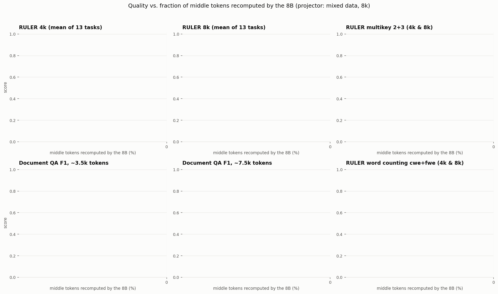

# 选择性重算实验

GPU：NVIDIA H100 80GB HBM3；生成：2026-10-14 03:33:51；projector：混合数据 8k（第 12000 步）。开头 8 个和最后 64 个 token 始终由 8B 计算；“重算比例”是中间部分由 8B 重新计算的 token 占比。

## 总表

| 配置 | 实际重算比例（RULER 8k） | RULER 4k | RULER 8k | 问答 F1 4k | 问答 F1 8k | 大海捞针 |
|---|---|---|---|---|---|---|
| 8B 单独 | 全部 | - | - | - | - | - |
| 混合，不重算 | - | - | - | - | - | - |

## 首 token 延迟（毫秒，H100，eager，不含 CUDA graph）

| 配置 | 4096 | 8192 | 16384 | 32768 |
|---|---|---|---|---|
| 8B 单独 | 155.2（1.00 倍） | 338.0（1.00 倍） | 782.6（1.00 倍） | 2035.4（1.00 倍） |
| 混合，不重算 | 73.9（2.10 倍） | 141.6（2.39 倍） | 306.4（2.55 倍） | 763.6（2.67 倍） |
| 随机 2% | 76.3（2.03 倍） | 145.6（2.32 倍） | 328.3（2.38 倍） | 880.9（2.31 倍） |
| 随机 5% | 83.1（1.87 倍） | 157.9（2.14 倍） | 378.8（2.07 倍） | 1046.4（1.95 倍） |
| 随机 10% | 86.9（1.78 倍） | 188.7（1.79 倍） | 473.6（1.65 倍） | 1327.2（1.53 倍） |
| 0.6B 注意力 5% | 85.8（1.81 倍） | 163.4（2.07 倍） | 390.3（2.01 倍） | 1061.7（1.92 倍） |
| 8B 注意力 5% | 111.0（1.40 倍） | 198.8（1.70 倍） | 445.9（1.76 倍） | 1158.9（1.76 倍） |
| 8B 注意力 5%，32 token 一块 | 112.1（1.38 倍） | 199.4（1.69 倍） | 446.8（1.75 倍） | 1164.2（1.75 倍） |
| 8B 注意力 5%，按句子 | 112.5（1.38 倍） | 199.8（1.69 倍） | 447.9（1.75 倍） | 1157.2（1.76 倍） |
| 0.6B 注意力 5%，按句子 | 86.8（1.79 倍） | 164.5（2.05 倍） | 391.6（2.00 倍） | 1065.2（1.91 倍） |

括号内是相对 8B 单独的加速比。
