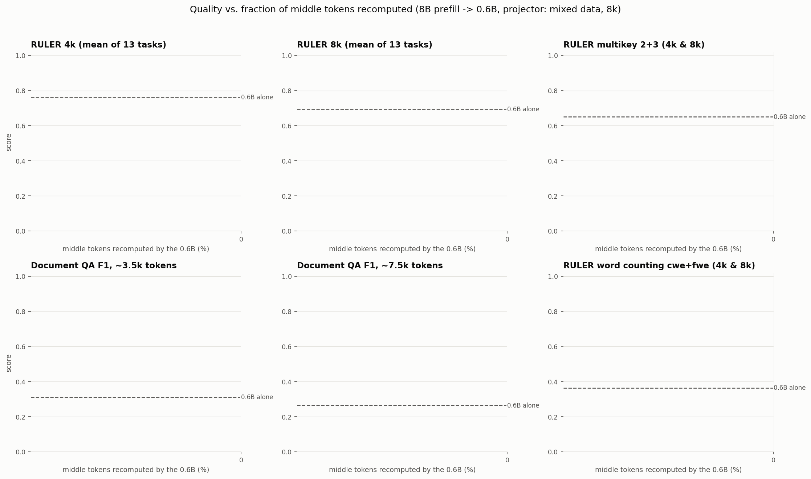

# 选择性重算实验

GPU：NVIDIA L40S；生成：2026-11-06 01:10:56；projector：混合数据 8k（第 12000 步）。小模型：8B，大模型：0.6B。开头 8 个和最后 64 个 token 始终由大模型计算；“重算比例”是中间部分由大模型重新计算的 token 占比。“丢弃其余”配置的选择方式与对应的重算配置完全相同，只是没选中的中间 token 被丢掉而不是用投影 KV 补上；SpecPrefill 是原论文方法（小模型打分，按 32 token 一块保留整段 prompt 的一部分，不强制保留开头和结尾，不用 projector），它的比例是整段 prompt 保留的比例。

## 总表

| 配置 | 实际重算比例（RULER 8k） | RULER 4k | RULER 8k | 问答 F1 4k | 问答 F1 8k | 大海捞针 |
|---|---|---|---|---|---|---|
| 0.6B 单独 | 全部 | 0.761 | 0.692 | 0.310 | 0.264 | 0.978 |
| 8B 单独 | 0.0% | 0.970 | 0.918 | 0.772 | 0.702 | 1.000 |
| 混合，不重算 | 0.0% | 0.727 | 0.635 | 0.634 | 0.560 | 1.000 |

## RULER 4096，按任务类型

| 配置 | 检索 | 汇总 | 变量追踪 | 问答 | 平均 |
|---|---|---|---|---|---|
| 0.6B 单独 | 0.96 | 0.38 | 0.67 | 0.40 | 0.761 |
| 8B 单独 | 1.00 | 0.97 | 1.00 | 0.83 | 0.970 |
| 混合，不重算 | 0.95 | 0.21 | 0.19 | 0.60 | 0.727 |

RULER 4096 全部子任务

| 配置 | cwe | fwe | niah_multikey_1 | niah_multikey_2 | niah_multikey_3 | niah_multiquery | niah_multivalue | niah_single_1 | niah_single_2 | niah_single_3 | qa_1 | qa_2 | vt |
|---|---|---|---|---|---|---|---|---|---|---|---|---|---|
| 0.6B 单独 | 0.00 | 0.76 | 1.00 | 0.87 | 0.87 | 0.97 | 0.97 | 1.00 | 1.00 | 1.00 | 0.53 | 0.27 | 0.67 |
| 8B 单独 | 0.99 | 0.96 | 1.00 | 1.00 | 1.00 | 1.00 | 1.00 | 1.00 | 1.00 | 1.00 | 0.93 | 0.73 | 1.00 |
| 混合，不重算 | 0.03 | 0.40 | 1.00 | 0.80 | 0.93 | 0.98 | 0.98 | 1.00 | 1.00 | 0.93 | 0.67 | 0.53 | 0.19 |

## RULER 8192，按任务类型

| 配置 | 检索 | 汇总 | 变量追踪 | 问答 | 平均 |
|---|---|---|---|---|---|
| 0.6B 单独 | 0.83 | 0.35 | 0.84 | 0.40 | 0.692 |
| 8B 单独 | 1.00 | 0.93 | 1.00 | 0.53 | 0.918 |
| 混合，不重算 | 0.89 | 0.12 | 0.07 | 0.43 | 0.635 |

RULER 8192 全部子任务

| 配置 | cwe | fwe | niah_multikey_1 | niah_multikey_2 | niah_multikey_3 | niah_multiquery | niah_multivalue | niah_single_1 | niah_single_2 | niah_single_3 | qa_1 | qa_2 | vt |
|---|---|---|---|---|---|---|---|---|---|---|---|---|---|
| 0.6B 单独 | 0.01 | 0.69 | 0.93 | 0.53 | 0.33 | 0.97 | 0.88 | 1.00 | 1.00 | 1.00 | 0.53 | 0.27 | 0.84 |
| 8B 单独 | 0.97 | 0.89 | 1.00 | 1.00 | 1.00 | 1.00 | 1.00 | 1.00 | 1.00 | 1.00 | 0.60 | 0.47 | 1.00 |
| 混合，不重算 | 0.00 | 0.24 | 1.00 | 0.67 | 0.60 | 0.95 | 0.87 | 1.00 | 1.00 | 1.00 | 0.53 | 0.33 | 0.07 |

## 问答 F1

| 配置 | squad 4k | hotpot 4k | trivia 4k | squad 8k | hotpot 8k | trivia 8k | 平均 4k | 平均 8k |
|---|---|---|---|---|---|---|---|---|
| 0.6B 单独 | 0.262 | 0.321 | 0.347 | 0.295 | 0.175 | 0.321 | 0.310 | 0.264 |
| 8B 单独 | 0.873 | 0.724 | 0.720 | 0.757 | 0.586 | 0.762 | 0.772 | 0.702 |
| 混合，不重算 | 0.711 | 0.592 | 0.600 | 0.742 | 0.344 | 0.595 | 0.634 | 0.560 |

## GSM8K（8-shot，对话轮次形式）

| 配置 | 准确率 | 遵守 #### 格式 |
|---|---|---|
| 0.6B 单独 | 0.487 | 0.447 |
| 8B 单独 | 0.907 | 0.593 |
| 混合，不重算 | 0.587 | 0.520 |

## 代码下一行补全

| 配置 | 4k 精确匹配 | 4k 相似度 | 8k 精确匹配 | 8k 相似度 |
|---|---|---|---|---|
| 0.6B 单独 | 0.150 | 0.592 | 0.150 | 0.532 |
| 8B 单独 | 0.230 | 0.613 | 0.290 | 0.639 |
| 混合，不重算 | 0.140 | 0.578 | 0.140 | 0.569 |
