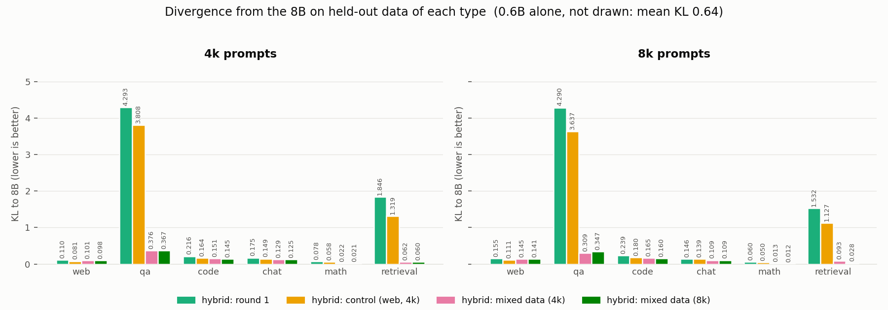
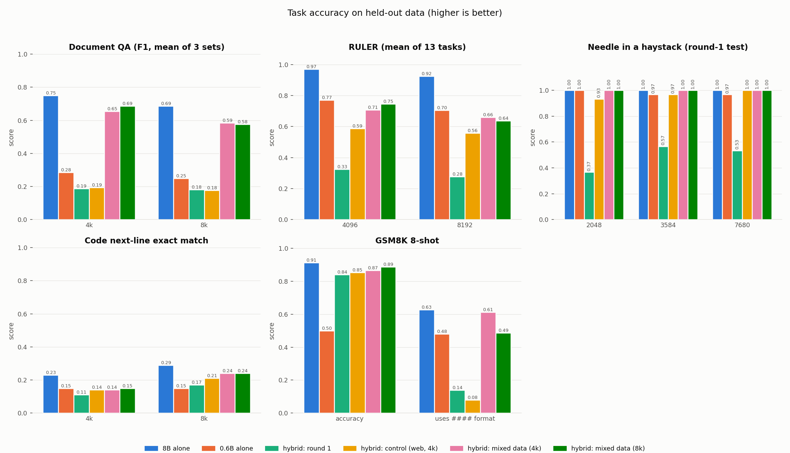
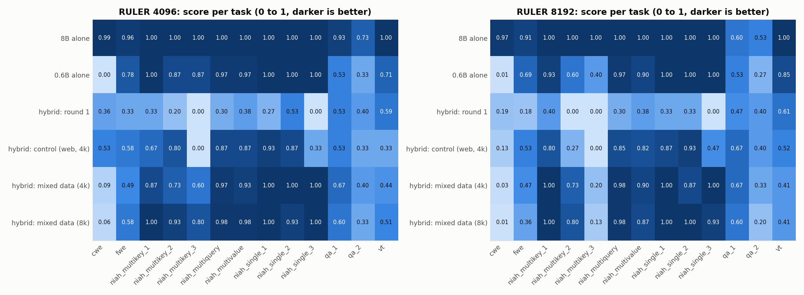
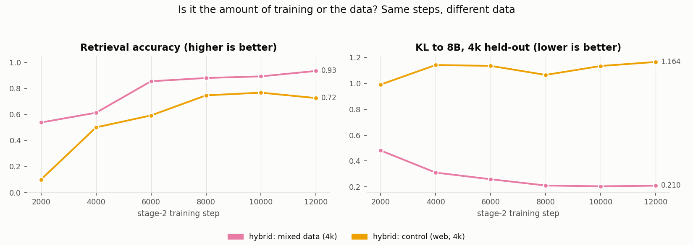
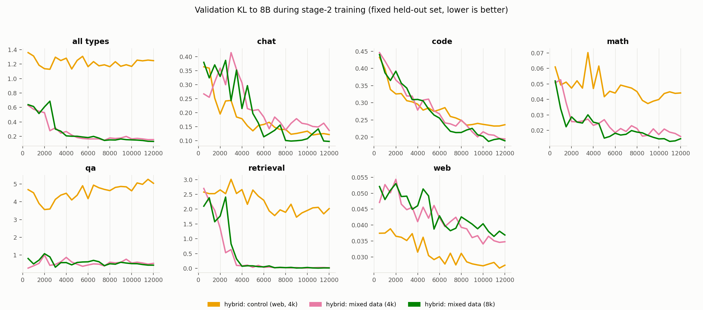
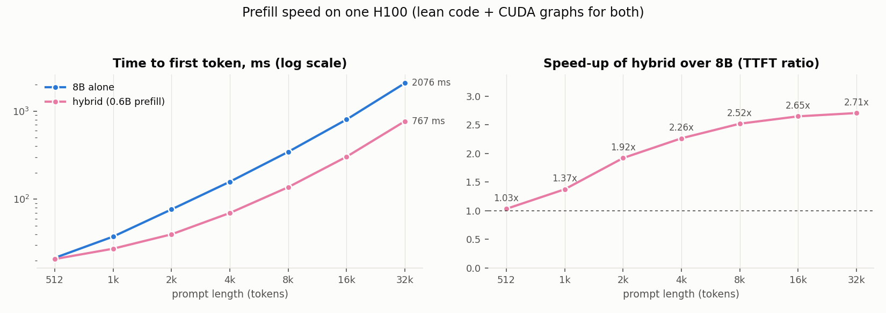

# 第二轮实验结果

GPU: NVIDIA H100 80GB HBM3；生成：2026-10-13 18:28:09。所有测试数据都没有参与训练。

配置：`big` = 8B 单独，`small` = 0.6B 单独，`r1` = 混合-第一轮，`ctrl4k` = 混合-对照(网页,4k)，`mix4k` = 混合-混合数据(4k)，`mix8k` = 混合-混合数据(8k)

## 图

## 与 8B 的 KL（4k prompt，越低越好）

| 配置 | chat | code | math | qa | retrieval | web | 平均 |
|---|---|---|---|---|---|---|---|
| 0.6B 单独 | 0.885 | 0.354 | 0.187 | 1.669 | 0.212 | 0.421 | 0.621 |
| 混合-第一轮 | 0.175 | 0.216 | 0.078 | 4.293 | 1.846 | 0.110 | 1.120 |
| 混合-对照(网页,4k) | 0.149 | 0.164 | 0.058 | 3.808 | 1.319 | 0.081 | 0.930 |
| 混合-混合数据(4k) | 0.129 | 0.151 | 0.022 | 0.376 | 0.062 | 0.101 | 0.140 |
| 混合-混合数据(8k) | 0.125 | 0.145 | 0.021 | 0.367 | 0.060 | 0.098 | 0.136 |

## 与 8B 的 KL（8k prompt，越低越好）

| 配置 | chat | code | math | qa | retrieval | web | 平均 |
|---|---|---|---|---|---|---|---|
| 0.6B 单独 | 0.815 | 0.351 | 0.169 | 1.968 | 0.259 | 0.445 | 0.668 |
| 混合-第一轮 | 0.146 | 0.239 | 0.060 | 4.290 | 1.532 | 0.155 | 1.070 |
| 混合-对照(网页,4k) | 0.139 | 0.180 | 0.050 | 3.637 | 1.127 | 0.111 | 0.874 |
| 混合-混合数据(4k) | 0.109 | 0.165 | 0.013 | 0.309 | 0.093 | 0.145 | 0.139 |
| 混合-混合数据(8k) | 0.109 | 0.160 | 0.012 | 0.347 | 0.028 | 0.141 | 0.133 |

## 问答 F1

| 配置 | squad 4k | hotpot 4k | trivia 4k | squad 8k | hotpot 8k | trivia 8k |
|---|---|---|---|---|---|---|
| 8B 单独 | 0.804 | 0.702 | 0.742 | 0.746 | 0.582 | 0.732 |
| 0.6B 单独 | 0.257 | 0.235 | 0.362 | 0.253 | 0.171 | 0.322 |
| 混合-第一轮 | 0.214 | 0.147 | 0.204 | 0.212 | 0.110 | 0.225 |
| 混合-对照(网页,4k) | 0.214 | 0.140 | 0.225 | 0.214 | 0.103 | 0.210 |
| 混合-混合数据(4k) | 0.675 | 0.581 | 0.704 | 0.648 | 0.405 | 0.703 |
| 混合-混合数据(8k) | 0.742 | 0.598 | 0.719 | 0.620 | 0.417 | 0.692 |

## RULER 4096

| 配置 | cwe | fwe | niah_multikey_1 | niah_multikey_2 | niah_multikey_3 | niah_multiquery | niah_multivalue | niah_single_1 | niah_single_2 | niah_single_3 | qa_1 | qa_2 | vt | 平均 |
|---|---|---|---|---|---|---|---|---|---|---|---|---|---|---|
| 8B 单独 | 0.99 | 0.96 | 1.00 | 1.00 | 1.00 | 1.00 | 1.00 | 1.00 | 1.00 | 1.00 | 0.93 | 0.73 | 1.00 | 0.970 |
| 0.6B 单独 | 0.00 | 0.78 | 1.00 | 0.87 | 0.87 | 0.97 | 0.97 | 1.00 | 1.00 | 1.00 | 0.53 | 0.33 | 0.71 | 0.771 |
| 混合-第一轮 | 0.36 | 0.33 | 0.33 | 0.20 | 0.00 | 0.30 | 0.38 | 0.27 | 0.53 | 0.00 | 0.53 | 0.40 | 0.59 | 0.325 |
| 混合-对照(网页,4k) | 0.53 | 0.58 | 0.67 | 0.80 | 0.00 | 0.87 | 0.87 | 0.93 | 0.87 | 0.33 | 0.53 | 0.33 | 0.33 | 0.588 |
| 混合-混合数据(4k) | 0.09 | 0.49 | 0.87 | 0.73 | 0.60 | 0.97 | 0.93 | 1.00 | 1.00 | 1.00 | 0.67 | 0.40 | 0.44 | 0.707 |
| 混合-混合数据(8k) | 0.06 | 0.58 | 1.00 | 0.93 | 0.80 | 0.98 | 0.98 | 1.00 | 0.93 | 1.00 | 0.60 | 0.33 | 0.51 | 0.747 |

## RULER 8192

| 配置 | cwe | fwe | niah_multikey_1 | niah_multikey_2 | niah_multikey_3 | niah_multiquery | niah_multivalue | niah_single_1 | niah_single_2 | niah_single_3 | qa_1 | qa_2 | vt | 平均 |
|---|---|---|---|---|---|---|---|---|---|---|---|---|---|---|
| 8B 单独 | 0.97 | 0.91 | 1.00 | 1.00 | 1.00 | 1.00 | 1.00 | 1.00 | 1.00 | 1.00 | 0.60 | 0.53 | 1.00 | 0.924 |
| 0.6B 单独 | 0.01 | 0.69 | 0.93 | 0.60 | 0.40 | 0.97 | 0.90 | 1.00 | 1.00 | 1.00 | 0.53 | 0.27 | 0.85 | 0.704 |
| 混合-第一轮 | 0.19 | 0.18 | 0.40 | 0.00 | 0.00 | 0.30 | 0.38 | 0.33 | 0.33 | 0.00 | 0.47 | 0.40 | 0.61 | 0.276 |
| 混合-对照(网页,4k) | 0.13 | 0.53 | 0.80 | 0.27 | 0.00 | 0.85 | 0.82 | 0.87 | 0.93 | 0.47 | 0.67 | 0.40 | 0.52 | 0.557 |
| 混合-混合数据(4k) | 0.03 | 0.47 | 1.00 | 0.73 | 0.20 | 0.98 | 0.90 | 1.00 | 0.87 | 1.00 | 0.67 | 0.33 | 0.41 | 0.661 |
| 混合-混合数据(8k) | 0.01 | 0.36 | 1.00 | 0.80 | 0.13 | 0.98 | 0.87 | 1.00 | 1.00 | 0.93 | 0.60 | 0.20 | 0.41 | 0.638 |

## 大海捞针（第一轮模板）

| 配置 | 2048 | 3584 | 7680 |
|---|---|---|---|
| 8B 单独 | 1.00 | 1.00 | 1.00 |
| 0.6B 单独 | 1.00 | 0.97 | 0.97 |
| 混合-第一轮 | 0.37 | 0.57 | 0.53 |
| 混合-对照(网页,4k) | 0.93 | 0.97 | 1.00 |
| 混合-混合数据(4k) | 1.00 | 1.00 | 1.00 |
| 混合-混合数据(8k) | 1.00 | 1.00 | 1.00 |

## GSM8K（8-shot，对话轮次形式）

| 配置 | 准确率 | 遵守 #### 格式 |
|---|---|---|
| 8B 单独 | 0.913 | 0.627 |
| 0.6B 单独 | 0.500 | 0.480 |
| 混合-第一轮 | 0.840 | 0.140 |
| 混合-对照(网页,4k) | 0.853 | 0.080 |
| 混合-混合数据(4k) | 0.867 | 0.613 |
| 混合-混合数据(8k) | 0.887 | 0.487 |

## 代码下一行补全

| 配置 | 4k 精确匹配 | 4k 相似度 | 8k 精确匹配 | 8k 相似度 |
|---|---|---|---|---|
| 8B 单独 | 0.230 | 0.612 | 0.290 | 0.645 |
| 0.6B 单独 | 0.150 | 0.578 | 0.150 | 0.536 |
| 混合-第一轮 | 0.110 | 0.529 | 0.170 | 0.570 |
| 混合-对照(网页,4k) | 0.140 | 0.557 | 0.210 | 0.589 |
| 混合-混合数据(4k) | 0.140 | 0.541 | 0.240 | 0.583 |
| 混合-混合数据(8k) | 0.150 | 0.553 | 0.240 | 0.593 |

## 训练步数的影响（4k）

| 训练 | 步数 | KL | 检索准确率 |
|---|---|---|---|
| 混合-混合数据(4k) | 2000 | 0.4812 | 0.537 |
| 混合-混合数据(4k) | 4000 | 0.3106 | 0.613 |
| 混合-混合数据(4k) | 6000 | 0.2593 | 0.854 |
| 混合-混合数据(4k) | 8000 | 0.2111 | 0.879 |
| 混合-混合数据(4k) | 10000 | 0.2051 | 0.892 |
| 混合-混合数据(4k) | 12000 | 0.2098 | 0.933 |
| 混合-对照(网页,4k) | 2000 | 0.9898 | 0.100 |
| 混合-对照(网页,4k) | 4000 | 1.1403 | 0.500 |
| 混合-对照(网页,4k) | 6000 | 1.1337 | 0.592 |
| 混合-对照(网页,4k) | 8000 | 1.0639 | 0.746 |
| 混合-对照(网页,4k) | 10000 | 1.1328 | 0.767 |
| 混合-对照(网页,4k) | 12000 | 1.1639 | 0.725 |
