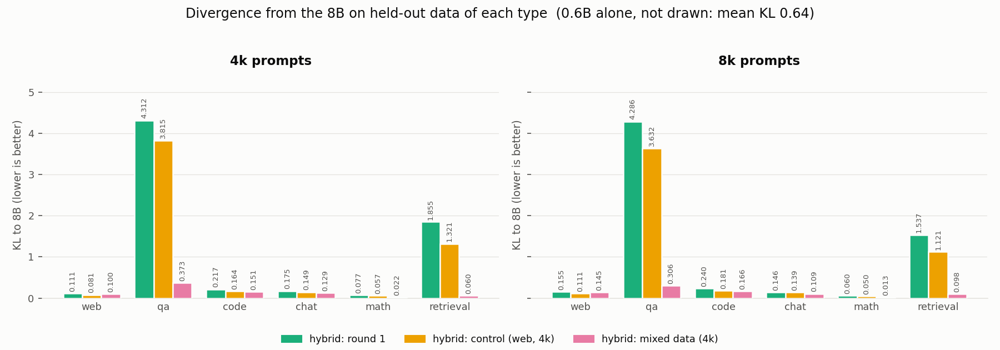
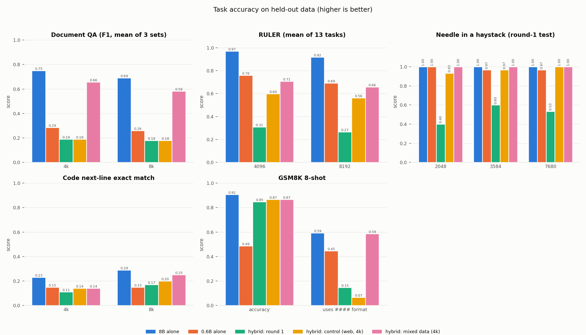
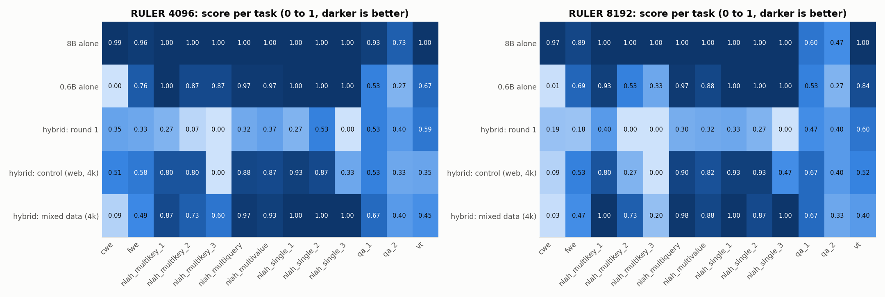
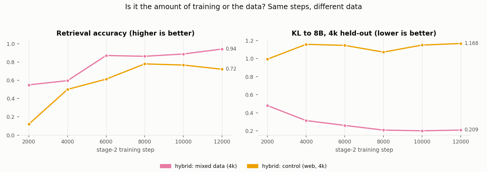
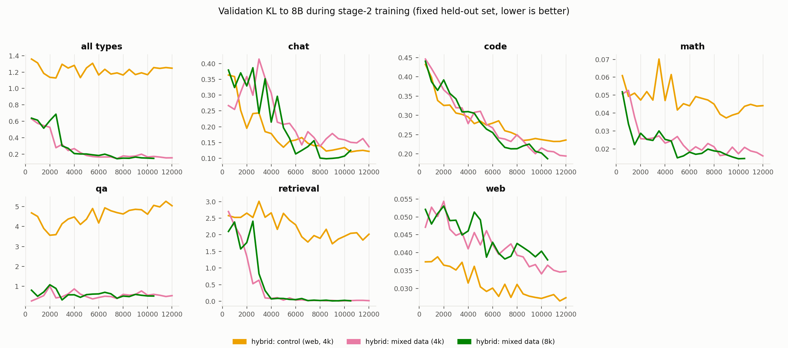
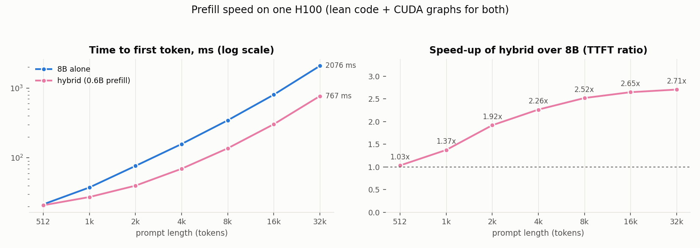

# 第二轮实验结果

GPU: NVIDIA L40S；生成：2026-10-13 14:11:34。所有测试数据都没有参与训练。

配置：`big` = 8B 单独，`small` = 0.6B 单独，`r1` = 混合-第一轮，`ctrl4k` = 混合-对照(网页,4k)，`mix4k` = 混合-混合数据(4k)

## 图

## 与 8B 的 KL（4k prompt，越低越好）

| 配置 | chat | code | math | qa | retrieval | web | 平均 |
|---|---|---|---|---|---|---|---|
| 0.6B 单独 | 0.886 | 0.354 | 0.186 | 1.639 | 0.212 | 0.422 | 0.617 |
| 混合-第一轮 | 0.175 | 0.217 | 0.077 | 4.312 | 1.855 | 0.111 | 1.125 |
| 混合-对照(网页,4k) | 0.149 | 0.164 | 0.057 | 3.815 | 1.321 | 0.081 | 0.931 |
| 混合-混合数据(4k) | 0.129 | 0.151 | 0.022 | 0.373 | 0.060 | 0.100 | 0.139 |

## 与 8B 的 KL（8k prompt，越低越好）

| 配置 | chat | code | math | qa | retrieval | web | 平均 |
|---|---|---|---|---|---|---|---|
| 0.6B 单独 | 0.815 | 0.351 | 0.170 | 1.954 | 0.256 | 0.444 | 0.665 |
| 混合-第一轮 | 0.146 | 0.240 | 0.060 | 4.286 | 1.537 | 0.155 | 1.071 |
| 混合-对照(网页,4k) | 0.139 | 0.181 | 0.050 | 3.632 | 1.121 | 0.111 | 0.872 |
| 混合-混合数据(4k) | 0.109 | 0.166 | 0.013 | 0.306 | 0.098 | 0.145 | 0.139 |

## 问答 F1

| 配置 | squad 4k | hotpot 4k | trivia 4k | squad 8k | hotpot 8k | trivia 8k |
|---|---|---|---|---|---|---|
| 8B 单独 | 0.810 | 0.694 | 0.747 | 0.749 | 0.590 | 0.734 |
| 0.6B 单独 | 0.258 | 0.240 | 0.360 | 0.266 | 0.179 | 0.330 |
| 混合-第一轮 | 0.216 | 0.144 | 0.209 | 0.205 | 0.110 | 0.224 |
| 混合-对照(网页,4k) | 0.212 | 0.139 | 0.219 | 0.219 | 0.103 | 0.212 |
| 混合-混合数据(4k) | 0.691 | 0.577 | 0.702 | 0.639 | 0.408 | 0.699 |

## RULER 4096

| 配置 | cwe | fwe | niah_multikey_1 | niah_multikey_2 | niah_multikey_3 | niah_multiquery | niah_multivalue | niah_single_1 | niah_single_2 | niah_single_3 | qa_1 | qa_2 | vt | 平均 |
|---|---|---|---|---|---|---|---|---|---|---|---|---|---|---|
| 8B 单独 | 0.99 | 0.96 | 1.00 | 1.00 | 1.00 | 1.00 | 1.00 | 1.00 | 1.00 | 1.00 | 0.93 | 0.73 | 1.00 | 0.970 |
| 0.6B 单独 | 0.00 | 0.76 | 1.00 | 0.87 | 0.87 | 0.97 | 0.97 | 1.00 | 1.00 | 1.00 | 0.53 | 0.27 | 0.67 | 0.761 |
| 混合-第一轮 | 0.35 | 0.33 | 0.27 | 0.07 | 0.00 | 0.32 | 0.37 | 0.27 | 0.53 | 0.00 | 0.53 | 0.40 | 0.59 | 0.309 |
| 混合-对照(网页,4k) | 0.51 | 0.58 | 0.80 | 0.80 | 0.00 | 0.88 | 0.87 | 0.93 | 0.87 | 0.33 | 0.53 | 0.33 | 0.35 | 0.599 |
| 混合-混合数据(4k) | 0.09 | 0.49 | 0.87 | 0.73 | 0.60 | 0.97 | 0.93 | 1.00 | 1.00 | 1.00 | 0.67 | 0.40 | 0.45 | 0.708 |

## RULER 8192

| 配置 | cwe | fwe | niah_multikey_1 | niah_multikey_2 | niah_multikey_3 | niah_multiquery | niah_multivalue | niah_single_1 | niah_single_2 | niah_single_3 | qa_1 | qa_2 | vt | 平均 |
|---|---|---|---|---|---|---|---|---|---|---|---|---|---|---|
| 8B 单独 | 0.97 | 0.89 | 1.00 | 1.00 | 1.00 | 1.00 | 1.00 | 1.00 | 1.00 | 1.00 | 0.60 | 0.47 | 1.00 | 0.918 |
| 0.6B 单独 | 0.01 | 0.69 | 0.93 | 0.53 | 0.33 | 0.97 | 0.88 | 1.00 | 1.00 | 1.00 | 0.53 | 0.27 | 0.84 | 0.692 |
| 混合-第一轮 | 0.19 | 0.18 | 0.40 | 0.00 | 0.00 | 0.30 | 0.32 | 0.33 | 0.27 | 0.00 | 0.47 | 0.40 | 0.60 | 0.265 |
| 混合-对照(网页,4k) | 0.09 | 0.53 | 0.80 | 0.27 | 0.00 | 0.90 | 0.82 | 0.93 | 0.93 | 0.47 | 0.67 | 0.40 | 0.52 | 0.563 |
| 混合-混合数据(4k) | 0.03 | 0.47 | 1.00 | 0.73 | 0.20 | 0.98 | 0.88 | 1.00 | 0.87 | 1.00 | 0.67 | 0.33 | 0.40 | 0.658 |

## 大海捞针（第一轮模板）

| 配置 | 2048 | 3584 | 7680 |
|---|---|---|---|
| 8B 单独 | 1.00 | 1.00 | 1.00 |
| 0.6B 单独 | 1.00 | 0.97 | 0.97 |
| 混合-第一轮 | 0.40 | 0.60 | 0.53 |
| 混合-对照(网页,4k) | 0.93 | 0.97 | 1.00 |
| 混合-混合数据(4k) | 1.00 | 1.00 | 1.00 |

## GSM8K（8-shot，对话轮次形式）

| 配置 | 准确率 | 遵守 #### 格式 |
|---|---|---|
| 8B 单独 | 0.907 | 0.593 |
| 0.6B 单独 | 0.487 | 0.447 |
| 混合-第一轮 | 0.847 | 0.147 |
| 混合-对照(网页,4k) | 0.867 | 0.067 |
| 混合-混合数据(4k) | 0.867 | 0.587 |

## 代码下一行补全

| 配置 | 4k 精确匹配 | 4k 相似度 | 8k 精确匹配 | 8k 相似度 |
|---|---|---|---|---|
| 8B 单独 | 0.230 | 0.613 | 0.290 | 0.639 |
| 0.6B 单独 | 0.150 | 0.592 | 0.150 | 0.532 |
| 混合-第一轮 | 0.110 | 0.528 | 0.170 | 0.565 |
| 混合-对照(网页,4k) | 0.140 | 0.562 | 0.200 | 0.585 |
| 混合-混合数据(4k) | 0.140 | 0.543 | 0.250 | 0.585 |

## 训练步数的影响（4k）

| 训练 | 步数 | KL | 检索准确率 |
|---|---|---|---|
| 混合-混合数据(4k) | 2000 | 0.4802 | 0.550 |
| 混合-混合数据(4k) | 4000 | 0.3146 | 0.596 |
| 混合-混合数据(4k) | 6000 | 0.2610 | 0.871 |
| 混合-混合数据(4k) | 8000 | 0.2093 | 0.863 |
| 混合-混合数据(4k) | 10000 | 0.2017 | 0.887 |
| 混合-混合数据(4k) | 12000 | 0.2092 | 0.942 |
| 混合-对照(网页,4k) | 2000 | 0.9946 | 0.121 |
| 混合-对照(网页,4k) | 4000 | 1.1585 | 0.500 |
| 混合-对照(网页,4k) | 6000 | 1.1468 | 0.613 |
| 混合-对照(网页,4k) | 8000 | 1.0724 | 0.779 |
| 混合-对照(网页,4k) | 10000 | 1.1502 | 0.767 |
| 混合-对照(网页,4k) | 12000 | 1.1676 | 0.721 |
