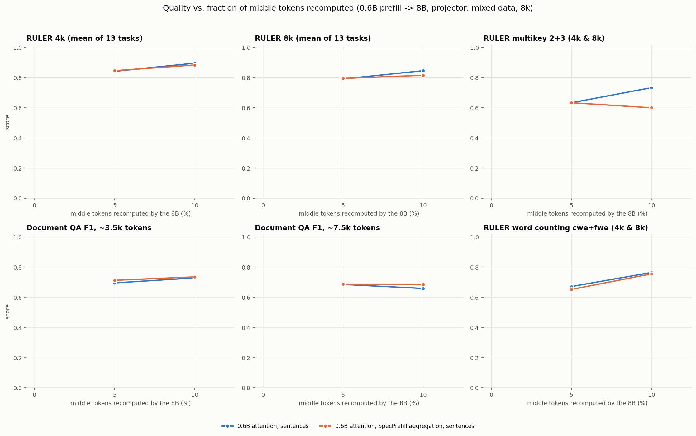

# 选择性重算实验

GPU：NVIDIA L40S；生成：2026-11-06 20:45:44；projector：混合数据 8k（第 12000 步）。小模型：0.6B，大模型：8B。开头 8 个和最后 64 个 token 始终由大模型计算；“重算比例”是中间部分由大模型重新计算的 token 占比。“丢弃其余”配置的选择方式与对应的重算配置完全相同，只是没选中的中间 token 被丢掉而不是用投影 KV 补上；SpecPrefill 是原论文方法（小模型打分，按 32 token 一块保留整段 prompt 的一部分，不强制保留开头和结尾，不用 projector），它的比例是整段 prompt 保留的比例。

## 总表

| 配置 | 实际重算比例（RULER 8k） | RULER 4k | RULER 8k | 问答 F1 4k | 问答 F1 8k | 大海捞针 |
|---|---|---|---|---|---|---|
| 0.6B 注意力 10%，按句子 | 10.1% | 0.896 | 0.846 | 0.729 | 0.659 | - |
| 0.6B 注意力，SpecPrefill 式汇总（不 look-ahead） 10%，按句子 | 10.1% | 0.884 | 0.815 | 0.735 | 0.686 | - |
| 0.6B 注意力，SpecPrefill 式汇总（不 look-ahead） 10% | 10.2% | 0.867 | 0.822 | 0.747 | 0.670 | - |
| SpecPrefill 打分（0.6B） 10% | 10.2% | 0.923 | 0.839 | 0.732 | 0.714 | - |
| 0.6B 注意力 5%，按句子 | 5.1% | 0.842 | 0.791 | 0.695 | 0.685 | - |
| 0.6B 注意力，SpecPrefill 式汇总（不 look-ahead） 5%，按句子 | 5.1% | 0.846 | 0.795 | 0.713 | 0.687 | - |

## RULER 4096，按任务类型

| 配置 | 检索 | 汇总 | 变量追踪 | 问答 | 平均 |
|---|---|---|---|---|---|
| 0.6B 注意力 10%，按句子 | 0.94 | 0.86 | 1.00 | 0.70 | 0.896 |
| 0.6B 注意力，SpecPrefill 式汇总（不 look-ahead） 10%，按句子 | 0.92 | 0.88 | 1.00 | 0.70 | 0.884 |
| 0.6B 注意力，SpecPrefill 式汇总（不 look-ahead） 10% | 0.91 | 0.87 | 0.84 | 0.70 | 0.867 |
| SpecPrefill 打分（0.6B） 10% | 0.98 | 0.81 | 0.99 | 0.77 | 0.923 |
| 0.6B 注意力 5%，按句子 | 0.92 | 0.79 | 0.79 | 0.60 | 0.842 |
| 0.6B 注意力，SpecPrefill 式汇总（不 look-ahead） 5%，按句子 | 0.93 | 0.77 | 0.79 | 0.63 | 0.846 |

RULER 4096 全部子任务

| 配置 | cwe | fwe | niah_multikey_1 | niah_multikey_2 | niah_multikey_3 | niah_multiquery | niah_multivalue | niah_single_1 | niah_single_2 | niah_single_3 | qa_1 | qa_2 | vt |
|---|---|---|---|---|---|---|---|---|---|---|---|---|---|
| 0.6B 注意力 10%，按句子 | 0.84 | 0.89 | 1.00 | 1.00 | 0.53 | 1.00 | 0.98 | 1.00 | 1.00 | 1.00 | 0.93 | 0.47 | 1.00 |
| 0.6B 注意力，SpecPrefill 式汇总（不 look-ahead） 10%，按句子 | 0.87 | 0.89 | 1.00 | 1.00 | 0.33 | 1.00 | 1.00 | 1.00 | 1.00 | 1.00 | 0.93 | 0.47 | 1.00 |
| 0.6B 注意力，SpecPrefill 式汇总（不 look-ahead） 10% | 0.85 | 0.89 | 1.00 | 0.87 | 0.47 | 1.00 | 0.97 | 1.00 | 1.00 | 1.00 | 0.93 | 0.47 | 0.84 |
| SpecPrefill 打分（0.6B） 10% | 0.77 | 0.84 | 1.00 | 1.00 | 0.87 | 1.00 | 1.00 | 1.00 | 1.00 | 1.00 | 0.93 | 0.60 | 0.99 |
| 0.6B 注意力 5%，按句子 | 0.72 | 0.87 | 1.00 | 1.00 | 0.40 | 1.00 | 0.97 | 1.00 | 1.00 | 1.00 | 0.73 | 0.47 | 0.79 |
| 0.6B 注意力，SpecPrefill 式汇总（不 look-ahead） 5%，按句子 | 0.70 | 0.84 | 1.00 | 1.00 | 0.40 | 1.00 | 1.00 | 1.00 | 1.00 | 1.00 | 0.80 | 0.47 | 0.79 |

## RULER 8192，按任务类型

| 配置 | 检索 | 汇总 | 变量追踪 | 问答 | 平均 |
|---|---|---|---|---|---|
| 0.6B 注意力 10%，按句子 | 0.93 | 0.66 | 1.00 | 0.63 | 0.846 |
| 0.6B 注意力，SpecPrefill 式汇总（不 look-ahead） 10%，按句子 | 0.88 | 0.63 | 1.00 | 0.63 | 0.815 |
| 0.6B 注意力，SpecPrefill 式汇总（不 look-ahead） 10% | 0.89 | 0.64 | 1.00 | 0.63 | 0.822 |
| SpecPrefill 打分（0.6B） 10% | 0.94 | 0.59 | 1.00 | 0.60 | 0.839 |
| 0.6B 注意力 5%，按句子 | 0.89 | 0.55 | 1.00 | 0.53 | 0.791 |
| 0.6B 注意力，SpecPrefill 式汇总（不 look-ahead） 5%，按句子 | 0.89 | 0.53 | 1.00 | 0.57 | 0.795 |

RULER 8192 全部子任务

| 配置 | cwe | fwe | niah_multikey_1 | niah_multikey_2 | niah_multikey_3 | niah_multiquery | niah_multivalue | niah_single_1 | niah_single_2 | niah_single_3 | qa_1 | qa_2 | vt |
|---|---|---|---|---|---|---|---|---|---|---|---|---|---|
| 0.6B 注意力 10%，按句子 | 0.51 | 0.82 | 1.00 | 1.00 | 0.40 | 1.00 | 1.00 | 1.00 | 1.00 | 1.00 | 0.80 | 0.47 | 1.00 |
| 0.6B 注意力，SpecPrefill 式汇总（不 look-ahead） 10%，按句子 | 0.47 | 0.80 | 1.00 | 1.00 | 0.07 | 1.00 | 1.00 | 1.00 | 1.00 | 1.00 | 0.80 | 0.47 | 1.00 |
| 0.6B 注意力，SpecPrefill 式汇总（不 look-ahead） 10% | 0.46 | 0.82 | 1.00 | 0.87 | 0.27 | 1.00 | 1.00 | 1.00 | 1.00 | 1.00 | 0.87 | 0.40 | 1.00 |
| SpecPrefill 打分（0.6B） 10% | 0.42 | 0.76 | 1.00 | 0.93 | 0.60 | 1.00 | 1.00 | 1.00 | 1.00 | 1.00 | 0.73 | 0.47 | 1.00 |
| 0.6B 注意力 5%，按句子 | 0.30 | 0.80 | 1.00 | 1.00 | 0.13 | 1.00 | 0.98 | 1.00 | 1.00 | 1.00 | 0.73 | 0.33 | 1.00 |
| 0.6B 注意力，SpecPrefill 式汇总（不 look-ahead） 5%，按句子 | 0.29 | 0.78 | 1.00 | 1.00 | 0.13 | 1.00 | 1.00 | 1.00 | 1.00 | 1.00 | 0.73 | 0.40 | 1.00 |

## 问答 F1

| 配置 | squad 4k | hotpot 4k | trivia 4k | squad 8k | hotpot 8k | trivia 8k | 平均 4k | 平均 8k |
|---|---|---|---|---|---|---|---|---|
| 0.6B 注意力 10%，按句子 | 0.873 | 0.639 | 0.673 | 0.747 | 0.497 | 0.732 | 0.729 | 0.659 |
| 0.6B 注意力，SpecPrefill 式汇总（不 look-ahead） 10%，按句子 | 0.867 | 0.659 | 0.680 | 0.803 | 0.508 | 0.747 | 0.735 | 0.686 |
| 0.6B 注意力，SpecPrefill 式汇总（不 look-ahead） 10% | 0.889 | 0.681 | 0.670 | 0.797 | 0.466 | 0.747 | 0.747 | 0.670 |
| SpecPrefill 打分（0.6B） 10% | 0.895 | 0.620 | 0.680 | 0.802 | 0.535 | 0.805 | 0.732 | 0.714 |
| 0.6B 注意力 5%，按句子 | 0.854 | 0.579 | 0.653 | 0.781 | 0.508 | 0.767 | 0.695 | 0.685 |
| 0.6B 注意力，SpecPrefill 式汇总（不 look-ahead） 5%，按句子 | 0.821 | 0.644 | 0.673 | 0.765 | 0.519 | 0.777 | 0.713 | 0.687 |

## 问答 F1，长 prompt（约 16k / 32k token）

| 配置 | squad 16k | hotpot 16k | trivia 16k | squad 32k | hotpot 32k | trivia 32k | 平均 16k | 平均 32k |
|---|---|---|---|---|---|---|---|---|
| 0.6B 注意力 10%，按句子 | 0.699 | 0.583 | 0.812 | 0.648 | 0.496 | 0.778 | 0.698 | 0.641 |
| 0.6B 注意力，SpecPrefill 式汇总（不 look-ahead） 10%，按句子 | 0.749 | 0.573 | 0.804 | 0.599 | 0.477 | 0.801 | 0.708 | 0.626 |
| 0.6B 注意力，SpecPrefill 式汇总（不 look-ahead） 10% | 0.727 | 0.623 | 0.835 | 0.614 | 0.547 | 0.778 | 0.728 | 0.646 |
| SpecPrefill 打分（0.6B） 10% | 0.732 | 0.480 | 0.812 | 0.668 | 0.453 | 0.817 | 0.674 | 0.646 |
| 0.6B 注意力 5%，按句子 | 0.682 | 0.497 | 0.793 | 0.625 | 0.417 | 0.767 | 0.658 | 0.603 |
| 0.6B 注意力，SpecPrefill 式汇总（不 look-ahead） 5%，按句子 | 0.720 | 0.557 | 0.775 | 0.626 | 0.491 | 0.742 | 0.684 | 0.620 |
