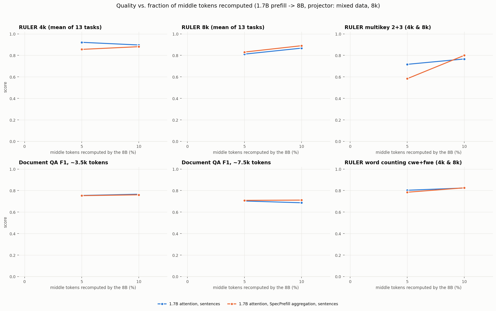

# 选择性重算实验

GPU：NVIDIA L40S；生成：2026-11-06 22:34:43；projector：混合数据 8k（第 12000 步）。小模型：1.7B，大模型：8B。开头 8 个和最后 64 个 token 始终由大模型计算；“重算比例”是中间部分由大模型重新计算的 token 占比。“丢弃其余”配置的选择方式与对应的重算配置完全相同，只是没选中的中间 token 被丢掉而不是用投影 KV 补上；SpecPrefill 是原论文方法（小模型打分，按 32 token 一块保留整段 prompt 的一部分，不强制保留开头和结尾，不用 projector），它的比例是整段 prompt 保留的比例。

## 总表

| 配置 | 实际重算比例（RULER 8k） | RULER 4k | RULER 8k | 问答 F1 4k | 问答 F1 8k | 大海捞针 |
|---|---|---|---|---|---|---|
| 1.7B 注意力 10%，按句子 | 10.1% | 0.897 | 0.867 | 0.766 | 0.686 | - |
| 1.7B 注意力，SpecPrefill 式汇总（不 look-ahead） 10%，按句子 | 10.1% | 0.881 | 0.890 | 0.760 | 0.711 | - |
| 1.7B 注意力，SpecPrefill 式汇总（不 look-ahead） 10% | 10.2% | 0.910 | 0.875 | 0.754 | 0.723 | - |
| SpecPrefill 打分（1.7B） 10% | 10.2% | 0.934 | 0.886 | 0.782 | 0.700 | - |
| 1.7B 注意力 5%，按句子 | 5.1% | 0.921 | 0.812 | 0.754 | 0.703 | - |
| 1.7B 注意力，SpecPrefill 式汇总（不 look-ahead） 5%，按句子 | 5.1% | 0.856 | 0.831 | 0.753 | 0.709 | - |

## RULER 4096，按任务类型

| 配置 | 检索 | 汇总 | 变量追踪 | 问答 | 平均 |
|---|---|---|---|---|---|
| 1.7B 注意力 10%，按句子 | 0.93 | 0.89 | 1.00 | 0.70 | 0.897 |
| 1.7B 注意力，SpecPrefill 式汇总（不 look-ahead） 10%，按句子 | 0.92 | 0.89 | 1.00 | 0.67 | 0.881 |
| 1.7B 注意力，SpecPrefill 式汇总（不 look-ahead） 10% | 0.97 | 0.89 | 0.99 | 0.67 | 0.910 |
| SpecPrefill 打分（1.7B） 10% | 1.00 | 0.87 | 1.00 | 0.70 | 0.934 |
| 1.7B 注意力 5%，按句子 | 0.98 | 0.84 | 0.99 | 0.73 | 0.921 |
| 1.7B 注意力，SpecPrefill 式汇总（不 look-ahead） 5%，按句子 | 0.89 | 0.84 | 0.92 | 0.70 | 0.856 |

RULER 4096 全部子任务

| 配置 | cwe | fwe | niah_multikey_1 | niah_multikey_2 | niah_multikey_3 | niah_multiquery | niah_multivalue | niah_single_1 | niah_single_2 | niah_single_3 | qa_1 | qa_2 | vt |
|---|---|---|---|---|---|---|---|---|---|---|---|---|---|
| 1.7B 注意力 10%，按句子 | 0.90 | 0.89 | 1.00 | 1.00 | 0.47 | 1.00 | 1.00 | 1.00 | 1.00 | 1.00 | 0.87 | 0.53 | 1.00 |
| 1.7B 注意力，SpecPrefill 式汇总（不 look-ahead） 10%，按句子 | 0.87 | 0.91 | 1.00 | 1.00 | 0.33 | 1.00 | 1.00 | 1.00 | 1.00 | 1.00 | 0.87 | 0.47 | 1.00 |
| 1.7B 注意力，SpecPrefill 式汇总（不 look-ahead） 10% | 0.91 | 0.87 | 1.00 | 1.00 | 0.73 | 1.00 | 1.00 | 1.00 | 1.00 | 1.00 | 0.87 | 0.47 | 0.99 |
| SpecPrefill 打分（1.7B） 10% | 0.83 | 0.91 | 1.00 | 1.00 | 1.00 | 1.00 | 1.00 | 1.00 | 1.00 | 1.00 | 0.87 | 0.53 | 1.00 |
| 1.7B 注意力 5%，按句子 | 0.85 | 0.82 | 1.00 | 1.00 | 0.87 | 1.00 | 0.98 | 1.00 | 1.00 | 1.00 | 0.87 | 0.60 | 0.99 |
| 1.7B 注意力，SpecPrefill 式汇总（不 look-ahead） 5%，按句子 | 0.83 | 0.84 | 1.00 | 1.00 | 0.13 | 1.00 | 1.00 | 1.00 | 1.00 | 1.00 | 0.87 | 0.53 | 0.92 |

## RULER 8192，按任务类型

| 配置 | 检索 | 汇总 | 变量追踪 | 问答 | 平均 |
|---|---|---|---|---|---|
| 1.7B 注意力 10%，按句子 | 0.95 | 0.75 | 1.00 | 0.60 | 0.867 |
| 1.7B 注意力，SpecPrefill 式汇总（不 look-ahead） 10%，按句子 | 0.98 | 0.76 | 1.00 | 0.60 | 0.890 |
| 1.7B 注意力，SpecPrefill 式汇总（不 look-ahead） 10% | 0.97 | 0.77 | 1.00 | 0.53 | 0.875 |
| SpecPrefill 打分（1.7B） 10% | 1.00 | 0.70 | 1.00 | 0.57 | 0.886 |
| 1.7B 注意力 5%，按句子 | 0.87 | 0.77 | 1.00 | 0.53 | 0.812 |
| 1.7B 注意力，SpecPrefill 式汇总（不 look-ahead） 5%，按句子 | 0.90 | 0.73 | 1.00 | 0.57 | 0.831 |

RULER 8192 全部子任务

| 配置 | cwe | fwe | niah_multikey_1 | niah_multikey_2 | niah_multikey_3 | niah_multiquery | niah_multivalue | niah_single_1 | niah_single_2 | niah_single_3 | qa_1 | qa_2 | vt |
|---|---|---|---|---|---|---|---|---|---|---|---|---|---|
| 1.7B 注意力 10%，按句子 | 0.71 | 0.80 | 1.00 | 1.00 | 0.60 | 1.00 | 0.97 | 1.00 | 1.00 | 1.00 | 0.80 | 0.40 | 1.00 |
| 1.7B 注意力，SpecPrefill 式汇总（不 look-ahead） 10%，按句子 | 0.67 | 0.84 | 1.00 | 1.00 | 0.87 | 1.00 | 0.98 | 1.00 | 1.00 | 1.00 | 0.73 | 0.47 | 1.00 |
| 1.7B 注意力，SpecPrefill 式汇总（不 look-ahead） 10% | 0.68 | 0.87 | 1.00 | 0.87 | 0.93 | 1.00 | 0.97 | 1.00 | 1.00 | 1.00 | 0.67 | 0.40 | 1.00 |
| SpecPrefill 打分（1.7B） 10% | 0.55 | 0.84 | 1.00 | 1.00 | 1.00 | 1.00 | 0.98 | 1.00 | 1.00 | 1.00 | 0.67 | 0.47 | 1.00 |
| 1.7B 注意力 5%，按句子 | 0.71 | 0.82 | 1.00 | 1.00 | 0.00 | 1.00 | 0.95 | 1.00 | 1.00 | 1.00 | 0.67 | 0.40 | 1.00 |
| 1.7B 注意力，SpecPrefill 式汇总（不 look-ahead） 5%，按句子 | 0.60 | 0.87 | 1.00 | 1.00 | 0.20 | 1.00 | 1.00 | 1.00 | 1.00 | 1.00 | 0.73 | 0.40 | 1.00 |

## 问答 F1

| 配置 | squad 4k | hotpot 4k | trivia 4k | squad 8k | hotpot 8k | trivia 8k | 平均 4k | 平均 8k |
|---|---|---|---|---|---|---|---|---|
| 1.7B 注意力 10%，按句子 | 0.903 | 0.695 | 0.700 | 0.757 | 0.544 | 0.759 | 0.766 | 0.686 |
| 1.7B 注意力，SpecPrefill 式汇总（不 look-ahead） 10%，按句子 | 0.870 | 0.711 | 0.700 | 0.814 | 0.546 | 0.774 | 0.760 | 0.711 |
| 1.7B 注意力，SpecPrefill 式汇总（不 look-ahead） 10% | 0.897 | 0.664 | 0.700 | 0.809 | 0.566 | 0.794 | 0.754 | 0.723 |
| SpecPrefill 打分（1.7B） 10% | 0.909 | 0.738 | 0.700 | 0.812 | 0.538 | 0.750 | 0.782 | 0.700 |
| 1.7B 注意力 5%，按句子 | 0.871 | 0.682 | 0.710 | 0.776 | 0.579 | 0.754 | 0.754 | 0.703 |
| 1.7B 注意力，SpecPrefill 式汇总（不 look-ahead） 5%，按句子 | 0.829 | 0.718 | 0.710 | 0.777 | 0.596 | 0.754 | 0.753 | 0.709 |

## 问答 F1，长 prompt（约 16k / 32k token）

| 配置 | squad 16k | hotpot 16k | trivia 16k | squad 32k | hotpot 32k | trivia 32k | 平均 16k | 平均 32k |
|---|---|---|---|---|---|---|---|---|
| 1.7B 注意力 10%，按句子 | 0.745 | 0.574 | 0.808 | 0.528 | 0.497 | 0.764 | 0.709 | 0.596 |
| 1.7B 注意力，SpecPrefill 式汇总（不 look-ahead） 10%，按句子 | 0.749 | 0.574 | 0.800 | 0.526 | 0.485 | 0.789 | 0.708 | 0.600 |
| 1.7B 注意力，SpecPrefill 式汇总（不 look-ahead） 10% | 0.729 | 0.620 | 0.813 | 0.541 | 0.498 | 0.749 | 0.720 | 0.596 |
| SpecPrefill 打分（1.7B） 10% | 0.746 | 0.605 | 0.828 | 0.546 | 0.498 | 0.774 | 0.726 | 0.606 |
| 1.7B 注意力 5%，按句子 | 0.739 | 0.527 | 0.815 | 0.529 | 0.455 | 0.740 | 0.694 | 0.575 |
| 1.7B 注意力，SpecPrefill 式汇总（不 look-ahead） 5%，按句子 | 0.749 | 0.564 | 0.835 | 0.546 | 0.505 | 0.761 | 0.716 | 0.604 |
