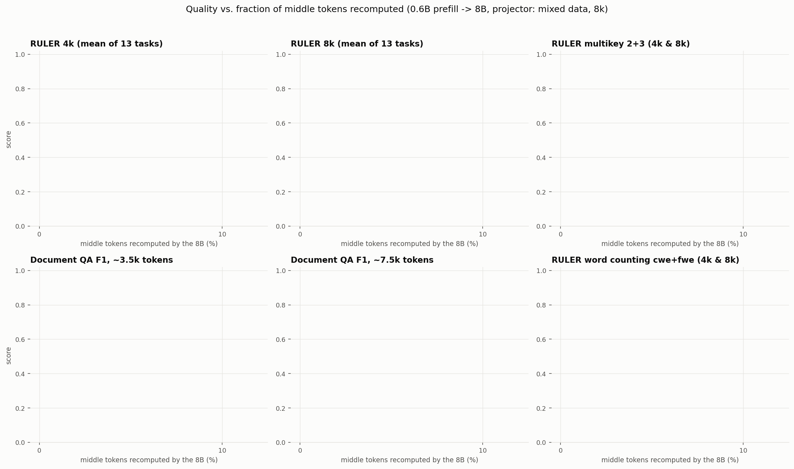

# 选择性重算实验

GPU：NVIDIA L40S；生成：2026-11-08 03:04:11；projector：混合数据 8k（第 12000 步）。小模型：0.6B，大模型：8B。开头 8 个和最后 64 个 token 始终由大模型计算；“重算比例”是中间部分由大模型重新计算的 token 占比。“丢弃其余”配置的选择方式与对应的重算配置完全相同，只是没选中的中间 token 被丢掉而不是用投影 KV 补上；SpecPrefill 是原论文方法（小模型打分，按 32 token 一块保留整段 prompt 的一部分，不强制保留开头和结尾，不用 projector），它的比例是整段 prompt 保留的比例。

## 总表

| 配置 | 实际重算比例（RULER 8k） | RULER 4k | RULER 8k | 问答 F1 4k | 问答 F1 8k | 大海捞针 |
|---|---|---|---|---|---|---|
| SpecPrefill 打分（0.6B） 10%，look-ahead 2 | 10.2% | 0.884 | 0.805 | 0.732 | 0.647 | - |
| SpecPrefill 打分（0.6B） 10%，look-ahead 3 | 10.2% | 0.891 | 0.836 | 0.719 | 0.674 | - |
| SpecPrefill 打分（0.6B） 10%，look-ahead 4 | 10.2% | 0.913 | 0.834 | 0.702 | 0.693 | - |

## RULER 4096，按任务类型

| 配置 | 检索 | 汇总 | 变量追踪 | 问答 | 平均 |
|---|---|---|---|---|---|
| SpecPrefill 打分（0.6B） 10%，look-ahead 2 | 0.93 | 0.85 | 1.00 | 0.67 | 0.884 |
| SpecPrefill 打分（0.6B） 10%，look-ahead 3 | 0.95 | 0.79 | 1.00 | 0.70 | 0.891 |
| SpecPrefill 打分（0.6B） 10%，look-ahead 4 | 0.97 | 0.82 | 0.97 | 0.73 | 0.913 |

RULER 4096 全部子任务

| 配置 | cwe | fwe | niah_multikey_1 | niah_multikey_2 | niah_multikey_3 | niah_multiquery | niah_multivalue | niah_single_1 | niah_single_2 | niah_single_3 | qa_1 | qa_2 | vt |
|---|---|---|---|---|---|---|---|---|---|---|---|---|---|
| SpecPrefill 打分（0.6B） 10%，look-ahead 2 | 0.81 | 0.89 | 1.00 | 0.87 | 0.60 | 1.00 | 1.00 | 1.00 | 1.00 | 1.00 | 0.87 | 0.47 | 1.00 |
| SpecPrefill 打分（0.6B） 10%，look-ahead 3 | 0.72 | 0.87 | 1.00 | 1.00 | 0.60 | 1.00 | 1.00 | 1.00 | 1.00 | 1.00 | 0.87 | 0.53 | 1.00 |
| SpecPrefill 打分（0.6B） 10%，look-ahead 4 | 0.77 | 0.87 | 1.00 | 1.00 | 0.80 | 1.00 | 1.00 | 1.00 | 1.00 | 1.00 | 0.87 | 0.60 | 0.97 |

## RULER 8192，按任务类型

| 配置 | 检索 | 汇总 | 变量追踪 | 问答 | 平均 |
|---|---|---|---|---|---|
| SpecPrefill 打分（0.6B） 10%，look-ahead 2 | 0.91 | 0.54 | 1.00 | 0.57 | 0.805 |
| SpecPrefill 打分（0.6B） 10%，look-ahead 3 | 0.93 | 0.56 | 1.00 | 0.63 | 0.836 |
| SpecPrefill 打分（0.6B） 10%，look-ahead 4 | 0.93 | 0.58 | 1.00 | 0.60 | 0.834 |

RULER 8192 全部子任务

| 配置 | cwe | fwe | niah_multikey_1 | niah_multikey_2 | niah_multikey_3 | niah_multiquery | niah_multivalue | niah_single_1 | niah_single_2 | niah_single_3 | qa_1 | qa_2 | vt |
|---|---|---|---|---|---|---|---|---|---|---|---|---|---|
| SpecPrefill 打分（0.6B） 10%，look-ahead 2 | 0.31 | 0.78 | 1.00 | 0.80 | 0.47 | 1.00 | 0.98 | 1.00 | 1.00 | 1.00 | 0.73 | 0.40 | 1.00 |
| SpecPrefill 打分（0.6B） 10%，look-ahead 3 | 0.37 | 0.76 | 1.00 | 0.93 | 0.53 | 1.00 | 1.00 | 1.00 | 1.00 | 1.00 | 0.80 | 0.47 | 1.00 |
| SpecPrefill 打分（0.6B） 10%，look-ahead 4 | 0.41 | 0.76 | 1.00 | 1.00 | 0.47 | 1.00 | 1.00 | 1.00 | 1.00 | 1.00 | 0.73 | 0.47 | 1.00 |

## 问答 F1

| 配置 | squad 4k | hotpot 4k | trivia 4k | squad 8k | hotpot 8k | trivia 8k | 平均 4k | 平均 8k |
|---|---|---|---|---|---|---|---|---|
| SpecPrefill 打分（0.6B） 10%，look-ahead 2 | 0.863 | 0.633 | 0.700 | 0.737 | 0.479 | 0.726 | 0.732 | 0.647 |
| SpecPrefill 打分（0.6B） 10%，look-ahead 3 | 0.882 | 0.586 | 0.690 | 0.780 | 0.516 | 0.726 | 0.719 | 0.674 |
| SpecPrefill 打分（0.6B） 10%，look-ahead 4 | 0.883 | 0.543 | 0.680 | 0.814 | 0.500 | 0.766 | 0.702 | 0.693 |

## 问答 F1，长 prompt（约 16k / 32k token）

| 配置 | squad 16k | hotpot 16k | trivia 16k | squad 32k | hotpot 32k | trivia 32k | 平均 16k | 平均 32k |
|---|---|---|---|---|---|---|---|---|
| SpecPrefill 打分（0.6B） 10%，look-ahead 2 | 0.721 | 0.476 | 0.829 | 0.611 | 0.485 | 0.792 | 0.675 | 0.629 |
| SpecPrefill 打分（0.6B） 10%，look-ahead 3 | 0.702 | 0.522 | 0.831 | 0.645 | 0.476 | 0.815 | 0.685 | 0.645 |
| SpecPrefill 打分（0.6B） 10%，look-ahead 4 | 0.726 | 0.492 | 0.836 | 0.661 | 0.469 | 0.792 | 0.685 | 0.641 |
