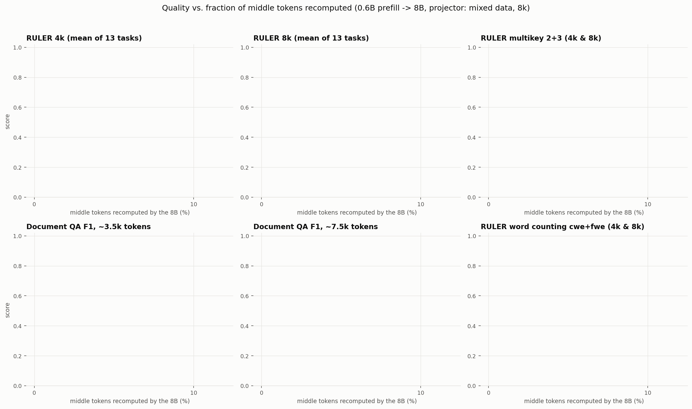

# 选择性重算实验

GPU：NVIDIA L40S；生成：2026-11-08 02:58:56；projector：混合数据 8k（第 12000 步）。小模型：0.6B，大模型：8B。开头 8 个和最后 64 个 token 始终由大模型计算；“重算比例”是中间部分由大模型重新计算的 token 占比。“丢弃其余”配置的选择方式与对应的重算配置完全相同，只是没选中的中间 token 被丢掉而不是用投影 KV 补上；SpecPrefill 是原论文方法（小模型打分，按 32 token 一块保留整段 prompt 的一部分，不强制保留开头和结尾，不用 projector），它的比例是整段 prompt 保留的比例。

## 总表

| 配置 | 实际重算比例（RULER 8k） | RULER 4k | RULER 8k | 问答 F1 4k | 问答 F1 8k | 大海捞针 |
|---|---|---|---|---|---|---|
| 0.6B 注意力 10%，按句子 | - | - | - | - | - | - |

## 首 token 延迟（毫秒，L40S，所有方法都用 CUDA graph：固定形状的阶段整段回放，只有选择步骤 eager）

| 配置 | 4096 | 8192 | 16384 | 32768 |
|---|---|---|---|---|
| 8B 单独 | 394.0（1.00 倍） | 925.1（1.00 倍） | 2085.7（1.00 倍） | 5057.8（1.00 倍） |
| 0.6B 注意力 10%，按句子 | 122.0（3.23 倍） | 282.4（3.28 倍） | 722.2（2.89 倍） | 1993.9（2.54 倍） |
| SpecPrefill 打分（0.6B） 10%，look-ahead 2 | 129.2（3.05 倍） | 286.1（3.23 倍） | 726.6（2.87 倍） | 1969.6（2.57 倍） |
| SpecPrefill 打分（0.6B） 10%，look-ahead 3 | 138.8（2.84 倍） | 300.2（3.08 倍） | 747.6（2.79 倍） | 2011.1（2.51 倍） |
| SpecPrefill 打分（0.6B） 10%，look-ahead 4 | 146.5（2.69 倍） | 312.6（2.96 倍） | 775.5（2.69 倍） | 2055.2（2.46 倍） |
| SpecPrefill 打分（0.6B） 10% | 181.0（2.18 倍） | 364.8（2.54 倍） | 862.5（2.42 倍） | 2217.9（2.28 倍） |
| SpecPrefill 保留整段 10% | 155.2（2.54 倍） | 309.1（2.99 倍） | 718.4（2.90 倍） | 1805.6（2.80 倍） |

括号内是相对 8B 单独（同样用 CUDA graph）的加速比。graph 与 eager 的首 token logits 最大相对差（4096 token）：8B 单独 0.0e+00，0.6B 注意力 10%，按句子 0.0e+00，SpecPrefill 打分（0.6B） 10%，look-ahead 2 0.0e+00，SpecPrefill 打分（0.6B） 10%，look-ahead 3 0.0e+00，SpecPrefill 打分（0.6B） 10%，look-ahead 4 0.0e+00，SpecPrefill 打分（0.6B） 10% 0.0e+00，SpecPrefill 保留整段 10% 0.0e+00。
