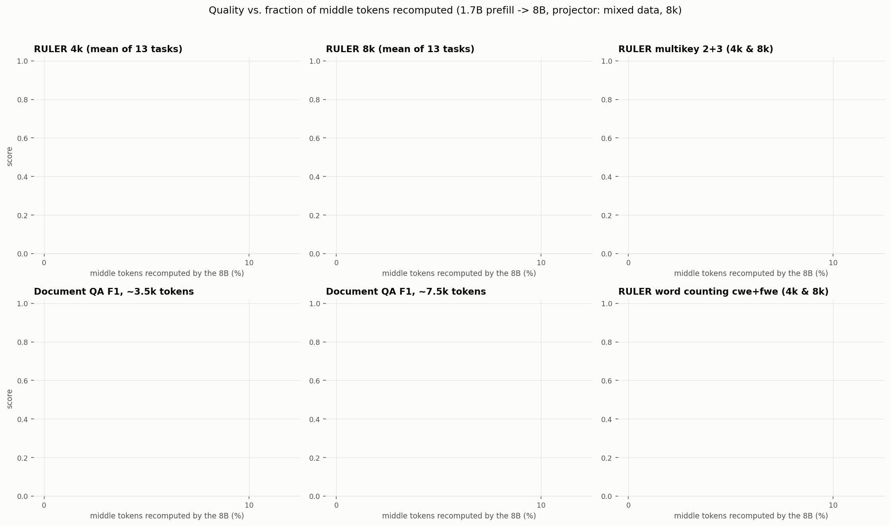

# 选择性重算实验

GPU：NVIDIA L40S；生成：2026-11-08 04:04:55；projector：混合数据 8k（第 12000 步）。小模型：1.7B，大模型：8B。开头 8 个和最后 64 个 token 始终由大模型计算；“重算比例”是中间部分由大模型重新计算的 token 占比。“丢弃其余”配置的选择方式与对应的重算配置完全相同，只是没选中的中间 token 被丢掉而不是用投影 KV 补上；SpecPrefill 是原论文方法（小模型打分，按 32 token 一块保留整段 prompt 的一部分，不强制保留开头和结尾，不用 projector），它的比例是整段 prompt 保留的比例。

## 总表

| 配置 | 实际重算比例（RULER 8k） | RULER 4k | RULER 8k | 问答 F1 4k | 问答 F1 8k | 大海捞针 |
|---|---|---|---|---|---|---|
| SpecPrefill 打分（1.7B） 10%，look-ahead 2 | 10.2% | 0.910 | 0.849 | 0.754 | 0.697 | - |
| SpecPrefill 打分（1.7B） 10%，look-ahead 3 | 10.2% | 0.913 | 0.840 | 0.762 | 0.708 | - |
| SpecPrefill 打分（1.7B） 10%，look-ahead 4 | 10.2% | 0.927 | 0.876 | 0.771 | 0.702 | - |

## RULER 4096，按任务类型

| 配置 | 检索 | 汇总 | 变量追踪 | 问答 | 平均 |
|---|---|---|---|---|---|
| SpecPrefill 打分（1.7B） 10%，look-ahead 2 | 0.97 | 0.85 | 1.00 | 0.70 | 0.910 |
| SpecPrefill 打分（1.7B） 10%，look-ahead 3 | 0.97 | 0.87 | 1.00 | 0.70 | 0.913 |
| SpecPrefill 打分（1.7B） 10%，look-ahead 4 | 0.99 | 0.86 | 1.00 | 0.70 | 0.927 |

RULER 4096 全部子任务

| 配置 | cwe | fwe | niah_multikey_1 | niah_multikey_2 | niah_multikey_3 | niah_multiquery | niah_multivalue | niah_single_1 | niah_single_2 | niah_single_3 | qa_1 | qa_2 | vt |
|---|---|---|---|---|---|---|---|---|---|---|---|---|---|
| SpecPrefill 打分（1.7B） 10%，look-ahead 2 | 0.83 | 0.87 | 1.00 | 1.00 | 0.73 | 1.00 | 1.00 | 1.00 | 1.00 | 1.00 | 0.87 | 0.53 | 1.00 |
| SpecPrefill 打分（1.7B） 10%，look-ahead 3 | 0.85 | 0.89 | 1.00 | 1.00 | 0.73 | 1.00 | 1.00 | 1.00 | 1.00 | 1.00 | 0.87 | 0.53 | 1.00 |
| SpecPrefill 打分（1.7B） 10%，look-ahead 4 | 0.83 | 0.89 | 1.00 | 1.00 | 0.93 | 1.00 | 1.00 | 1.00 | 1.00 | 1.00 | 0.87 | 0.53 | 1.00 |

## RULER 8192，按任务类型

| 配置 | 检索 | 汇总 | 变量追踪 | 问答 | 平均 |
|---|---|---|---|---|---|
| SpecPrefill 打分（1.7B） 10%，look-ahead 2 | 0.92 | 0.73 | 1.00 | 0.60 | 0.849 |
| SpecPrefill 打分（1.7B） 10%，look-ahead 3 | 0.92 | 0.73 | 1.00 | 0.57 | 0.840 |
| SpecPrefill 打分（1.7B） 10%，look-ahead 4 | 0.97 | 0.73 | 1.00 | 0.57 | 0.876 |

RULER 8192 全部子任务

| 配置 | cwe | fwe | niah_multikey_1 | niah_multikey_2 | niah_multikey_3 | niah_multiquery | niah_multivalue | niah_single_1 | niah_single_2 | niah_single_3 | qa_1 | qa_2 | vt |
|---|---|---|---|---|---|---|---|---|---|---|---|---|---|
| SpecPrefill 打分（1.7B） 10%，look-ahead 2 | 0.59 | 0.87 | 1.00 | 0.93 | 0.47 | 1.00 | 0.98 | 1.00 | 1.00 | 1.00 | 0.73 | 0.47 | 1.00 |
| SpecPrefill 打分（1.7B） 10%，look-ahead 3 | 0.61 | 0.84 | 1.00 | 1.00 | 0.33 | 1.00 | 1.00 | 1.00 | 1.00 | 1.00 | 0.67 | 0.47 | 1.00 |
| SpecPrefill 打分（1.7B） 10%，look-ahead 4 | 0.61 | 0.84 | 1.00 | 1.00 | 0.80 | 1.00 | 1.00 | 1.00 | 1.00 | 1.00 | 0.67 | 0.47 | 1.00 |

## 问答 F1

| 配置 | squad 4k | hotpot 4k | trivia 4k | squad 8k | hotpot 8k | trivia 8k | 平均 4k | 平均 8k |
|---|---|---|---|---|---|---|---|---|
| SpecPrefill 打分（1.7B） 10%，look-ahead 2 | 0.889 | 0.682 | 0.690 | 0.769 | 0.586 | 0.735 | 0.754 | 0.697 |
| SpecPrefill 打分（1.7B） 10%，look-ahead 3 | 0.891 | 0.705 | 0.690 | 0.797 | 0.573 | 0.755 | 0.762 | 0.708 |
| SpecPrefill 打分（1.7B） 10%，look-ahead 4 | 0.887 | 0.716 | 0.710 | 0.778 | 0.580 | 0.750 | 0.771 | 0.702 |

## 问答 F1，长 prompt（约 16k / 32k token）

| 配置 | squad 16k | hotpot 16k | trivia 16k | squad 32k | hotpot 32k | trivia 32k | 平均 16k | 平均 32k |
|---|---|---|---|---|---|---|---|---|
| SpecPrefill 打分（1.7B） 10%，look-ahead 2 | 0.743 | 0.591 | 0.820 | 0.542 | 0.460 | 0.769 | 0.718 | 0.590 |
| SpecPrefill 打分（1.7B） 10%，look-ahead 3 | 0.730 | 0.616 | 0.807 | 0.539 | 0.448 | 0.769 | 0.718 | 0.585 |
| SpecPrefill 打分（1.7B） 10%，look-ahead 4 | 0.768 | 0.616 | 0.828 | 0.526 | 0.481 | 0.789 | 0.737 | 0.599 |
