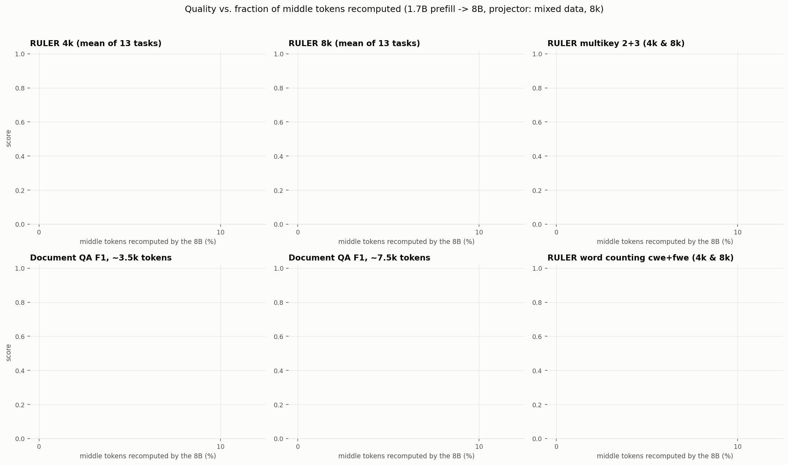

# 选择性重算实验

GPU：NVIDIA L40S；生成：2026-11-08 03:58:42；projector：混合数据 8k（第 12000 步）。小模型：1.7B，大模型：8B。开头 8 个和最后 64 个 token 始终由大模型计算；“重算比例”是中间部分由大模型重新计算的 token 占比。“丢弃其余”配置的选择方式与对应的重算配置完全相同，只是没选中的中间 token 被丢掉而不是用投影 KV 补上；SpecPrefill 是原论文方法（小模型打分，按 32 token 一块保留整段 prompt 的一部分，不强制保留开头和结尾，不用 projector），它的比例是整段 prompt 保留的比例。

## 总表

| 配置 | 实际重算比例（RULER 8k） | RULER 4k | RULER 8k | 问答 F1 4k | 问答 F1 8k | 大海捞针 |
|---|---|---|---|---|---|---|
| 1.7B 注意力 10%，按句子 | - | - | - | - | - | - |

## 首 token 延迟（毫秒，L40S，所有方法都用 CUDA graph：固定形状的阶段整段回放，只有选择步骤 eager）

| 配置 | 4096 | 8192 | 16384 | 32768 |
|---|---|---|---|---|
| 8B 单独 | 405.9（1.00 倍） | 944.5（1.00 倍） | 2158.9（1.00 倍） | 5071.6（1.00 倍） |
| 1.7B 注意力 10%，按句子 | 178.6（2.27 倍） | 405.4（2.33 倍） | 997.3（2.16 倍） | 2459.3（2.06 倍） |
| SpecPrefill 打分（1.7B） 10%，look-ahead 2 | 188.6（2.15 倍） | 412.8（2.29 倍） | 1003.5（2.15 倍） | 2420.2（2.10 倍） |
| SpecPrefill 打分（1.7B） 10%，look-ahead 3 | 200.8（2.02 倍） | 429.2（2.20 倍） | 1027.0（2.10 倍） | 2477.3（2.05 倍） |
| SpecPrefill 打分（1.7B） 10%，look-ahead 4 | 211.9（1.92 倍） | 443.7（2.13 倍） | 1053.5（2.05 倍） | 2516.5（2.02 倍） |
| SpecPrefill 打分（1.7B） 10% | 260.1（1.56 倍） | 507.7（1.86 倍） | 1150.8（1.88 倍） | 2675.1（1.90 倍） |
| SpecPrefill 保留整段 10% | 226.8（1.79 倍） | 439.8（2.15 倍） | 983.8（2.19 倍） | 2254.1（2.25 倍） |

括号内是相对 8B 单独（同样用 CUDA graph）的加速比。graph 与 eager 的首 token logits 最大相对差（4096 token）：8B 单独 0.0e+00，1.7B 注意力 10%，按句子 0.0e+00，SpecPrefill 打分（1.7B） 10%，look-ahead 2 3.0e-02，SpecPrefill 打分（1.7B） 10%，look-ahead 3 0.0e+00，SpecPrefill 打分（1.7B） 10%，look-ahead 4 0.0e+00，SpecPrefill 打分（1.7B） 10% 0.0e+00，SpecPrefill 保留整段 10% 0.0e+00。
