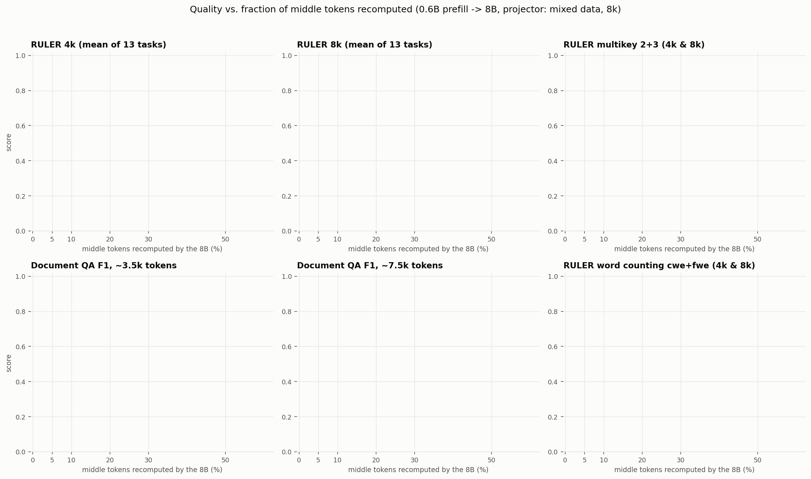
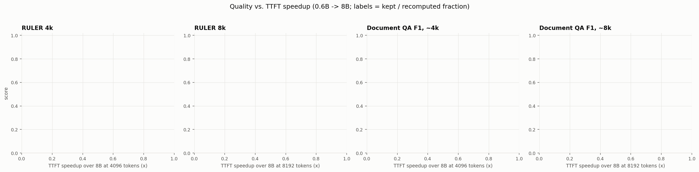

# 选择性重算实验

GPU：NVIDIA L40S；生成：2026-10-23 01:32:06；projector：混合数据 8k（第 12000 步）。小模型：0.6B，大模型：8B。开头 8 个和最后 64 个 token 始终由大模型计算；“重算比例”是中间部分由大模型重新计算的 token 占比。“丢弃其余”配置的选择方式与对应的重算配置完全相同，只是没选中的中间 token 被丢掉而不是用投影 KV 补上；SpecPrefill 是原论文方法（小模型打分，按 32 token 一块保留整段 prompt 的一部分，不强制保留开头和结尾，不用 projector），它的比例是整段 prompt 保留的比例。

## 总表

| 配置 | 实际重算比例（RULER 8k） | RULER 4k | RULER 8k | 问答 F1 4k | 问答 F1 8k | 大海捞针 |
|---|---|---|---|---|---|---|
| 8B 单独 | 全部 | - | - | - | - | 1.000 |
| 0.6B 单独 | - | - | - | - | - | 0.978 |
| 混合，不重算 | - | - | - | - | - | 1.000 |
| 0.6B 注意力 5%，按句子 | - | - | - | - | - | 1.000 |
| 0.6B 注意力 10%，按句子 | - | - | - | - | - | 1.000 |
| 0.6B 注意力 20%，按句子 | - | - | - | - | - | 1.000 |
| 丢弃其余（不投影）：0.6B 注意力 5%，按句子 | - | - | - | - | - | 0.967 |
| 丢弃其余（不投影）：0.6B 注意力 10%，按句子 | - | - | - | - | - | 1.000 |
| 丢弃其余（不投影）：0.6B 注意力 20%，按句子 | - | - | - | - | - | 1.000 |
| SpecPrefill 打分（0.6B） 10% | - | - | - | - | - | 1.000 |
| SpecPrefill 打分（0.6B） 20% | - | - | - | - | - | 1.000 |
| SpecPrefill 保留整段 10% | - | - | - | - | - | 1.000 |
| SpecPrefill 保留整段 20% | - | - | - | - | - | 1.000 |
| SpecPrefill 保留整段 30% | - | - | - | - | - | 1.000 |
| SpecPrefill 保留整段 50% | - | - | - | - | - | 1.000 |
| SpecPrefill 保留整段 10%，look-ahead 1 | - | - | - | - | - | 1.000 |

## 首 token 延迟（毫秒，H100，eager，不含 CUDA graph）

| 配置 | 4096 | 8192 | 16384 | 32768 |
|---|---|---|---|---|
| 8B 单独 | 383.9（1.00 倍） | 900.5（1.00 倍） | 2102.9（1.00 倍） | 5039.4（1.00 倍） |
| 0.6B 单独 | 48.5（7.91 倍） | 131.4（6.86 倍） | 393.9（5.34 倍） | 1180.1（4.27 倍） |
| 混合，不重算 | 141.2（2.72 倍） | 291.5（3.09 倍） | 686.9（3.06 倍） | 1746.4（2.89 倍） |
| 0.6B 注意力 5%，按句子 | 163.8（2.34 倍） | 334.1（2.70 倍） | 839.6（2.50 倍） | 2259.8（2.23 倍） |
| 0.6B 注意力 10%，按句子 | 171.0（2.25 倍） | 395.5（2.28 倍） | 991.7（2.12 倍） | 2724.6（1.85 倍） |
| 0.6B 注意力 20%，按句子 | 214.7（1.79 倍） | 499.2（1.80 倍） | 1298.2（1.62 倍） | 3772.0（1.34 倍） |
| 丢弃其余（不投影）：0.6B 注意力 5%，按句子 | 95.6（4.02 倍） | 190.2（4.73 倍） | 508.9（4.13 倍） | 1390.8（3.62 倍） |
| 丢弃其余（不投影）：0.6B 注意力 10%，按句子 | 101.3（3.79 倍） | 228.9（3.93 倍） | 573.6（3.67 倍） | 1558.6（3.23 倍） |
| 丢弃其余（不投影）：0.6B 注意力 20%，按句子 | 134.8（2.85 倍） | 294.7（3.06 倍） | 737.1（2.85 倍） | 1959.6（2.57 倍） |
| SpecPrefill 打分（0.6B） 10% | 307.5（1.25 倍） | 525.0（1.72 倍） | 1136.2（1.85 倍） | 2844.4（1.77 倍） |
| SpecPrefill 打分（0.6B） 20% | 352.5（1.09 倍） | 624.4（1.44 倍） | 1440.5（1.46 倍） | 3891.6（1.29 倍） |
| SpecPrefill 保留整段 10% | 233.0（1.65 倍） | 350.4（2.57 倍） | 693.5（3.03 倍） | 1658.7（3.04 倍） |
| SpecPrefill 保留整段 20% | 265.6（1.45 倍） | 417.3（2.16 倍） | 852.2（2.47 倍） | 2065.8（2.44 倍） |
| SpecPrefill 保留整段 30% | 297.3（1.29 倍） | 492.4（1.83 倍） | 1048.8（2.01 倍） | 2495.2（2.02 倍） |
| SpecPrefill 保留整段 50% | 359.0（1.07 倍） | 661.8（1.36 倍） | 1468.7（1.43 倍） | 3478.4（1.45 倍） |
| SpecPrefill 保留整段 10%，look-ahead 1 | 98.0（3.92 倍） | 214.9（4.19 倍） | 561.1（3.75 倍） | 1512.3（3.33 倍） |

括号内是相对 8B 单独的加速比。
