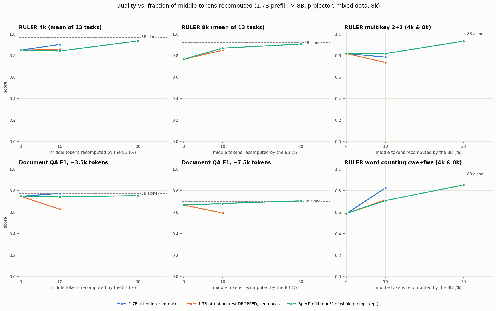
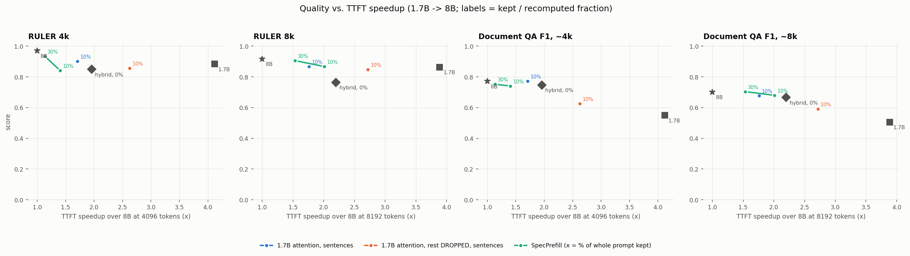

# 选择性重算实验

GPU：NVIDIA L40S；生成：2026-10-27 03:39:38；projector：混合数据 8k（第 12000 步）。小模型：1.7B，大模型：8B。开头 8 个和最后 64 个 token 始终由大模型计算；“重算比例”是中间部分由大模型重新计算的 token 占比。“丢弃其余”配置的选择方式与对应的重算配置完全相同，只是没选中的中间 token 被丢掉而不是用投影 KV 补上；SpecPrefill 是原论文方法（小模型打分，按 32 token 一块保留整段 prompt 的一部分，不强制保留开头和结尾，不用 projector），它的比例是整段 prompt 保留的比例。

## 总表

| 配置 | 实际重算比例（RULER 8k） | RULER 4k | RULER 8k | 问答 F1 4k | 问答 F1 8k | 大海捞针 |
|---|---|---|---|---|---|---|
| 8B 单独 | 全部 | 0.970 | 0.918 | 0.772 | 0.702 | 1.000 |
| 混合，不重算 | 0.0% | 0.849 | 0.764 | 0.746 | 0.666 | 1.000 |
| 1.7B 注意力 10%，按句子 | 10.1% | 0.902 | 0.867 | 0.773 | 0.678 | 1.000 |
| 丢弃其余（不投影）：1.7B 注意力 10%，按句子 | 10.1% | 0.857 | 0.847 | 0.626 | 0.591 | 1.000 |
| SpecPrefill 保留整段 10% | 10.0% | 0.841 | 0.867 | 0.741 | 0.680 | 1.000 |
| SpecPrefill 保留整段 30% | 30.0% | 0.935 | 0.906 | 0.752 | 0.704 | 1.000 |

## RULER 4096，按任务类型

| 配置 | 检索 | 汇总 | 变量追踪 | 问答 | 平均 |
|---|---|---|---|---|---|
| 8B 单独 | 1.00 | 0.97 | 1.00 | 0.83 | 0.970 |
| 混合，不重算 | 0.97 | 0.68 | 0.65 | 0.63 | 0.849 |
| 1.7B 注意力 10%，按句子 | 0.94 | 0.90 | 1.00 | 0.70 | 0.902 |
| 丢弃其余（不投影）：1.7B 注意力 10%，按句子 | 0.90 | 0.78 | 1.00 | 0.70 | 0.857 |
| SpecPrefill 保留整段 10% | 0.92 | 0.73 | 0.61 | 0.73 | 0.841 |
| SpecPrefill 保留整段 30% | 0.96 | 0.88 | 1.00 | 0.83 | 0.935 |

RULER 4096 全部子任务

| 配置 | cwe | fwe | niah_multikey_1 | niah_multikey_2 | niah_multikey_3 | niah_multiquery | niah_multivalue | niah_single_1 | niah_single_2 | niah_single_3 | qa_1 | qa_2 | vt |
|---|---|---|---|---|---|---|---|---|---|---|---|---|---|
| 8B 单独 | 0.99 | 0.96 | 1.00 | 1.00 | 1.00 | 1.00 | 1.00 | 1.00 | 1.00 | 1.00 | 0.93 | 0.73 | 1.00 |
| 混合，不重算 | 0.69 | 0.67 | 1.00 | 1.00 | 0.80 | 0.98 | 0.98 | 1.00 | 1.00 | 1.00 | 0.80 | 0.47 | 0.65 |
| 1.7B 注意力 10%，按句子 | 0.91 | 0.89 | 1.00 | 1.00 | 0.53 | 1.00 | 1.00 | 1.00 | 1.00 | 1.00 | 0.87 | 0.53 | 1.00 |
| 丢弃其余（不投影）：1.7B 注意力 10%，按句子 | 0.73 | 0.82 | 1.00 | 1.00 | 0.33 | 1.00 | 0.85 | 1.00 | 1.00 | 1.00 | 0.87 | 0.53 | 1.00 |
| SpecPrefill 保留整段 10% | 0.58 | 0.89 | 1.00 | 1.00 | 0.53 | 0.85 | 1.00 | 1.00 | 1.00 | 1.00 | 0.87 | 0.60 | 0.61 |
| SpecPrefill 保留整段 30% | 0.83 | 0.93 | 1.00 | 1.00 | 0.73 | 0.98 | 1.00 | 1.00 | 1.00 | 1.00 | 0.93 | 0.73 | 1.00 |

## RULER 8192，按任务类型

| 配置 | 检索 | 汇总 | 变量追踪 | 问答 | 平均 |
|---|---|---|---|---|---|
| 8B 单独 | 1.00 | 0.93 | 1.00 | 0.53 | 0.918 |
| 混合，不重算 | 0.92 | 0.50 | 0.59 | 0.50 | 0.764 |
| 1.7B 注意力 10%，按句子 | 0.95 | 0.75 | 1.00 | 0.60 | 0.867 |
| 丢弃其余（不投影）：1.7B 注意力 10%，按句子 | 0.95 | 0.65 | 1.00 | 0.57 | 0.847 |
| SpecPrefill 保留整段 10% | 0.96 | 0.68 | 1.00 | 0.63 | 0.867 |
| SpecPrefill 保留整段 30% | 1.00 | 0.82 | 1.00 | 0.57 | 0.906 |

RULER 8192 全部子任务

| 配置 | cwe | fwe | niah_multikey_1 | niah_multikey_2 | niah_multikey_3 | niah_multiquery | niah_multivalue | niah_single_1 | niah_single_2 | niah_single_3 | qa_1 | qa_2 | vt |
|---|---|---|---|---|---|---|---|---|---|---|---|---|---|
| 8B 单独 | 0.97 | 0.89 | 1.00 | 1.00 | 1.00 | 1.00 | 1.00 | 1.00 | 1.00 | 1.00 | 0.60 | 0.47 | 1.00 |
| 混合，不重算 | 0.41 | 0.58 | 0.93 | 1.00 | 0.47 | 1.00 | 0.95 | 1.00 | 1.00 | 1.00 | 0.67 | 0.33 | 0.59 |
| 1.7B 注意力 10%，按句子 | 0.68 | 0.82 | 1.00 | 1.00 | 0.60 | 1.00 | 0.97 | 1.00 | 1.00 | 1.00 | 0.80 | 0.40 | 1.00 |
| 丢弃其余（不投影）：1.7B 注意力 10%，按句子 | 0.50 | 0.80 | 1.00 | 1.00 | 0.60 | 1.00 | 0.98 | 1.00 | 1.00 | 1.00 | 0.80 | 0.33 | 1.00 |
| SpecPrefill 保留整段 10% | 0.43 | 0.93 | 1.00 | 1.00 | 0.73 | 0.92 | 1.00 | 1.00 | 1.00 | 1.00 | 0.73 | 0.53 | 1.00 |
| SpecPrefill 保留整段 30% | 0.69 | 0.96 | 1.00 | 1.00 | 1.00 | 1.00 | 1.00 | 1.00 | 1.00 | 1.00 | 0.73 | 0.40 | 1.00 |

## 问答 F1

| 配置 | squad 4k | hotpot 4k | trivia 4k | squad 8k | hotpot 8k | trivia 8k |
|---|---|---|---|---|---|---|
| 8B 单独 | 0.873 | 0.724 | 0.720 | 0.757 | 0.586 | 0.762 |
| 混合，不重算 | 0.812 | 0.717 | 0.710 | 0.741 | 0.531 | 0.726 |
| 1.7B 注意力 10%，按句子 | 0.903 | 0.715 | 0.700 | 0.757 | 0.539 | 0.739 |
| 丢弃其余（不投影）：1.7B 注意力 10%，按句子 | 0.752 | 0.569 | 0.559 | 0.691 | 0.433 | 0.649 |
| SpecPrefill 保留整段 10% | 0.817 | 0.705 | 0.700 | 0.804 | 0.524 | 0.712 |
| SpecPrefill 保留整段 30% | 0.824 | 0.748 | 0.685 | 0.800 | 0.590 | 0.722 |

## GSM8K（8-shot，对话轮次形式）

| 配置 | 准确率 | 遵守 #### 格式 |
|---|---|---|
| 8B 单独 | 0.907 | 0.593 |
| 混合，不重算 | 0.880 | 0.627 |
| 1.7B 注意力 10%，按句子 | 0.920 | 0.727 |
| 丢弃其余（不投影）：1.7B 注意力 10%，按句子 | 0.853 | 0.207 |
| SpecPrefill 保留整段 10% | 0.827 | 0.020 |
| SpecPrefill 保留整段 30% | 0.880 | 0.353 |

## 代码下一行补全

| 配置 | 4k 精确匹配 | 4k 相似度 | 8k 精确匹配 | 8k 相似度 |
|---|---|---|---|---|
| 8B 单独 | 0.230 | 0.613 | 0.290 | 0.639 |
| 混合，不重算 | 0.160 | 0.589 | 0.280 | 0.601 |
| 1.7B 注意力 10%，按句子 | 0.180 | 0.618 | 0.290 | 0.641 |
| 丢弃其余（不投影）：1.7B 注意力 10%，按句子 | 0.150 | 0.583 | 0.280 | 0.623 |
| SpecPrefill 保留整段 10% | 0.210 | 0.615 | 0.280 | 0.629 |
| SpecPrefill 保留整段 30% | 0.210 | 0.599 | 0.280 | 0.642 |

## 首 token 延迟（毫秒，H100，eager，不含 CUDA graph）

| 配置 | 4096 | 8192 | 16384 | 32768 |
|---|---|---|---|---|
| 8B 单独 | 396.7（1.00 倍） | 943.1（1.00 倍） | 2132.9（1.00 倍） | 5057.7（1.00 倍） |
| 1.7B 单独 | 96.3（4.12 倍） | 242.6（3.89 倍） | 641.9（3.32 倍） | 1612.8（3.14 倍） |
| 混合，不重算 | 202.5（1.96 倍） | 428.4（2.20 倍） | 987.3（2.16 倍） | 2292.7（2.21 倍） |
| 1.7B 注意力 5%，按句子 | 225.4（1.76 倍） | 481.1（1.96 倍） | 1149.0（1.86 倍） | 2813.5（1.80 倍） |
| 1.7B 注意力 10%，按句子 | 232.3（1.71 倍） | 536.1（1.76 倍） | 1290.2（1.65 倍） | 3287.1（1.54 倍） |
| 1.7B 注意力 20%，按句子 | 277.7（1.43 倍） | 644.1（1.46 倍） | 1603.7（1.33 倍） | 4345.4（1.16 倍） |
| 丢弃其余（不投影）：1.7B 注意力 5%，按句子 | 145.8（2.72 倍） | 314.4（3.00 倍） | 756.4（2.82 倍） | 1858.7（2.72 倍） |
| 丢弃其余（不投影）：1.7B 注意力 10%，按句子 | 151.0（2.63 倍） | 347.2（2.72 倍） | 826.9（2.58 倍） | 2029.3（2.49 倍） |
| 丢弃其余（不投影）：1.7B 注意力 20%，按句子 | 186.1（2.13 倍） | 413.4（2.28 倍） | 991.6（2.15 倍） | 2420.4（2.09 倍） |
| SpecPrefill 打分（1.7B） 10% | 371.5（1.07 倍） | 668.5（1.41 倍） | 1431.3（1.49 倍） | 3407.6（1.48 倍） |
| SpecPrefill 打分（1.7B） 20% | 416.4（0.95 倍） | 773.9（1.22 倍） | 1735.8（1.23 倍） | 4457.0（1.13 倍） |
| SpecPrefill 保留整段 10% | 282.1（1.41 倍） | 469.0（2.01 倍） | 943.3（2.26 倍） | 2101.9（2.41 倍） |
| SpecPrefill 保留整段 20% | 315.8（1.26 倍） | 538.3（1.75 倍） | 1092.8（1.95 倍） | 2516.1（2.01 倍） |
| SpecPrefill 保留整段 30% | 350.0（1.13 倍） | 614.7（1.53 倍） | 1298.6（1.64 倍） | 2959.9（1.71 倍） |
| SpecPrefill 保留整段 50% | 418.4（0.95 倍） | 797.9（1.18 倍） | 1741.0（1.23 倍） | 3939.0（1.28 倍） |
| SpecPrefill 保留整段 10%，look-ahead 1 | 148.3（2.67 倍） | 332.0（2.84 倍） | 804.3（2.65 倍） | 1969.3（2.57 倍） |

括号内是相对 8B 单独的加速比。
