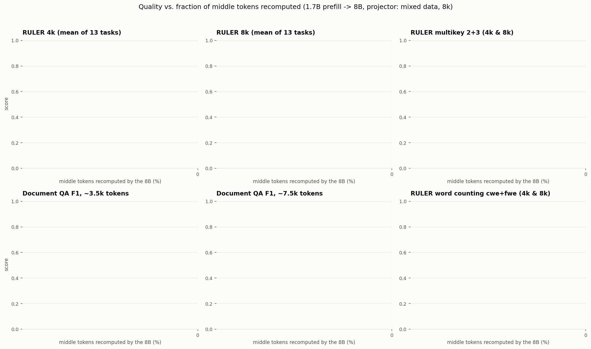

# 选择性重算实验

GPU：NVIDIA L40S；生成：2026-10-28 17:27:59；projector：混合数据 8k（第 12000 步）。小模型：1.7B，大模型：8B。开头 8 个和最后 64 个 token 始终由大模型计算；“重算比例”是中间部分由大模型重新计算的 token 占比。“丢弃其余”配置的选择方式与对应的重算配置完全相同，只是没选中的中间 token 被丢掉而不是用投影 KV 补上；SpecPrefill 是原论文方法（小模型打分，按 32 token 一块保留整段 prompt 的一部分，不强制保留开头和结尾，不用 projector），它的比例是整段 prompt 保留的比例。

## 总表

| 配置 | 实际重算比例（RULER 8k） | RULER 4k | RULER 8k | 问答 F1 4k | 问答 F1 8k | 大海捞针 |
|---|---|---|---|---|---|---|
| 混合，不重算 | - | - | - | - | - | - |

## 首 token 延迟（毫秒，L40S，所有方法都用 CUDA graph：固定形状的阶段整段回放，只有选择步骤 eager）

| 配置 | 4096 | 8192 | 16384 | 32768 |
|---|---|---|---|---|
| 8B 单独 | 395.3（1.00 倍） | 921.7（1.00 倍） | 2068.3（1.00 倍） | 5038.4（1.00 倍） |
| 1.7B 单独 | 94.0（4.20 倍） | 238.7（3.86 倍） | 636.0（3.25 倍） | 1591.7（3.17 倍） |
| 混合，不重算 | 199.7（1.98 倍） | 422.2（2.18 倍） | 977.2（2.12 倍） | 2261.0（2.23 倍） |
| 1.7B 注意力 10%，按句子 | 228.2（1.73 倍） | 527.6（1.75 倍） | 1286.2（1.61 倍） | 3239.0（1.56 倍） |
| 1.7B 注意力 20%，按句子 | 273.6（1.44 倍） | 633.3（1.46 倍） | 1587.1（1.30 倍） | 4276.7（1.18 倍） |
| 丢弃其余（不投影）：1.7B 注意力 20%，按句子 | 182.2（2.17 倍） | 402.9（2.29 倍） | 972.2（2.13 倍） | 2379.8（2.12 倍） |
| SpecPrefill 保留整段 10% | 223.7（1.77 倍） | 434.2（2.12 倍） | 963.5（2.15 倍） | 2220.1（2.27 倍） |
| SpecPrefill 保留整段 20% | 258.8（1.53 倍） | 502.4（1.83 倍） | 1117.1（1.85 倍） | 2631.7（1.91 倍） |
| SpecPrefill 保留整段 30% | 292.7（1.35 倍） | 579.0（1.59 倍） | 1327.6（1.56 倍） | 3068.6（1.64 倍） |

括号内是相对 8B 单独（同样用 CUDA graph）的加速比。graph 与 eager 的首 token logits 最大相对差（4096 token）：8B 单独 0.0e+00，1.7B 单独 0.0e+00，混合，不重算 0.0e+00，1.7B 注意力 10%，按句子 0.0e+00，1.7B 注意力 20%，按句子 0.0e+00，丢弃其余（不投影）：1.7B 注意力 20%，按句子 0.0e+00，SpecPrefill 保留整段 10% 0.0e+00，SpecPrefill 保留整段 20% 6.1e-02，SpecPrefill 保留整段 30% 6.2e-02。
