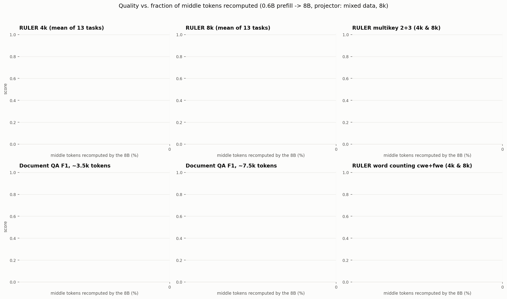

# 选择性重算实验

GPU：NVIDIA L40S；生成：2026-11-03 21:28:47；projector：混合数据 8k（第 12000 步）。小模型：0.6B，大模型：8B。开头 8 个和最后 64 个 token 始终由大模型计算；“重算比例”是中间部分由大模型重新计算的 token 占比。“丢弃其余”配置的选择方式与对应的重算配置完全相同，只是没选中的中间 token 被丢掉而不是用投影 KV 补上；SpecPrefill 是原论文方法（小模型打分，按 32 token 一块保留整段 prompt 的一部分，不强制保留开头和结尾，不用 projector），它的比例是整段 prompt 保留的比例。

## 总表

| 配置 | 实际重算比例（RULER 8k） | RULER 4k | RULER 8k | 问答 F1 4k | 问答 F1 8k | 大海捞针 |
|---|---|---|---|---|---|---|
| 混合，不重算 | - | - | - | - | - | - |

## 首 token 延迟（毫秒，L40S，所有方法都用 CUDA graph：固定形状的阶段整段回放，只有选择步骤 eager）

| 配置 | 4096 | 8192 | 16384 | 32768 |
|---|---|---|---|---|
| 8B 单独 | 404.3（1.00 倍） | 942.2（1.00 倍） | 2128.6（1.00 倍） | 5126.0（1.00 倍） |
| 0.6B 单独 | 49.2（8.22 倍） | 134.9（6.98 倍） | 409.0（5.20 倍） | 1191.8（4.30 倍） |
| 混合，不重算 | 104.5（3.87 倍） | 216.7（4.35 倍） | 542.9（3.92 倍） | 1439.8（3.56 倍） |
| 0.6B 注意力 10%，按句子 | 137.1（2.95 倍） | 325.4（2.90 倍） | 852.5（2.50 倍） | 2399.6（2.14 倍） |
| 0.6B 注意力 20%，按句子 | 182.8（2.21 倍） | 431.9（2.18 倍） | 1161.6（1.83 倍） | 3468.0（1.48 倍） |
| 丢弃其余（不投影）：0.6B 注意力 20%，按句子 | 139.3（2.90 倍） | 305.2（3.09 倍） | 754.6（2.82 倍） | 1976.2（2.59 倍） |
| SpecPrefill 保留整段 10% | 158.1（2.56 倍） | 314.0（3.00 倍） | 722.9（2.94 倍） | 1799.0（2.85 倍） |
| SpecPrefill 保留整段 20% | 194.3（2.08 倍） | 385.8（2.44 倍） | 882.6（2.41 倍） | 2221.6（2.31 倍） |
| SpecPrefill 保留整段 30% | 229.5（1.76 倍） | 466.9（2.02 倍） | 1091.5（1.95 倍） | 2679.2（1.91 倍） |

括号内是相对 8B 单独（同样用 CUDA graph）的加速比。graph 与 eager 的首 token logits 最大相对差（4096 token）：8B 单独 0.0e+00，0.6B 单独 0.0e+00，混合，不重算 0.0e+00，0.6B 注意力 10%，按句子 0.0e+00，0.6B 注意力 20%，按句子 0.0e+00，丢弃其余（不投影）：0.6B 注意力 20%，按句子 0.0e+00，SpecPrefill 保留整段 10% 0.0e+00，SpecPrefill 保留整段 20% 0.0e+00，SpecPrefill 保留整段 30% 3.5e-02。
