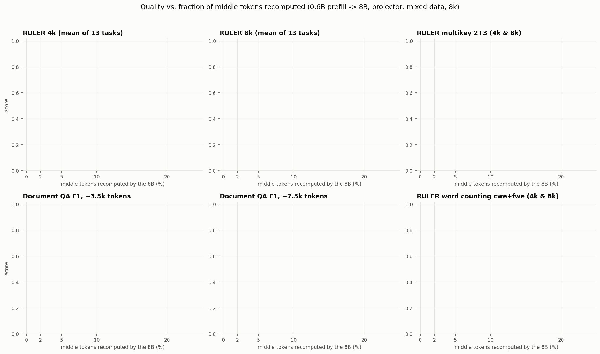
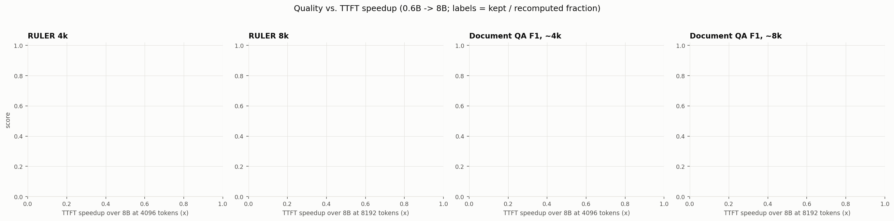

# 选择性重算实验

GPU：NVIDIA L40S；生成：2026-10-27 19:48:16；projector：混合数据 8k（第 12000 步）。小模型：0.6B，大模型：8B。开头 8 个和最后 64 个 token 始终由大模型计算；“重算比例”是中间部分由大模型重新计算的 token 占比。“丢弃其余”配置的选择方式与对应的重算配置完全相同，只是没选中的中间 token 被丢掉而不是用投影 KV 补上；SpecPrefill 是原论文方法（小模型打分，按 32 token 一块保留整段 prompt 的一部分，不强制保留开头和结尾，不用 projector），它的比例是整段 prompt 保留的比例。

## 总表

| 配置 | 实际重算比例（RULER 8k） | RULER 4k | RULER 8k | 问答 F1 4k | 问答 F1 8k | 大海捞针 |
|---|---|---|---|---|---|---|
| 8B 单独 | 全部 | - | - | - | - | - |
| 混合，不重算 | - | - | - | - | - | - |
| 8B 注意力 2% | - | - | - | - | - | - |
| 8B 注意力 5% | - | - | - | - | - | - |
| 8B 注意力 10% | - | - | - | - | - | - |
| 8B 注意力 20% | - | - | - | - | - | - |
| 0.6B 注意力 2% | - | - | - | - | - | - |
| 0.6B 注意力 5% | - | - | - | - | - | - |
| 0.6B 注意力 10% | - | - | - | - | - | - |
| 0.6B 注意力 20% | - | - | - | - | - | - |
| 随机 10% | - | - | - | - | - | - |
| 随机 20% | - | - | - | - | - | - |
| 最近（加长尾部） 10% | - | - | - | - | - | - |
| 最近（加长尾部） 20% | - | - | - | - | - | - |
| 理想（答案位置） | - | - | - | - | - | - |

## 首 token 延迟（毫秒，L40S，eager；SpecPrefill 的 look-ahead 用 CUDA graph 回放）

| 配置 | 4096 | 8192 | 16384 | 32768 |
|---|---|---|---|---|
| 8B 单独 | 375.7（1.00 倍） | 893.2（1.00 倍） | 2006.3（1.00 倍） | 5038.9（1.00 倍） |
| 0.6B 单独 | 47.9（7.84 倍） | 129.4（6.90 倍） | 391.3（5.13 倍） | 1154.5（4.36 倍） |
| 混合，不重算 | 141.6（2.65 倍） | 290.6（3.07 倍） | 688.4（2.91 倍） | 1725.6（2.92 倍） |
| 0.6B 注意力 10%，按句子 | 170.0（2.21 倍） | 394.1（2.27 倍） | 994.4（2.02 倍） | 2721.1（1.85 倍） |
| 0.6B 注意力 20%，按句子 | 213.3（1.76 倍） | 497.3（1.80 倍） | 1300.7（1.54 倍） | 3778.5（1.33 倍） |
| 丢弃其余（不投影）：0.6B 注意力 20%，按句子 | 133.9（2.81 倍） | 290.0（3.08 倍） | 732.1（2.74 倍） | 1930.3（2.61 倍） |
| SpecPrefill 保留整段 10% | 156.5（2.40 倍） | 305.2（2.93 倍） | 708.6（2.83 倍） | 1768.4（2.85 倍） |
| SpecPrefill 保留整段 20% | 189.2（1.99 倍） | 371.5（2.40 倍） | 860.9（2.33 倍） | 2173.4（2.32 倍） |
| SpecPrefill 保留整段 30% | 220.8（1.70 倍） | 445.3（2.01 倍） | 1063.2（1.89 倍） | 2599.8（1.94 倍） |
| SpecPrefill 保留整段 10%，look-ahead 1 | 97.4（3.86 倍） | 213.5（4.18 倍） | 552.0（3.63 倍） | 1487.6（3.39 倍） |

括号内是相对 8B 单独的加速比。

## 混合方案各阶段耗时（毫秒，L40S，eager）

每个阶段单独计时。“不重算”的首 token 时间 ≈ 小模型 prefill + projector + 开头/尾部；“重算 10%”≈ 小模型 prefill + 尾部打分 + projector + 重算调用。

| 阶段 | 4096 | 8192 | 16384 | 32768 |
|---|---|---|---|---|
| 0.6B prefill | 50.0 | 133.4 | 398.2 | 1160.8 |
| 0.6B prefill + 尾部打分 | 54.1 | 142.5 | 419.2 | 1215.9 |
| projector + KV（folded） | 59.7 | 120.6 | 242.2 | 484.2 |
| 8B 开头 + 尾部 | 37.6 | 43.3 | 55.4 | 79.1 |
| 8B 重算 10% 句子 + 开头 + 尾部 | 63.9 | 141.7 | 345.1 | 1010.6 |
| 8B 单独 | 405.6 | 919.5 | 2095.9 | 5038.6 |
| 重算的 token 数 | 408 | 841 | 1644 | 3290 |
