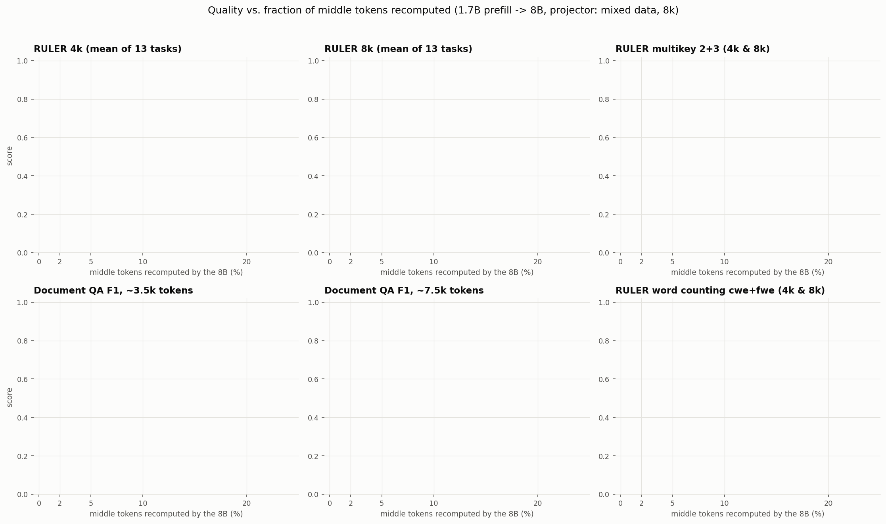
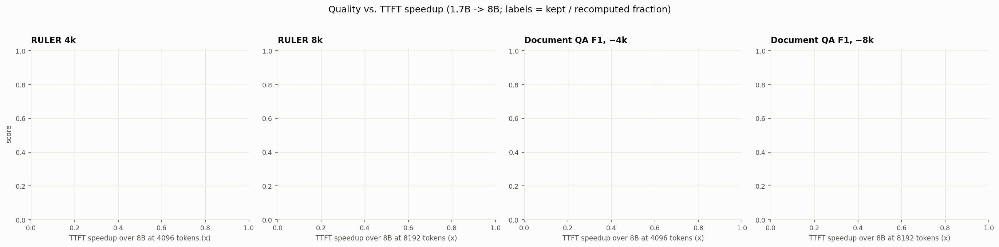

# 选择性重算实验

GPU：NVIDIA L40S；生成：2026-10-27 19:55:12；projector：混合数据 8k（第 12000 步）。小模型：1.7B，大模型：8B。开头 8 个和最后 64 个 token 始终由大模型计算；“重算比例”是中间部分由大模型重新计算的 token 占比。“丢弃其余”配置的选择方式与对应的重算配置完全相同，只是没选中的中间 token 被丢掉而不是用投影 KV 补上；SpecPrefill 是原论文方法（小模型打分，按 32 token 一块保留整段 prompt 的一部分，不强制保留开头和结尾，不用 projector），它的比例是整段 prompt 保留的比例。

## 总表

| 配置 | 实际重算比例（RULER 8k） | RULER 4k | RULER 8k | 问答 F1 4k | 问答 F1 8k | 大海捞针 |
|---|---|---|---|---|---|---|
| 8B 单独 | 全部 | - | - | - | - | - |
| 混合，不重算 | - | - | - | - | - | - |
| 8B 注意力 2% | - | - | - | - | - | - |
| 8B 注意力 5% | - | - | - | - | - | - |
| 8B 注意力 10% | - | - | - | - | - | - |
| 8B 注意力 20% | - | - | - | - | - | - |
| 1.7B 注意力 2% | - | - | - | - | - | - |
| 1.7B 注意力 5% | - | - | - | - | - | - |
| 1.7B 注意力 10% | - | - | - | - | - | - |
| 1.7B 注意力 20% | - | - | - | - | - | - |
| 随机 10% | - | - | - | - | - | - |
| 随机 20% | - | - | - | - | - | - |
| 最近（加长尾部） 10% | - | - | - | - | - | - |
| 最近（加长尾部） 20% | - | - | - | - | - | - |
| 理想（答案位置） | - | - | - | - | - | - |

## 首 token 延迟（毫秒，L40S，eager；SpecPrefill 的 look-ahead 用 CUDA graph 回放）

| 配置 | 4096 | 8192 | 16384 | 32768 |
|---|---|---|---|---|
| 8B 单独 | 394.3（1.00 倍） | 913.8（1.00 倍） | 2064.3（1.00 倍） | 5038.6（1.00 倍） |
| 1.7B 单独 | 95.7（4.12 倍） | 236.1（3.87 倍） | 629.4（3.28 倍） | 1585.8（3.18 倍） |
| 混合，不重算 | 202.5（1.95 倍） | 423.6（2.16 倍） | 976.6（2.11 倍） | 2258.0（2.23 倍） |
| 1.7B 注意力 10%，按句子 | 232.0（1.70 倍） | 529.8（1.72 倍） | 1283.6（1.61 倍） | 3244.6（1.55 倍） |
| 1.7B 注意力 20%，按句子 | 277.6（1.42 倍） | 634.1（1.44 倍） | 1596.8（1.29 倍） | 4298.4（1.17 倍） |
| 丢弃其余（不投影）：1.7B 注意力 20%，按句子 | 184.3（2.14 倍） | 402.7（2.27 倍） | 975.1（2.12 倍） | 2369.7（2.13 倍） |
| SpecPrefill 保留整段 10% | 227.1（1.74 倍） | 435.8（2.10 倍） | 969.1（2.13 倍） | 2216.4（2.27 倍） |
| SpecPrefill 保留整段 20% | 260.7（1.51 倍） | 502.1（1.82 倍） | 1123.5（1.84 倍） | 2620.8（1.92 倍） |
| SpecPrefill 保留整段 30% | 294.9（1.34 倍） | 578.1（1.58 倍） | 1327.6（1.55 倍） | 3049.6（1.65 倍） |
| SpecPrefill 保留整段 10%，look-ahead 1 | 146.9（2.68 倍） | 323.8（2.82 倍） | 790.4（2.61 倍） | 1915.8（2.63 倍） |

括号内是相对 8B 单独的加速比。

## 混合方案各阶段耗时（毫秒，L40S，eager）

每个阶段单独计时。“不重算”的首 token 时间 ≈ 小模型 prefill + projector + 开头/尾部；“重算 10%”≈ 小模型 prefill + 尾部打分 + projector + 重算调用。

| 阶段 | 4096 | 8192 | 16384 | 32768 |
|---|---|---|---|---|
| 1.7B prefill | 97.1 | 239.9 | 637.2 | 1600.6 |
| 1.7B prefill + 尾部打分 | 101.0 | 249.2 | 659.5 | 1667.5 |
| projector + KV（folded） | 71.8 | 144.7 | 290.6 | 582.9 |
| 8B 开头 + 尾部 | 37.5 | 43.3 | 55.3 | 78.8 |
| 8B 重算 10% 句子 + 开头 + 尾部 | 64.4 | 141.2 | 346.9 | 1010.1 |
| 8B 单独 | 403.4 | 930.8 | 2094.7 | 5038.0 |
| 重算的 token 数 | 419 | 835 | 1641 | 3283 |
