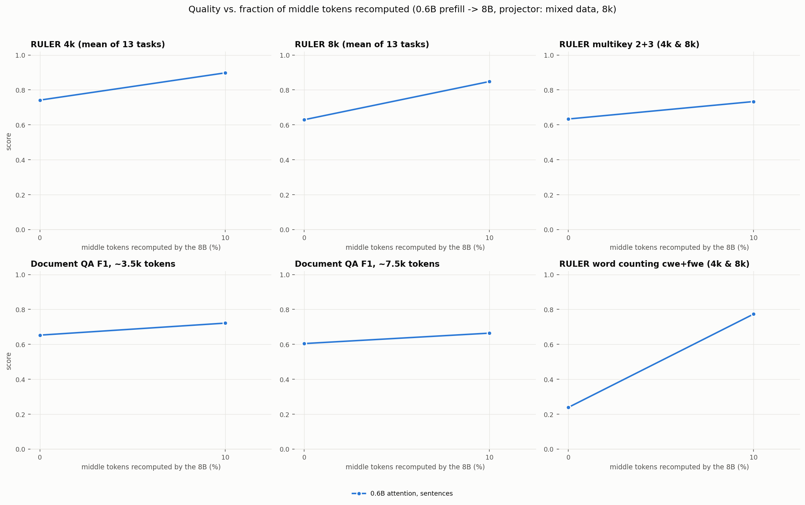

# 选择性重算实验

GPU：NVIDIA L40S；生成：2026-11-04 00:36:35；projector：混合数据 8k（第 12000 步）。小模型：0.6B，大模型：8B。开头 8 个和最后 64 个 token 始终由大模型计算；“重算比例”是中间部分由大模型重新计算的 token 占比。“丢弃其余”配置的选择方式与对应的重算配置完全相同，只是没选中的中间 token 被丢掉而不是用投影 KV 补上；SpecPrefill 是原论文方法（小模型打分，按 32 token 一块保留整段 prompt 的一部分，不强制保留开头和结尾，不用 projector），它的比例是整段 prompt 保留的比例。

## 总表

| 配置 | 实际重算比例（RULER 8k） | RULER 4k | RULER 8k | 问答 F1 4k | 问答 F1 8k | 大海捞针 |
|---|---|---|---|---|---|---|
| 混合，不重算 | 0.0% | 0.742 | 0.629 | 0.653 | 0.604 | 1.000 |
| 0.6B 注意力 10%，按句子 | 10.1% | 0.898 | 0.848 | 0.722 | 0.664 | 1.000 |

## RULER 4096，按任务类型

| 配置 | 检索 | 汇总 | 变量追踪 | 问答 | 平均 |
|---|---|---|---|---|---|
| 混合，不重算 | 0.95 | 0.30 | 0.48 | 0.50 | 0.742 |
| 0.6B 注意力 10%，按句子 | 0.94 | 0.87 | 1.00 | 0.70 | 0.898 |

RULER 4096 全部子任务

| 配置 | cwe | fwe | niah_multikey_1 | niah_multikey_2 | niah_multikey_3 | niah_multiquery | niah_multivalue | niah_single_1 | niah_single_2 | niah_single_3 | qa_1 | qa_2 | vt |
|---|---|---|---|---|---|---|---|---|---|---|---|---|---|
| 混合，不重算 | 0.06 | 0.53 | 1.00 | 0.87 | 0.80 | 0.98 | 0.98 | 1.00 | 0.93 | 1.00 | 0.67 | 0.33 | 0.48 |
| 0.6B 注意力 10%，按句子 | 0.85 | 0.89 | 1.00 | 1.00 | 0.53 | 1.00 | 1.00 | 1.00 | 1.00 | 1.00 | 0.93 | 0.47 | 1.00 |

## RULER 8192，按任务类型

| 配置 | 检索 | 汇总 | 变量追踪 | 问答 | 平均 |
|---|---|---|---|---|---|
| 混合，不重算 | 0.83 | 0.18 | 0.40 | 0.40 | 0.629 |
| 0.6B 注意力 10%，按句子 | 0.93 | 0.68 | 1.00 | 0.63 | 0.848 |

RULER 8192 全部子任务

| 配置 | cwe | fwe | niah_multikey_1 | niah_multikey_2 | niah_multikey_3 | niah_multiquery | niah_multivalue | niah_single_1 | niah_single_2 | niah_single_3 | qa_1 | qa_2 | vt |
|---|---|---|---|---|---|---|---|---|---|---|---|---|---|
| 混合，不重算 | 0.01 | 0.36 | 1.00 | 0.73 | 0.13 | 0.98 | 0.83 | 1.00 | 1.00 | 0.93 | 0.60 | 0.20 | 0.40 |
| 0.6B 注意力 10%，按句子 | 0.51 | 0.84 | 1.00 | 1.00 | 0.40 | 1.00 | 1.00 | 1.00 | 1.00 | 1.00 | 0.80 | 0.47 | 1.00 |

## 问答 F1

| 配置 | squad 4k | hotpot 4k | trivia 4k | squad 8k | hotpot 8k | trivia 8k | 平均 4k | 平均 8k |
|---|---|---|---|---|---|---|---|---|
| 混合，不重算 | 0.783 | 0.537 | 0.638 | 0.681 | 0.378 | 0.754 | 0.653 | 0.604 |
| 0.6B 注意力 10%，按句子 | 0.872 | 0.619 | 0.673 | 0.743 | 0.517 | 0.732 | 0.722 | 0.664 |

## GSM8K（8-shot，对话轮次形式）

| 配置 | 准确率 | 遵守 #### 格式 |
|---|---|---|
| 混合，不重算 | 0.860 | 0.467 |
| 0.6B 注意力 10%，按句子 | 0.907 | 0.680 |
